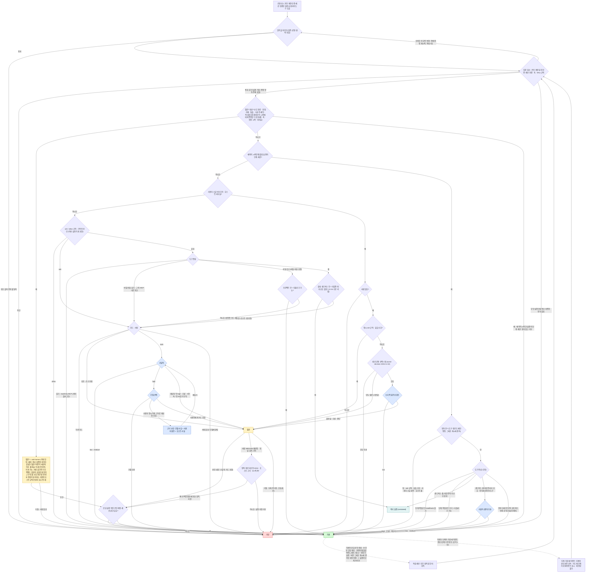

# Ave permission decision tree (v4)

Status: owner-approved 2026-10-29. Mode names were updated 2026-10-30. Session surfaces, remote-user parity and shell-sandbox defaults: owner decision 2026-11-02. Ave home sandbox read boundary: owner decision 2026-11-07. Workflow templates (template runs, stage sub-agents, remote work approvals, run-scoped grant, unattended start, model-judged pass conditions): owner decision 2026-11-16. Unattended lane, schedule attachment, envelope, requested outputs, stage workspaces and per-stage breaker: owner decision 2026-11-16. Boot home privacy floor (any boot privacy failure) and helper-unavailable deny: owner decision 2026-11-24. Windows absent protected names are watched, never materialised: owner decision 2026-11-24. Exact saved host rule on a no-backend host, Windows extension starts with no backend or past the readiness deadline, memory-map inference with no backend, analysis limits ask, a backend that does not contain shells joins the no-confinement floor and the local-network gate after X2: owner decision 2026-11-25. Policy core (five outcomes, the unknown rule, the single no-confinement floor, backend-neutral wording): owner decision 2026-11-25.
Source design and reference comparison: artifact "에이전트 권한 결정 트리 비교", section 4.
This file is the single source of truth for permission-decision work. Implementers and reviewers of any change
to permission classification, approval cards, the reviewer, hooks or headless behaviour must read it and
keep the code in this order. A change to this tree needs an owner decision.

Outcomes (five, closed):

| Outcome | Meaning | Applies when |
|---|---|---|
| allow | Runs with no human. The evidence is a rule, the mode or the tool kind. | The effect is known and already granted. |
| contained (still named `sandbox-auto` for one release) | Runs with no human, because a proven container encloses its file, network and process effects. | Containment evidence exists for this launch. |
| ask (normal card) | A human, or a delegate the user set up (rule, mode, reviewer), may answer. Any scope may remember the answer. | The effect is known or bounded but not yet granted, or the effect is unknown (U1). |
| ask-human (질문†; named ask-forced today) | Only a present human answers: this time only, no reviewer, no allow-mode pass, no memory, deny when headless. The no-confinement floor, when it is the only 질문†, also offers this session. One exception to no memory: on a no-backend host, an exactly matching saved host rule passes the no-confinement ask. See No-confinement floor. | A floor: the action touches a boundary directly, or confinement cannot be proven (U2). |
| deny | Does not run. Nothing in this session changes it. The reason names the fix. | A deny rule, an admission failure, or Ave cannot judge (U3). |

Unavailable is a state, not an outcome. A confinement capability is ready, checking or unavailable (with a reason). A state never runs anything by itself and never silently substitutes another route. It resolves to contained on another proven route, to ask-human, or to deny, by the unknown rule.

Unknown rule:
- U1, unknown effect (what the action will touch: a dynamic path, an unresolved working directory, an unknown destination class): ask. Never allow or contained, never deny. On the host route, where nothing contains the action and the effect may be a 질문† target, the ask is raised to ask-human; inside a container it stays an ordinary ask. Not yet implemented: today such an ask on the host route is an ordinary ask.
- U2, unknown boundary (confinement was requested but cannot be proven for this start): ask-human, with the session scope; deny when headless.
- U3, unknown judge (Ave itself cannot evaluate: the policy store is unreadable, a helper is silent, an identity probe failed or changed, evidence is missing): deny or refuse, with the fix named. Nothing waives it. A capability that is still checking is pending, not an error.
- A budget (analysis size, fork count, time) may only turn an outcome into ask or refuse, never into allow.

Modes: 기본 / Default (former 모두 확인 = strict; default for new installs) · 쓰기 허용 / Allow writes
(former 쓰기만 확인) · auto · 허용 / Allow.

Notes that are part of the contract:
- **Human evidence re-adjudication (owner decision 2026-11-13, EA only):** an ordinary card may offer a separate, unselected human action to re-adjudicate the sole host-proven static `write path not declared` HIGH as MEDIUM and remember the exact input in the user's chosen scope. Missing host evidence, concrete danger, other HIGH reasons, forced floors, reviewer failures and plugin self-report cannot use EA. The raw classifier verdict remains unchanged. Evidence records use a dedicated exact-input matcher and never fall through to ordinary allow matching. Reuse enters the existing R remembered-allow edge without revalidating evidence; the attended `R` path has no evidence-revalidation step. (The `EV` node belongs to the unattended lane and checks the stage envelope, not EA evidence.) Admission, deny/ask rules, live authority and effect permissions retain their existing checks and order. The [EA design](../design/evidence-readjudication-333.md) owns the evidence and card contract.
- **Agent browser sites (owner decision 2026-11-08):** builtin tool use in agent-opened tabs is allowed. Opening a new HTTP(S) origin asks the human to allow that exact scheme, host and port for this session, allow any HTTP(S) site for this session, or deny. Dismissal denies. Grants are memory-only, never inherited by children, and end with the session. Top-level requests, including click/submit navigation, redirects and new windows, must pass site consent before loading. Non-web schemes and embedded credentials stay denied. Admission, deny rules, explicit asks, human-only exfiltration checks, sensitive input and irreversible-submit guards remain authoritative. User-owned tabs retain the shared surface choice; headless actions deny.
- **Plugin read declarations (owner decision 2026-11-06, 읽기 선언만 허용):** the existing `K → readOnly MCP → allow` edge also covers plugin tools declaring `annotations.readOnlyHint: true`. This is the only authorable annotation. Missing/false hints or an operation policy with a write kind or a higher minimum risk retain ordinary approval. Admission, forced floors, rules and remembered decisions keep their existing order. Command/network evidence, path checks, active filesystem-containment requirements for command reads, egress/hostFetch, secret leases and actual host effects retain their own gates; the declaration grants no effect capability. App-written text and app-initiated write/shell/network actions retain their confirmation requirements.
- Standalone reverse HostApi effects: writes to the plugin's own storage need no approval and are denied outside it; every other effect is allowed only within the plugin's [declared background effects](architecture.md#extension-runtime) approved at enable, bound to its install source and declared-scope hash and re-asked when either changes. Within that scope a deny or forced floor still denies and the card answers only ordinary asks; any other ask, and any effect outside the scope, is denied.
- **App approval delivery (bug correction, no tree change):** sidebar and floating-dock app calls use the focused main window’s unattributed approval lane, with plugin attribution. Each card stays with its recipient across focus changes; if that window leaves, the host re-sends it to the next main window and retires its old copy. No registered main-window surface means an action requiring a card is denied under Q. An iframe click supplies no user-gesture authority.
- **Shared surfaces (owner decision 2026-11-02):** one conversation-local choice covers both logged-in browser tabs and host terminal tabs. One shared card selects Allow all, Auto or Ask (default); there is no separate choice per surface, persistence across sessions or child inheritance. Explicit ask rules and the human-only exfiltration guardrail precede this choice; generic allows and remembered grants do not replace it.
- **Remote user (owner decision 2026-11-02):** an authenticated controller whose account matches the host-owned owner-identity anchor and is bound to the current session enters the same tree as the local user, including rules, remembered grants, mode, reviewer and 질문†. Missing/mismatched owner identity, authentication, session binding or live transport authority is admission-denied, including after asynchronous approval. Remote provenance alone never creates an other-principal floor; genuine external-content guidance still does.
- **Remote intake and paste parity (owner decision 2026-11-02):** remote input cannot turn a staged, app-message or plugin envelope into raw user intent. The same origin/envelope mismatch is rejected before a turn, request anchor, native quote or terminal eligibility is created. Explicit attachments and recognized pasted-text wrappers retain file-content taint. The paired browser transport supplies image attachments; the provider bridge accepts text only. Neither carries a distinct pasted-text flag, so unmarked remote text is treated like typed text, without a size-based paste heuristic.
- **Delegated work (owner decision 2026-11-02):** admitted children, resumed children and routine executions use the same independent sessions and provenance as local delegation. They do not inherit the originating controller's session-bound authority. After the parent creation/scheduling action passes its permission checks, the child spawn/resume execution or routine fire enters an independent scope. Revocation denies subsequent controller-bound admissions, pending card answers and pre-effect rechecks; it does not itself revoke the delegated session or promise interruption of an already running effect. Ordinary parent/child cancellation, routine signals, unattended/headless policy and genuine other-principal floors remain effective; a child's own tool calls still pass its own permission tree. A shared browser/terminal choice is never inherited. Browser input authority belongs only to the tab's owning session; parent and sibling sessions gain no input authority from ancestry. The parent may view children's tabs and labelled activity without acquiring their leases (owner decision 2026-11-08). The unattended lane consults no mode, allow rule, remembered grant, run-scoped grant or persistent egress grant (owner decision 2026-11-16).
- **Work approvals (owner decision 2026-11-04; workflow templates 2026-11-16):** a work approval is the user's decision on a host work object: a plan approval, a human stage gate, a join-conflict gate, a template confirmation, `Create and run`, a schedule attachment or a requested-output approval. A local plan approval keeps its desktop keyboard-gesture requirement. A local stage gate, template confirmation or `Create and run` needs an explicit desktop user gesture. A local schedule attachment needs a keyboard gesture in the desktop window. A local requested-output approval needs an explicit desktop user gesture, the same as a stage gate. Remote work approvals use only the Tailnet path below. A plan approval is bound to the exact stored plan hash, a stage gate to run + stage + attempt + `resultHash` (the stage output; a requested output binds to its own `outputHash`), and a template confirmation to the graph hash. `Create and run` authorizes only the exact confirmed `(templateId, version, graphHash)` chosen by that decision. The host validates it and pins the run to the same tuple before creating any child. Local and Tailnet start decisions validate the same binding. A mismatch refuses to start. A schedule attachment (bound to template id, version and graph hash) and a requested output (bound to `outputHash`) are work objects too, and deciding them is a work approval. A work approval is a user action outside this tree, like user-typed terminal commands. A plan approval only authorizes creating the execute child. A confirmed template version plus `Create and run` only authorizes creating that run's stage children. A stage gate only lets the scheduler start the next stages. Each child enters `CHILD → H` and every tool call it makes passes this tree. Remote controllers can decide work approvals only through the Tailnet surface; every other remote path is refused.
- **Template runs (owner decision 2026-11-16):** a confirmed template version plus the user's `Create and run` gesture is a third source on the `ALLOW -.-> CHILD` edge. It authorizes creating that run's stage children, including all-tools stages, with no per-run plan approval. A plan stage is optional. Confirmation binds to the graph hash. `Create and run` starts the template's current confirmed version only. A mismatch, or an archived version, refuses to start. A run pinned to `(templateId, version, graphHash)` may only create the stage children of that version. This source grants no tool permission: every tool call of every stage child still enters `CHILD → H` in tree order.
- **Stage sub-agents (owner decision 2026-11-16):** a stage may opt in to sub-agents, at depth 1 only. A grandchild inherits the stage's approval surface. Its cards name the stage and the grandchild, and its asks go to the user directly. The reviewer breaker counts it as its own session. It may not spawn further. When a stage ends, its live grandchildren are interrupted. The stage's spawn call passes this tree like any other tool call, and the grandchild's tool calls enter `H` and pass this tree like any child's. The approval surface is card delivery only: the shared browser/terminal choice, agent-browser site grants and the no-confinement floor's session grant are still not inherited.
- **Remote work approvals (owner decision 2026-11-16):** every work approval can be decided remotely: plan approvals, stage gates, join-conflict gates, template confirmation, `Create and run`, schedule attachment and requested-output approval. Remote decisions are accepted only through the existing [Tailnet surface](multisurface-conversation-runtime.md#tailnet-only-remote-sharing-model-and-controller-follow-up). That means Tailscale Serve ingress to the loopback-only `TailnetSurfaceServer`, a current owner-identity match from the Serve identity headers, a paired, bound session, and the controller role. LAN, Funnel, public links and any other ingress are refused, fail-closed. A remote decision binds to exactly the same object hash as a local one and is audited with origin `tailnet-surface`. The identity shown is the Serve login; Serve supplies no device name. Without the Tailnet configured, work approvals stay local-desktop only. The controller capability for remote work decisions is added to the Tailnet contract by PR-C. Until then there is no remote path for any work approval: fail-closed, local only.
- **Run-scoped grant (owner decision 2026-11-16):** node `R` has one more remembered scope, "Allow for this run". It is shared by the stage sessions of one run and their grandchildren. It matches with the tool's existing remember key, scoped to the run. Cards that are already open when the grant is made are not auto-answered. It ends when the run ends. It is never saved as a rule and never crosses runs or items. Floors that this tree marks as non-rememberable stay non-rememberable. It is read at `R` only, so admission, deny rules and 질문† keep their order before it.
- **Unattended template runs (owner decision 2026-11-16):** a schedule may start a template run, only through its schedule attachment. The routine-creation source does not cover template runs. Human gates park in the board's Needs review, with no timeout, and can be decided locally or over the Tailnet. A parked gate is a work approval, not a tool ask, so the headless rule below is unchanged: a tool ask with nobody present is still denied. Authority and tool calls of a schedule-started run follow the schedule attachment and unattended lane notes below.
- **Model-judged pass conditions (owner decision 2026-11-16):** a stage's pass condition may be model-judged, for example "the reviewer stage says OK". It is labelled as a model judgement, and the verdict is the stage's own structured ending. It is still a scheduler predicate, not a node of this tree. It never answers, skips or pre-fills a permission card.
- **Schedule attachment (owner decision 2026-11-16):** a schedule runs a template only through a new work approval that attaches it to an exact `(templateId, version, graphHash)`, decided locally or over the Tailnet. It is the fourth source on the `ALLOW -.-> CHILD` edge, and it is the source for schedule-started runs. The `routine_schedule` tool cannot create it. The existing routine-creation source keeps its meaning and does not cover template runs. A scheduled fire is not a `Create and run` gesture. It may create only the stage children of the pinned version, and a hash mismatch refuses to start. Confirming v2 does not move a schedule.
- **Unattended lane (owner decision 2026-11-16):** stage sessions of a schedule-started run never ask. After `F` they take `UN → EV → KU` instead of `U`, so admission, deny rules, hooks and every 질문† floor still come first. A 질문† target in a schedule-started stage session is denied and never asked: the `F → DENY` edge, not `ASKF`. `H` denies an unattended call when isolation is not proven or the stage has no envelope. A call is allowed only inside the stage's capability envelope (confirmed with the version, inside the graph hash), inside the isolation profile of the unattended review (§5.3) and inside the stage workspace. Anything else is denied with "do not retry". It is never asked and never queued. The lane ignores ambient mode, allow rules, remembered grants and run-scoped grants. Deny rules and ask rules still apply; an ask rule that matches means deny. An exfil signal, a user-owned surface and a host shell deny. The lane is keyed on how the run started, not on whether someone is reachable. Grandchildren inherit the stage's envelope and budget and cannot widen them. Interim rule: until WT-15 and WT-16 land, a schedule may start only templates whose stages are all read-only.
- **Envelope contents (owner decision and lead ruling 2026-11-16):** the envelope only narrows. An envelope may declare, per stage, network domains, and MCP or plugin tools without `readOnlyHint`, provided their effect is local generation or fetching. These are confirmed explicitly. Each declared tool carries a data-sent flag, inside the graph hash, that says whether its prompts and inputs leave the machine. The confirm screen shows the flag for each tool, and names the service for a tool flagged as sending. The flag is disclosure only: it grants no permission and no exception to the publishing ban or to the deny, exfil and effect checks. Network domains and declared tools are empty unless the owner fills them in at confirmation. A tool whose effect is outward publishing can never be declared in an envelope. An envelope cannot list a host shell, a 질문† target, a secret file or a user-owned surface. Local and private-network destinations are refused even when an envelope lists them. The Windows limitation in the unattended review (§5.3) stands and is not solved here: Windows qualifies only through container shells, which today need the local-network access this lane refuses. The local-network gate for Windows container shells (attended and unattended) is removed once X2 (PR #666) merges: the Ave relay then holds both loopback ports, 127.0.0.1:P and [::1]:P, and refuses a foreign process holding either (owner decision 2026-11-25). Until the owner decides whether the unattended lane then qualifies on Windows, the §5.3 limitation stands. Everything else that the unattended review (§5.7) forbids stays forbidden, whatever the envelope says. That includes unattended changes to settings, rules, permissions, plugins, MCP servers, templates, schedules or routines, device or OAuth sign-in, a new origin in the agent browser, keychain and host credential stores, escalation and the unsandboxed retry. Neither confirmation nor a reviewer result can override these.
- **Unattended reviewer (owner decision 2026-11-16):** inside the envelope, the reviewer checks unproven or destructive sandboxed shell commands and declared tool calls, and can only deny. Low or medium continues. High, an error or an open breaker denies. There is no model choice, no resubmission and no card. The reviewer can never allow something outside the envelope.
- **Requested outputs (owner decision 2026-11-16):** nothing leaves an unattended run. Outward effects (publish, upload, post, send, push, merge, purchase) are requested outputs: data bound to `outputHash` that the host executes only after a human gate approves them, locally or over the Tailnet. The host executes them with the approver present, through the ordinary tree. This is not a deferred queue: no tool call is parked and nothing is replayed.
- **Stage workspaces (owner decision 2026-11-16):** every stage of a template run runs in its own workspace under `~/.ave/worktrees/<project>/<run>/<stage>/`. In a git project the workspace is a git worktree. Otherwise it is a plain folder seeded with the stage's declared inputs. Seeding never copies gitignored files or secret files such as `.env`, in git and plain-folder workspaces alike. Creating a workspace authorizes nothing: a template's setup commands are ordinary tool calls that pass this tree, and in the unattended lane they also need the stage envelope. The Ave-home boundary re-allows a stage session only its own workspace, for reads and writes, in addition to what the boundary note below lists. The stage's own workspace is also carved out of the protected-path 질문† floor, for reads and writes, for that stage session and its grandchildren. The carve-out is a host-minted binding from the stage session id to the workspace realpath, not a path-prefix match. Symlinks and `..` cannot widen it. Other stages' workspaces, the run folder outside the stage and the rest of `~/.ave` stay protected. The stage workspace is the stage's project root for write policy. Grandchildren inherit the stage's workspace. A conflict at a join becomes a human gate that shows it. Workflows are general-purpose: nothing here may assume a git repository, source code or a build.
- **Internal approval lifetime (owner decision 2026-11-02):** skill-load and hook-command cards bind the originating controller authority to the same session as ordinary tool cards. Revocation while waiting denies the answer and subsequent skill registration or hook spawn; internal cards cannot outlive authenticated authority. Skill-grant persistence also rechecks authority after queued/asynchronous preparation and immediately before its atomic commit; revocation during that wait records no grant.
- **Owner identity (owner decision 2026-11-02, 본인 계정만 연결 허용):** only the owner's own account may pair, activate a share or enter a bound turn. For the tailnet transport, the canonical owner is the local node's untagged authenticated user: status `Self.UserID` selects `User[id].LoginName`. The peer's authenticated WhoIs-derived login must match it; peer input cannot supply the owner anchor. Missing local identity, tagged nodes, lookup failure and mismatches deny with named visible errors. Each HTTP admission and owner activation/refresh takes one fresh asynchronous local-status observation, after the applicable request rate limit. Request evidence passes through the HTTP identity gate and authorization without duplicate probes. How LIVE and the admission check H are realized for a bound controller: before each controller-bound tool effect and approval response, including internal skill and hook cards, await a fresh asynchronous local-status probe and compare the owner with the binding. A check is satisfied only by a probe that started at or after the check asked: a check arriving while a probe is already running waits for, and shares, the next probe, and a completed result is never reused for a later check. No TTL owner cache grants admission or effects. A transition to unavailable advances the revocation generation, so recovery never rehabilitates old evidence. At each asynchronous pre-effect boundary, await the fresh probe after permission and preparation waits. Check the current binding, session and revocation state before the handler, nested host effect, process spawn or atomic grant commit; any later asynchronous wait must be followed by another revocation-state check before use. Pending card persistence uses the same check as the answer itself; it cannot record a remembered allow before detecting an invalid owner. These live checks apply equally to mode, rule and remembered allows and do not depend on an open event stream. Lookup failure refuses the current action. Compare canonical logins exactly, without aliases or peer-supplied normalization. A confirmed changed local login invalidates and persistently revokes old non-matching bindings. An unavailable observation only suspends access in memory and surfaces an unavailable snapshot; it never persists an identity revocation. A requesting peer mismatch cannot revoke the owner's pairings.
- **Streaming identity checks:** assistant text deltas and replay events do not probe identity. Each event checks the active share’s expiresAt with a clock comparison. Store-change subscriptions invalidate affected streams synchronously; the existing 15-second scope-check interval performs asynchronous identity refresh and rechecks revocation before retaining the stream. A native account change without a store notification may therefore be detected on the next interval plus probe completion, rather than on the next delta; this is periodic detection, not a real-time guarantee. This keeps native process startup and waits off the main thread and per-delta path.
- **Command acceptance:** validate owner and share authority before submitting a command. Once accepted, the HTTP response remains an accepted result. If the authority is already lost when that response is built, its `turn` carries `denied: true` with `remote-controller-authority-suspended` (identity unavailable, or recovered to the same owner) or `remote-controller-authority-revoked` (a confirmed different owner, or a share or pairing that is no longer current). There is no separate turn-denial event. A denial before the turn starts records `{ok:false}` only in the host-side command completion, which settles the idempotency receipt; the bound UI receives no shared event for it. A denial at a later effect boundary of a running turn ends that tool call as an error result, which the shared projection carries only as `tool.state: failed`, without a reason or code. When the host observes the revocation or suspension, the bound event stream ends with `reauthorize-required`, so a client may miss events after that. Revocation prevents subsequent effects and cannot retroactively make an accepted command appear unsubmitted.
- **Identity residual risk:** identical `LoginName` strings can exist across distinct tailnets, while forwarded Serve identity headers carry no `UserID`. Login equality therefore does not prove a globally unique cross-tailnet account identity; this remains a limit of the current matching evidence.
- **Explicit account registration (owner decision 2026-11-02):** the messaging connection's Settings page requires the desktop owner's own numeric user ID before pairing. Registration/change uses the sender-validated desktop IPC and a verified local keyboard gesture; remote messages cannot set this anchor. Verified private-message `sender.id` must match that registered ID to complete pairing and send. This explicit desktop registration is the owner assertion; the provider cannot prove that a remote human is the desktop owner. Missing registration denies. Changing the anchor revokes prior codes, pairings and conversation approvals; a code alone grants nothing.
- **Existing bindings (owner decision 2026-11-02):** revalidate saved tailnet pairings/shares against the current host owner identity, and saved messaging bindings against the registered owner ID. For tailnet bindings, unverifiable local identity means nonpersisted suspension; a confirmed different local owner means persistent revocation. Recovery with the same owner permits a new freshly observed request to use the preserved pairing, while old request evidence stays invalid. Only a revoked/unrecognized binding needs pairing and conversation approval again. Messaging bindings still require explicit registered-owner revalidation. Show suspension in Settings, and do not count retained terminal/revoked rows as a current mismatch. The same owner match remains part of live guards after an asynchronous approval.
- **Shell default (owner decision 2026-11-02):** shell sandboxing defaults on for all supported desktop platforms, including win32. A missing stored setting uses this default; an explicit stored false remains false. For shell tool calls outside the user-owned surface lane, only active isolation supplies sandbox evidence: proven read-only commands inside it auto-allow in Default, while host and escalated commands ask. Agent typing into the user's terminal instead follows the shared surface choice above. Settings activation without an available backend visibly warns and degrades without claiming confinement. A shell runs contained when the active backend proves containment for it. When confinement is requested and no backend proves it, the no-confinement floor applies.
- **No-confinement floor (reason code `sandbox-unavailable`; owner decisions 2026-11-08, 2026-11-24 and 2026-11-25):** one trigger: confinement was requested but cannot be proven for this start (shell, hook, extension start, terminal). Nothing in that state runs silently without the sandbox. It is 질문† (ask-human): once, or this session for shells and hooks; never saved; deny when headless. Its causes:
  - the sandbox is on and no backend is usable;
  - a backend is active but does not contain shells;
  - Ave home privacy is unverified at boot (any boot privacy failure: boundary-link, boundary-unlisted, the Windows ACL, ownership, icacls and read-back categories, and POSIX posix-root-unsafe): the OS sandbox cannot be relied on to keep the Ave home private, so host shells (bash, PowerShell) run unconfined on the unavailable-sandbox route, on the sandbox-off route when only worker confinement was requested (shell scope off), and as an explicit host request.

  Shells and hooks: each command runs only after a human approves it on its card (the shell card for that route, or the out-of-directory card when the command leaves the allowed folders): allow once, allow for this session, or deny once. Apart from the one saved-rule pass below, no saved rule, remembered grant, allow mode, auto review or sandbox auto-allow passes it, there is no durable approval, and a headless run is denied. An explicit host request on such a host is the same uncontained shell and takes the same ask. The session choice records a grant of this floor for the requesting session only (children do not inherit command choices), kept in memory only, never as a rule, and dropped when the conversation ends or Ave restarts. While the cause lasts, later shell commands and host hooks of that same session pass this floor, whatever the command, dialect, default or explicit-host plan, or background run (session-wide). The ordinary stages then decide without a reviewer: an allow rule or the allow mode runs it without a card, under its own one-shot execution permit per run; anything else (an ordinary ask in the default or auto mode) keeps the floor's card. Another conversation asks again. It does not need the rule grammar, so compound and interpreter commands get it too. It answers only this floor: it never satisfies an ordinary ask, and an ordinary session allow never passes it. When another 질문† also applies (protected path, project escape, critical delete, other principal), the card stays once-only. Host command hooks use the same plan and ask the same way; a headless blocking hook (prompt submit, pre-tool) is denied and can refuse its turn, which is the intended fail-closed result. The Permissions banner says shell commands will ask for approval once or for the session, for every boot privacy-failure category.

  One saved-rule pass (owner decision 2026-11-25): when the missing backend is the only cause and boot verified Ave home privacy, a saved host rule that exactly matches the command passes without asking, for a default shell and for an explicit host request alike, as it does for an explicit host request on a host whose backend is ready. Saved prefix rules, the allow mode and auto review still get the ask. The pass applies only when this floor is the only 질문†. No saved rule passes while Ave home privacy is unverified at boot, or when the cause is an active backend that does not contain shells.

  Extension starts: A Windows extension start with no confinement backend is 질문† (owner decision 2026-11-25): when an attended session exists it asks once per start; headless denies, so the start is left unstarted with one notice. Consent is spent at spawn and never reused. Several pending starts may share one card, but each start gets its own yes or no. When a backend's readiness deadline expires, each start gets this 질문† ask, not a refusal (owner decision 2026-11-25). This applies to a start with no backend selected; a start beneath a holder or ancestor already admitted under a container backend is still refused when its own deadline expires, so nothing drops below its ancestor's confinement (owner decision 2026-11-25). The helper-unavailable deny below still wins: no such start is offered while the privacy helper is unavailable.
- 질문† (ask-human) triggers, listed once here: protected paths (files the host runs later outside confinement: .git .vscode .idea .husky .cargo .devcontainer .yarn
  .mvn .config/git .bashrc .zshrc .zprofile .profile .envrc .gitconfig .npmrc .mcp.json; of agent folders only .agents
  and Ave's own config/home dirs, not other agents' folders such as .claude or .codex — owner decision 2026-11-25), critical delete, project escape, other-principal turn, and the no-confinement floor above. Nothing else is 질문†.
  A template stage's own workspace is not a protected path for that stage session and its grandchildren. The host
  binds the stage session id to the workspace realpath; see Stage workspaces.
- Native copy-class operand grammar (destination slot, protected-write floor) is matched by the executable spelling as typed,
  extension included (`copy.exe`), before the extension-stripped verb. Bare `copy` stays the cmd builtin / copy-item alias.
- Exfil (owner decision 2026-10-30, aligned with Codex, Claude Code and Hermes): an upload/exfil signal found in
  command text is a guardrail, not 질문†. It makes the call an ordinary ask: a card in 기본 and 쓰기 허용, the
  reviewer in auto, allowed in 허용, denied headless. The security boundary for network egress is the sandbox egress
  proxy (default-deny host allow-list). Command-text screening is not extended to an ever-growing list of wrappers.
  A non-sandboxed host shell in 허용 runs opaque or wrapped uploads, as the other hosts do in full-access modes.
  This limit is disclosed.
  Headless denies an exfil signal before the reviewer, superseding resolved conflict 6 for this signal. An applicable
  explicit allow rule or remembered grant precedes the exfil guardrail, by tree order. A surface session choice is
  not such a grant. An exfil signal on a user-owned surface always asks the human (owner 2026-10-31), regardless
  of its session choice; it uses a normal card, skips the logical reviewer, and denies headless.
  In the unattended lane an exfil signal denies before the envelope. This differs from `R`, where an allow rule
  precedes the guardrail.
- 기본 mode: writes and shell that would be allowed also go to the card. Reads stay allowed.
- A contained shell that the sandbox blocks (escalation) goes to 모드 · 사람.
- The reviewer breaker is 3 consecutive or 20 per turn. The rest of the turn goes to a human. For template runs, each stage session and each grandchild gets its own breaker; the shipped single-run flow is unchanged (owner decision 2026-11-16, corrected).
- Reviewer denial → model choice (owner decision 2026-10-30). When the reviewer returns high, the model receives
  the denial with three choices and picks one:
  1. **Accept the denial**: the call is denied, and the model continues without it.
  2. **Resubmit with strengthened grounds (once per request)**: allowed only when the user explicitly permitted this
     action in this session. The model's rationale must cite that user message. The host verifies that the cited
     text exists in a user-role turn (never model text or tool output) and attaches it with host-verified safety
     facts (target path, sandbox state, reversibility/checkpoint, change scope). The reviewer re-judges once. A
     second high, or a missing or unverifiable citation, goes to the normal card (headless: deny).
  3. **Ask the user with a permission card**: a normal card (headless: deny + do not retry).
  - Model choice is offered only to requests with a sealed resumable anchor. An already-running nested effect or
    egress request without that anchor uses a normal permission card instead; headless fallback denies with
    "Nobody can approve this request; do not retry." No continuation or replay of prior effects is introduced.
  - The model rationale is an untrusted claim. Only the verified user quote and host facts count as evidence.
  - A reviewer error or a tripped breaker goes straight to the card. 질문† and deny outcomes never reach this choice.
  - The choice grants no execution authority by itself. The breaker counts one denial per request, after the
    choice resolves.
  - Basis: Codex's escalation request, where the model sends a `justification` with `require_escalated`, the
    reviewer re-judges with it, and otherwise the request goes to the user (owner reference 2026-10-30). Ave adds a
    verified user quote and host facts as the only trusted evidence.
- Headless means deny, and the model is told not to retry. There is no deferred queue; a "recently denied" list
  lets the user re-run a call.
  A stage session of a schedule-started template run does not reach `Q`; it uses the unattended lane, where a call
  is allowed inside its confirmed envelope and proven isolation and is otherwise denied. Nothing asks.
- An owner-away turn means the card waits. The default is unlimited; an optional auto-skip after N minutes denies.
- Reviewed or managed PreToolUse and PermissionRequest hooks may replace input. A changed input restarts the entire invocation at envelope validation and admission, preserving every existing node's order. Three actual replacements are allowed; a further replacement denies. An identical replacement is a no-op. Sealed resumptions and host authentication lifecycles deny a replacement rather than reuse previous authority. A hook allow never grants permission. Hook-provided context is capped and attributed to its exact hook identity.
- Credential stores owned by the host (encryption keys, credential DBs, cookie/token stores) stay admission-denied.
- **Ave home sandbox read boundary (owner decision 2026-11-07):** the sandbox read deny covers the Ave home as one directory, not as a list of file rows. Every child is denied by default, including children added later. A confined process is re-opened only the children `src/permissions/ave-home-read-boundary.ts` lists (workspace, its own sandbox HOME and temp, its own plugin, agent plugin or MCP server directories and a marketplace server's own data directory, the host runtime layout, Windows container staging), and only where its own wrap grants them. A grant elsewhere in the Ave home is withheld, and a plugin-chosen directory there is refused. `certs` and `sessions` stay on the protected floor and still need their own pierce. A home that is, or lies beneath, a link, that cannot be listed or pinned, or whose entry is a link or vanishes while it is pinned, refuses confinement instead of launching with fewer denies. How each platform applies the deny, and the limits of each mechanism, are in [architecture.md](architecture.md#ave-home-boundary-and-protected-name-mechanics).
- Limits of the Ave home boundary, disclosed: where a platform cannot deny the Ave home as one directory, a top-level child created after a launch's enumeration is covered from the next launch, and the home's top-level files are held as file rows. A deny on a single file (home dotfiles such as `.gitconfig` and `.npmrc` among them) can bind to the file present at launch, so a long-lived confined child can read a file the host replaces by rename-over; per-command shells re-apply their denies on every launch. The per-platform detail is in [architecture.md](architecture.md#ave-home-boundary-and-protected-name-mechanics).
- Local memory inference is host-owned code, so the extension-start ask of the no-confinement floor does not apply to it. With no confinement backend, memory-map inference runs unconfined through its switch, which is on by default; with the switch off, inference is disabled (OQ-14 confirmed; owner decision 2026-11-25). Not yet implemented: until the Windows container backend flip (R-win) ships the switch, inference is refused (`local-runtime-unavailable`) when the OS sandbox is not active (owner decision 2026-11-25). Its working directory and model delivery are in [architecture.md](architecture.md#ave-home-boundary-and-protected-name-mechanics).
- **Cannot judge (owner decision 2026-11-24):** when Ave cannot judge (a helper is silent, the policy store is unreadable, an identity changed), the action is denied with the fix named. Nothing waives it. One case is the boot category helper-unavailable (the privacy helper did not answer): Ave cannot judge the home's protection, so host shells and host hooks are denied, and so is a confined shell whose home denies were skipped or could not be applied without that helper; no extension is offered a start without isolation. The notice tells the user to restart Ave. No approval, session grant or rule passes this denial.
- **Protected names (owner decision 2026-11-24):** a protected name is never created or written by a confined child, and Ave never creates it for the user: no placeholder is put in the user's workspace or home to carry a deny. Where a platform cannot deny a name that is absent at launch (for example `.vscode`, `.idea`, `.git/hooks`), the name is watched: one that appears is moved to quarantine under the Ave home, the command result carries a named violation, and the user is told and may restore it. A failed move refuses host-side consumers of that workspace. When the check runs, and how each platform holds an absent name, are in [architecture.md](architecture.md#ave-home-boundary-and-protected-name-mechanics).
- User-typed terminal-tab commands are user actions and stay outside this tree. A command the agent sends into a bound host terminal
  (`terminal_run`) runs on the host, so the no-confinement floor applies to it before the user-surface session choice.
- **Network destination classes:** For shell egress, a name that resolves to a local address (loopback or private) is treated as local and gets an ordinary fresh ask when there is no matching grant for that destination and class. Local approvals have in-memory scopes only. Public destinations follow the ordinary network policy. Reserved destinations (link-local, metadata, unspecified, multicast) are denied whether named by literal or resolved address. Host fetch requires an explicit private-network grant for private addresses even when the host is allow-listed. Loopback requires its own allow-listed literal. In the unattended lane local and reserved destinations are both denied.
- **Launch admission (outside this tree):** starting a confined process can be refused before any tool call reaches this tree. The refusals are a closed list: a backend that rejected the start or is not ready for it; a grant beyond the extension's own roots or its catalog, or one that pierces the sensitive floor or reaches host-only storage; a state directory that is a link or that the process names itself; a restart after an exit that could not be verified; a grant of a volume root, or an admitted root under a denied path; a deny that cannot be resolved or applied; a launcher that is missing or not the pinned build; a proxy that is not loopback, a working directory outside the grants, or an incomplete environment; an Ave home that is a link or cannot be listed; an identity that changed. Each refusal names its cause. A refusal never substitutes another route. Not yet implemented: one stable reason code for every refusal.

## Mode behaviour matrix (owner clarification 2026-10-30)

Modes are behaviour, not labels. Each column matches the reference hosts' equivalent mode.

| Action | 기본 (Claude default / Codex untrusted) | 쓰기 허용 (Codex Auto = workspace-write+on-request / Claude acceptEdits / OpenCode build) | auto (쓰기 허용 + Codex auto_review / Claude auto classifier) | 허용 (Codex Full Access / Claude bypass, but deny rules and 질문† still apply) | basis |
|---|---|---|---|---|---|
| file read (non-secret) | allow | allow | allow | allow | all four hosts |
| secret-file read | ask | ask | reviewer | allow | OpenCode *.env ask; owner comment |
| in-project write/edit/delete (checkpoint available) | ask | allow | allow | allow | Codex workspace-write, Claude acceptEdits, OpenCode build |
| outside-project write | ask (one card with folder grant) | ask (one card) | reviewer | allow | Claude add-dir card, OpenCode external_directory; owner "질문 1회" |
| known-safe read-only shell (ls, cat, git status/diff/log, rg…, as the existing literal-proof/read-only classifier defines it) | allow | allow | allow | allow | Claude default read-only bash, Codex untrusted safe commands |
| other sandboxed shell, incl. file-changing commands inside the project (mkdir/mv/cp/rm/build/test) | ask | contained | contained | contained | Proven containment covers file, network and process effects. |
| sandboxed shell with an unproven/destructive signal (incl. a command that exceeds the 16-fork cd budget for directory changes: an ask, never a deny; owner decision 2026-11-25) | ask | ask | reviewer | allow (unless 질문†) | Unproven or destructive effects follow the mode unless a human-only floor applies. |
| command that exceeds another command-analysis limit | contained route: by mode, as the row above; host route: ask-human | same | same (no reviewer on the host route) | same | owner decision 2026-11-25. Not yet implemented: until the command-analysis change lands, such a command is denied (`shell-analysis-limit`) |
| sandbox escalation / host shell (sandbox off) / explicit host request on a host whose backend is ready | ask (prefix rule savable) | ask (prefix rule savable) | reviewer | allow (unless 질문†) | Ordinary host-shell asks may save a prefix rule. A saved host rule that exactly matches the command passes an explicit host request. |
| builtin browser in agent-opened tab | tool use allow; new origin ask (this-site / any-site) | same | same | same | owner decision 2026-11-08; session only, no child inheritance; headless deny |
| network / web fetch | ask | ask | reviewer | allow | Codex sandbox network off, Claude WebFetch rules |
| MCP readOnlyHint (server or plugin) | allow | allow | allow | allow | Codex MCP read-only; owner "우리도 맞춰"; plugin read declaration: owner decision 2026-11-06 |
| MCP other | ask (remember per tool) | ask (remember per tool) | reviewer | allow | Claude per-tool rules; owner "클로드에 맞춰" |
| 질문† targets: protected path, critical delete, project escape, other-principal turn (the triggers are listed once, in the notes) | ask-human | ask-human | ask-human (no reviewer) | ask-human | protected paths and instruction files need fresh human consent each time; once only, never saved, deny when headless |
| no-confinement floor: a shell, hook or agent terminal command when confinement was requested but cannot be proven (no usable backend, a backend that does not contain shells, Ave home privacy unverified at boot), an explicit host request on such a host included | ask-human: once, or this session when it is the only 질문† | same | same (no reviewer) | same | boundary shells: lead decision 2026-11-08, with later shells and hooks of this session (owner decision 2026-11-08); every boot privacy failure: owner decision 2026-11-24; a backend that does not contain shells: owner decision 2026-11-25; never saved, deny when headless. One pass (owner decision 2026-11-25): when the missing backend is the only cause and boot home privacy is verified, a saved host rule that exactly matches the command passes without asking; saved prefix rules, allow mode and auto review do not. No saved rule passes while boot home privacy is unverified or when an active backend does not contain shells |
| Windows extension start with no confinement backend, incl. a start whose backend readiness deadline expired | ask-human once per start when an attended session exists; several pending starts may share one card, each start with its own yes or no | same | same (no reviewer) | same | owner decision 2026-11-25; consent is spent at spawn and never reused; headless denies, so the start is left unstarted with one notice; an expired readiness deadline asks, it does not refuse; the helper-unavailable deny still wins |
| headless (no human), anything that would ask | deny + "do not retry" | same | same (the reviewer still decides first; a fallback to ask → deny) | n/a | A headless denial names its cause and what the user can do, one reason code per cause, and "do not retry" appears only on the no-approver and unattended denials. Not yet implemented: today headless denials from the egress relay and from tool results use their own wording |
| unattended template stage (schedule-started run) | inside the envelope, a proven sandbox and the stage workspace: allow, contained or reviewer (deny only); anything else: deny + "do not retry" | same | same | same | owner decision 2026-11-16; mode, rules and grants are ignored; nothing asks |

auto = 쓰기 허용 + automatic review: every non-† ask goes to the reviewer first. The reviewer never sees 질문†.

## Resolved conflicts with existing invariants (lead decision 2026-10-30, from INVENTORY review)
1. A corrupt or unreadable policy store means the stage-1 deny. It fails closed, because unread deny rules must not be bypassed by the reviewer or the allow mode.
2. Actions in a user-owned (logged-in) browser tab are their own surface. They are NOT 질문† and not an ordinary read or network. (Owner decision 2026-10-30.) On the first agent action in a user-owned tab in a session, a card offers three choices, which last for that session:
   - **이 세션 모두 허용 / Allow all this session**: later actions in user-owned tabs run without asking.
   - **오토 / Auto**: each action goes to the reviewer, which performs only a LOGICAL check. Does this action follow from the user's request and the current task step? Is the target the tab and page the task is about? Is it free of steps the user did not ask for? The reviewer does not judge general risk. Fail or uncertain means a normal card.
   - **모두 질문 / Ask every time**: every action asks. This is the default, and it is the behaviour when the card is dismissed.
   An exfil signal on a user-owned surface always asks the human (owner 2026-10-31), including Allow all and Auto; it uses a normal card, skips logical review, and denies headless.
   deny rules, admission, credential entry and payment/irreversible-submit protections still apply in every choice. Headless means deny. The shared choice covers browser and host terminal actions in this session and is never remembered across sessions (owner decision 2026-11-02).
3. Plugin effects are evaluated per actual effect through this same pipeline. An approval binds to that exact effect; a tool-level reviewer allow never opens every effect. Headless effects follow the headless rule.
4. A user-configured read boundary (an outside-path read restriction) is an explicit rule. It is evaluated in stage 1/3 before modes, and it is preserved.
5. When a command is both "known-safe read-only" and "host/escalation" (e.g. `git status` with the sandbox off), the host/escalation row wins.
6. Headless in auto mode: the reviewer decides first. Only a fallback to ask becomes a deny with "do not retry". This supersedes INVENTORY's "immediate deny" reading.
7. The host terminal tab (the user's own shell, which the agent may drive per #308) uses the SAME three-way per-session choice as user-owned browser tabs. (Owner decision 2026-10-30.)
   - 이 세션 모두 허용: agent commands run in that tab without asking.
   - 오토: the reviewer does a logical consistency check only. Does the command follow from the user's request and task step, in the tab the task is about?
   - 모두 질문: every command asks. This is the default, and it is the behaviour when the card is dismissed.
   Together, the browser tab and the host terminal tab are the "user-owned surfaces". One shared choice covers both surfaces per session, is never persisted and has no child inheritance (owner decision 2026-11-02). An exfil signal on a user-owned surface always asks the human (owner 2026-10-31), in every session choice, using a normal card and skipping logical review. These surfaces have no sandbox egress boundary. Deny rules and credential protections still apply. Headless means deny. Commands the user types in the tab are user actions and are never gated.
8. "Checkpoint available" (the row-114 gate) is decided on each write target's realpath-native filesystem identity — `canonicalPath(resolve(path))`, the spelling the checkpoint recorder keys a mutation on — not the permission matching form, which lowercases the win32 drive letter and so made the pre-check disagree with the recorder on every Windows write. Win32 now matches POSIX: a leaf symlink or a dangling link cannot be snapshotted, so it asks; a write through an in-project directory junction/symlink is followed and auto-allows because the real target stays undoable; a junction/symlink that escapes the project roots is denied by the project-membership test (which uses the realpath'd form), not by the checkpoint gate. (win32 native-path parity, 2026-10-31.)
