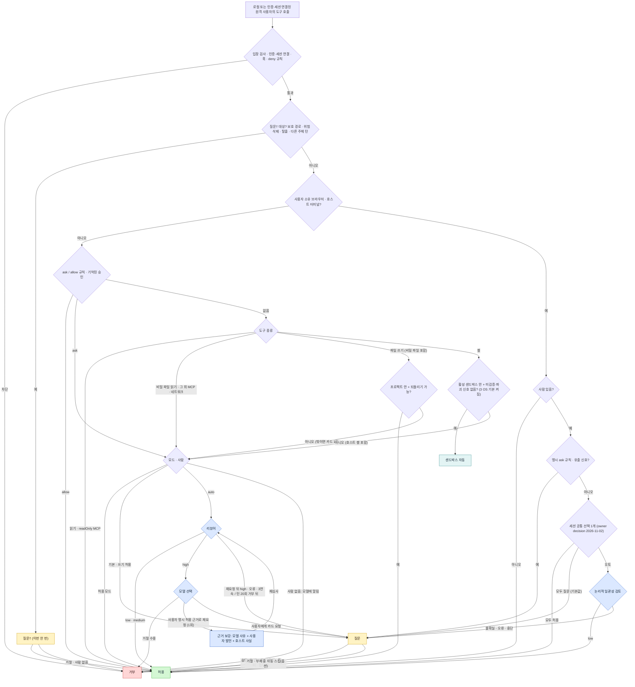

# Ave permission decision tree (v4)

Status: owner-approved 2026-10-29. Mode names were updated 2026-10-30. Session surfaces, remote-user parity and shell-sandbox defaults: owner decision 2026-11-02.
Source design and reference comparison: artifact "에이전트 권한 결정 트리 비교", section 4.
This file is the single source of truth for permission-decision work. Implementers and reviewers of any change
to permission classification, approval cards, the reviewer, hooks or headless behaviour must read it and
keep the code in this order. A change to this tree needs an owner decision.

Outcomes: allow, sandbox-auto, ask (normal card), ask-forced (질문†: this time only, no reviewer, no allow-mode pass,
no memory, deny when headless), deny.

Modes: 기본 / Default (former 모두 확인 = strict; default for new installs) · 쓰기 허용 / Allow writes
(former 쓰기만 확인) · auto · 허용 / Allow.

Notes that are part of the contract:
- **Shared surfaces (owner decision 2026-11-02):** one conversation-local choice covers both logged-in browser tabs and host terminal tabs. One shared card selects Allow all, Auto or Ask (default); there is no separate choice per surface, persistence across sessions or child inheritance. Explicit ask rules and the human-only exfiltration guardrail precede this choice; generic allows and remembered grants do not replace it.
- **Remote user (owner decision 2026-11-02):** an authenticated controller bound to the current session enters the same tree as the local user, including rules, remembered grants, mode, reviewer and 질문†. Missing authentication, session binding or live transport authority is admission-denied, including after asynchronous approval. Remote provenance alone never creates an other-principal floor; genuine external-content guidance still does.
- **Shell default (owner decision 2026-11-02):** shell sandboxing defaults on for all supported desktop platforms, including win32. A missing stored setting uses this default; an explicit stored false remains false. For shell tool calls outside the user-owned surface lane, only active isolation supplies sandbox evidence: proven read-only commands inside it auto-allow in Default, while host and escalated commands ask. Agent typing into the user's terminal instead follows the shared surface choice above. Settings activation without an available backend visibly warns and degrades without claiming confinement. On win32, MXC confines shells; the existing srt-win-only plan requires explicit host approval for shells and confines extensions. Missing both backends retains the visible unavailable path.
- 질문† triggers only: protected paths (Claude Code list: .git .vscode .idea .husky .cargo .devcontainer .yarn
  .mvn .claude .config/git .bashrc .zshrc .zprofile .profile .envrc .gitconfig .npmrc .mcp.json .claude.json,
  plus Ave config/home dirs), critical delete, project escape, other-principal turn.
- Native copy-class operand grammar (destination slot, protected-write floor) is matched by the executable spelling as typed,
  extension included (`copy.exe`), before the extension-stripped verb. Bare `copy` stays the cmd builtin / copy-item alias.
- Exfil (owner decision 2026-10-30, aligned with Codex, Claude Code and Hermes): an upload/exfil signal found in
  command text is a guardrail, not 질문†. It makes the call an ordinary ask: a card in 기본 and 쓰기 허용, the
  reviewer in auto, allowed in 허용, denied headless. The security boundary for network egress is the sandbox egress
  proxy (default-deny host allow-list). Command-text screening is not extended to an ever-growing list of wrappers.
  A non-sandboxed host shell in 허용 runs opaque or wrapped uploads, as the other hosts do in full-access modes.
  This limit is disclosed.
  Headless denies an exfil signal before the reviewer, superseding resolved conflict 6 for this signal. An applicable
  explicit allow rule or remembered grant precedes the exfil guardrail, by tree order. A surface session choice is
  not such a grant. An exfil signal on a user-owned surface always asks the human (owner 2026-10-31), regardless
  of its session choice; it uses a normal card, skips the logical reviewer, and denies headless.
- 기본 mode: writes and shell that would be allowed also go to the card. Reads stay allowed.
- Sandbox-auto blocked by the sandbox (escalation) goes to 모드 · 사람.
- The reviewer breaker is 3 consecutive or 20 per turn. The rest of the turn goes to a human.
- Reviewer denial → model choice (owner decision 2026-10-30). When the reviewer returns high, the model receives
  the denial with three choices and picks one:
  1. **Accept the denial**: the call is denied, and the model continues without it.
  2. **Resubmit with strengthened grounds (once per request)**: allowed only when the user explicitly permitted this
     action in this session. The model's rationale must cite that user message. The host verifies that the cited
     text exists in a user-role turn (never model text or tool output) and attaches it with host-verified safety
     facts (target path, sandbox state, reversibility/checkpoint, change scope). The reviewer re-judges once. A
     second high, or a missing or unverifiable citation, goes to the normal card (headless: deny).
  3. **Ask the user with a permission card**: a normal card (headless: deny + do not retry).
  - Model choice is offered only to requests with a sealed resumable anchor. An already-running nested effect or
    egress request without that anchor uses a normal permission card instead; headless fallback denies with
    "Nobody can approve this request; do not retry." No continuation or replay of prior effects is introduced.
  - The model rationale is an untrusted claim. Only the verified user quote and host facts count as evidence.
  - A reviewer error or a tripped breaker goes straight to the card. 질문† and deny outcomes never reach this choice.
  - The choice grants no execution authority by itself. The breaker counts one denial per request, after the
    choice resolves.
  - Basis: Codex's escalation request, where the model sends a `justification` with `require_escalated`, the
    reviewer re-judges with it, and otherwise the request goes to the user (owner reference 2026-10-30). Ave adds a
    verified user quote and host facts as the only trusted evidence.
- Headless means deny, and the model is told not to retry. There is no deferred queue; a "recently denied" list
  lets the user re-run a call.
- An owner-away turn means the card waits. The default is unlimited; an optional auto-skip after N minutes denies.
- The user script PreToolUse hook runs in the first stage and is block-only. Argument hooks may rewrite input.
- Credential stores owned by the host (encryption keys, credential DBs, cookie/token stores) stay admission-denied.
- User-typed terminal-tab commands are user actions and stay outside this tree.

## Mode behaviour matrix (owner clarification 2026-10-30)

Modes are behaviour, not labels. Each column matches the reference hosts' equivalent mode.

| Action | 기본 (Claude default / Codex untrusted) | 쓰기 허용 (Codex Auto = workspace-write+on-request / Claude acceptEdits / OpenCode build) | auto (쓰기 허용 + Codex auto_review / Claude auto classifier) | 허용 (Codex Full Access / Claude bypass, but deny rules and 질문† still apply) | basis |
|---|---|---|---|---|---|
| file read (non-secret) | allow | allow | allow | allow | all four hosts |
| secret-file read | ask | ask | reviewer | allow | OpenCode *.env ask; owner comment |
| in-project write/edit/delete (checkpoint available) | ask | allow | allow | allow | Codex workspace-write, Claude acceptEdits, OpenCode build |
| outside-project write | ask (one card with folder grant) | ask (one card) | reviewer | allow | Claude add-dir card, OpenCode external_directory; owner "질문 1회" |
| known-safe read-only shell (ls, cat, git status/diff/log, rg…, as the existing literal-proof/read-only classifier defines it) | allow | allow | allow | allow | Claude default read-only bash, Codex untrusted safe commands |
| other sandboxed shell, incl. file-changing commands inside the project (mkdir/mv/cp/rm/build/test) | ask | sandbox-auto | sandbox-auto | sandbox-auto | Codex workspace-write sandbox, Claude sandboxed bash |
| sandboxed shell with an unproven/destructive signal | ask | ask | reviewer | allow (unless 질문†) | Codex dangerous heuristic, Claude critical rm |
| sandbox escalation / host shell (sandbox off) | ask (prefix rule savable) | ask (prefix rule savable) | reviewer | allow (unless 질문†) | Codex escalation + prefix rules; owner "코덱스와 맞춰" |
| network / web fetch | ask | ask | reviewer | allow | Codex sandbox network off, Claude WebFetch rules |
| MCP readOnlyHint | allow | allow | allow | allow | Codex MCP read-only; owner "우리도 맞춰" |
| MCP other | ask (remember per tool) | ask (remember per tool) | reviewer | allow | Claude per-tool rules; owner "클로드에 맞춰" |
| 질문† targets | ask-forced | ask-forced | ask-forced (no reviewer) | ask-forced | Claude protected paths, Hermes instruction-file gate |
| headless (no human), anything that would ask | deny + "do not retry" | same | same (the reviewer still decides first; a fallback to ask → deny) | n/a | Claude -p --permission-prompts none, Codex exec never, OpenCode run, Hermes cron |

auto = 쓰기 허용 + automatic review: every non-† ask goes to the reviewer first. The reviewer never sees 질문†.

## Resolved conflicts with existing invariants (lead decision 2026-10-30, from INVENTORY review)
1. A corrupt or unreadable policy store means the stage-1 deny. It fails closed, because unread deny rules must not be bypassed by the reviewer or the allow mode.
2. Actions in a user-owned (logged-in) browser tab are their own surface. They are NOT 질문† and not an ordinary read or network. (Owner decision 2026-10-30.) On the first agent action in a user-owned tab in a session, a card offers three choices, which last for that session:
   - **이 세션 모두 허용 / Allow all this session**: later actions in user-owned tabs run without asking.
   - **오토 / Auto**: each action goes to the reviewer, which performs only a LOGICAL check. Does this action follow from the user's request and the current task step? Is the target the tab and page the task is about? Is it free of steps the user did not ask for? The reviewer does not judge general risk. Fail or uncertain means a normal card.
   - **모두 질문 / Ask every time**: every action asks. This is the default, and it is the behaviour when the card is dismissed.
   An exfil signal on a user-owned surface always asks the human (owner 2026-10-31), including Allow all and Auto; it uses a normal card, skips logical review, and denies headless.
   deny rules, admission, credential entry and payment/irreversible-submit protections still apply in every choice. Headless means deny. The shared choice covers browser and host terminal actions in this session and is never remembered across sessions (owner decision 2026-11-02).
3. Plugin effects are evaluated per actual effect through this same pipeline. An approval binds to that exact effect; a tool-level reviewer allow never opens every effect. Headless effects follow the headless rule.
4. A user-configured read boundary (an outside-path read restriction) is an explicit rule. It is evaluated in stage 1/3 before modes, and it is preserved.
5. When a command is both "known-safe read-only" and "host/escalation" (e.g. `git status` with the sandbox off), the host/escalation row wins.
6. Headless in auto mode: the reviewer decides first. Only a fallback to ask becomes a deny with "do not retry". This supersedes INVENTORY's "immediate deny" reading.
7. The host terminal tab (the user's own shell, which the agent may drive per #308) uses the SAME three-way per-session choice as user-owned browser tabs. (Owner decision 2026-10-30.)
   - 이 세션 모두 허용: agent commands run in that tab without asking.
   - 오토: the reviewer does a logical consistency check only. Does the command follow from the user's request and task step, in the tab the task is about?
   - 모두 질문: every command asks. This is the default, and it is the behaviour when the card is dismissed.
   Together, the browser tab and the host terminal tab are the "user-owned surfaces". One shared choice covers both surfaces per session, is never persisted and has no child inheritance (owner decision 2026-11-02). An exfil signal on a user-owned surface always asks the human (owner 2026-10-31), in every session choice, using a normal card and skipping logical review. These surfaces have no sandbox egress boundary. Deny rules and credential protections still apply. Headless means deny. Commands the user types in the tab are user actions and are never gated.
8. "Checkpoint available" (the row-114 gate) is decided on each write target's realpath-native filesystem identity — `canonicalPath(resolve(path))`, the spelling the checkpoint recorder keys a mutation on — not the permission matching form, which lowercases the win32 drive letter and so made the pre-check disagree with the recorder on every Windows write. Win32 now matches POSIX: a leaf symlink or a dangling link cannot be snapshotted, so it asks; a write through an in-project directory junction/symlink is followed and auto-allows because the real target stays undoable; a junction/symlink that escapes the project roots is denied by the project-membership test (which uses the realpath'd form), not by the checkpoint gate. (win32 native-path parity, 2026-10-31.)
