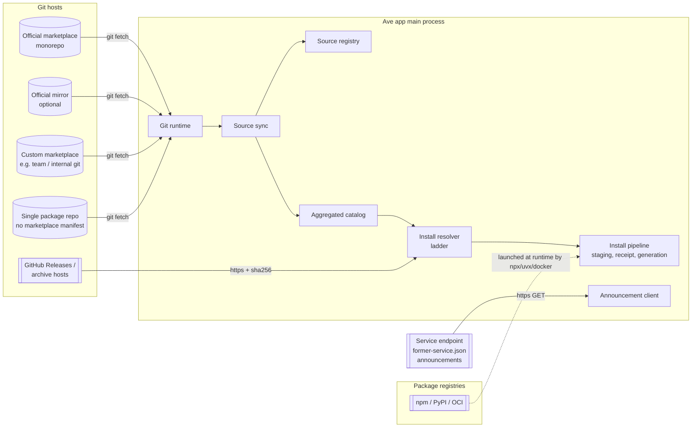
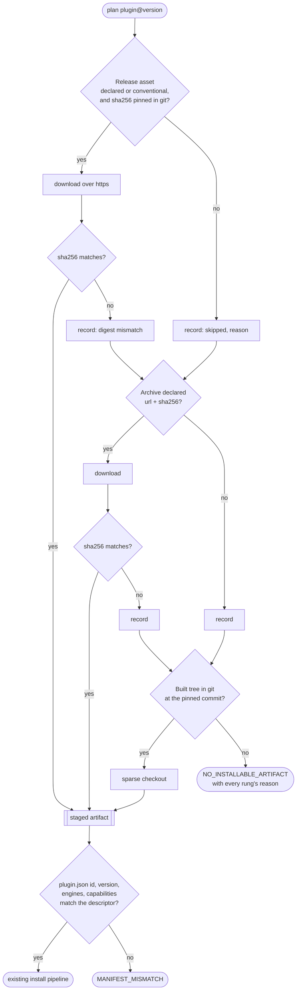

# Multi-source Git Marketplace — Architecture

> Status: **Proposal — accepted direction, not implemented** (owner decisions
> 2026-09-23). Supersedes the single-server marketplace model described by
> `src/plugins/cloud-marketplace-fetcher.ts` and the signing plans in
> [keyless-marketplace-signing](../../blueprints/keyless-marketplace-signing.md)
> and [signed-admission-catalog](../../blueprints/signed-admission-catalog.md).
>
> Companion documents:
> - Blueprint (staged delivery): [../../blueprints/multi-source-git-marketplace.md](../../blueprints/multi-source-git-marketplace.md)
> - Design specification (contracts, schemas, UI states): [../../design/multi-source-git-marketplace.md](../../design/multi-source-git-marketplace.md)
> - Mockup: [../../design/multi-source-git-marketplace.html](../../design/multi-source-git-marketplace.html)
> - Korean mirror: [../../ko/architecture/proposals/multi-source-git-marketplace.md](../../ko/architecture/proposals/multi-source-git-marketplace.md)

## 1. Why this changes

Today the app has exactly one marketplace. `MarketplaceSettings.cloudBaseUrl`
points at a catalog server (`agent-marketplace/server`) that owns the catalog,
stores artifact zips, signs them with the `prod-v1` Ed25519 key, serves
announcements, accepts telemetry, and runs publish approval, yank, canary
rollout and internal-network visibility. A React web store sits beside it.
Changing the URL in *Settings → Marketplace → Advanced* **replaces** that one
server; it never adds a second one.

That shape has three problems the owner wants removed:

1. **One operator, one failure domain.** The server, its web UI, its hosted
   deployment and the signed feeds published from the `marketplace-whitelist`
   repository are all ours to run, and the feeds share one hosting account: an
   outage of that account takes the whitelist, admission and revocation feeds
   and the app release feed down at the same moment.
2. **No second source.** Teams cannot publish an internal catalog next to the
   official one. The only "internal" mechanism is a server-side CIDR list that
   the server must keep secret.
3. **Manifest lock-in.** Anything that is not already a marketplace row
   (an MCP server described by `server.json`, a bare skill folder) can only be
   added through ad-hoc paths (the MCP tab form, the desktop config importer).

## 2. Owner decisions this architecture encodes

| # | Decision | Consequence here |
|---|---|---|
| D1 | The official marketplace is a **git monorepo**; its root holds themes, fonts, languages, plugins, MCP servers and the other official package kinds. No web store, no catalog server. | The catalog is data in git. The catalog server, its web UI and its hosted deployment retire. |
| D2 | Users register **additional git marketplaces** by URL. All registered marketplaces are listed **together**, as several package indexes feeding one catalog. | A source registry with N entries and an aggregated catalog. |
| D3 | Packages can also be installed **without any Ave marketplace manifest** (an MCP server, a skill folder, a single package repo). | Direct-install adapters that synthesize a package descriptor. |
| D4 | Trust is **git pinning only — no signatures**, for official and custom sources alike. | `prod-v1` envelope verification, the signed admission/whitelist/revocation feeds and their keys are removed. Integrity comes from commit SHAs and sha256 values that live inside pinned git content. |
| D5 | Supported delivery forms: everything the ecosystem uses **except MCPB bundles**: repository directories, git sources (`github`, `url`, `git-subdir`), archives (`url`+`sha256`), and MCP launchers (`npx`/`uvx`/`docker`/remote), including MCP Registry `server.json`. | Section 6. |
| D6 | Plugin install resolves through a **ladder**: take a GitHub Release asset when one is published, otherwise step down to the next target until an installable artifact is found. | Section 7. |
| D7 | Git transport uses the **git CLI**; the install sequence provisions git when it is missing. | Section 8. |
| D8 | Publish approval is **merge to the default branch**. Version compatibility is **declared in each package's manifest**. | No approval queue; `engines.ave` is mandatory. |
| D9 | Announcements move to a **static service endpoint** on our domain (option B), with the domain kept replaceable. Internal-only content becomes an **internal custom marketplace** the user registers. | Section 10. |

## 3. System context



Everything left of the app is someone else's static storage. The app never
talks to an Ave-operated API to list, resolve or install a package.

## 4. Components

| Component | Responsibility | Replaces / reuses |
|---|---|---|
| **Git runtime** (`src/marketplace/git/`) | Locate a usable `git` (system ≥ 2.27, or an app-managed copy), provision the managed copy with a pinned sha256, run git with a hardened environment (protocol allow-list, no prompts, proxy from PAC). | Pattern of `PythonRuntimeBootstrapper` (`src/main/python-runtime.ts`). |
| **Source registry** | Persist registered sources (`~/.ave/marketplaces/sources.json`): id, URL, ref, pinned commit, enabled, auth kind, origin (official / custom / direct). Enforce reserved names and managed policy. | Replaces `MarketplaceSettings.cloudBaseUrl`. |
| **Source sync** | Per source: fetch, choose the candidate commit, apply the history rule (§9.2), parse and validate the index at that commit, move the pin atomically, publish an immutable catalog snapshot. | Replaces the HTTP catalog fetch and `offline-cache.ts`'s role. |
| **Aggregated catalog** | Union of every enabled source's snapshot. Rows are keyed by `(source, kind, name)`; nothing is merged across sources. Computes compatibility (`engines.ave`), yank, rollout eligibility and installed/update state. | Replaces `MarketplaceFetcher.listPlugins/getPluginDetail`. |
| **Install resolver** | For one `(source, kind, name, version)` produce an **install plan**: the artifact ladder for plugins, the launcher spec for MCP, the file set for content kinds, and the consent the user must give. | New; hands off to the existing pipeline. |
| **Install pipeline** | Staging, receipt, registry commit, generation publication, recovery journals. | **Reused unchanged** from `marketplace.ts` / `plugin-artifact-store.ts` / `plugin-generation-coordinator.ts`, minus envelope verification. |
| **Content package store** | Install themes, fonts, languages, skills, agents, providers and messaging connections as data under `~/.ave/packages/<kind>/<name>/<version>/` and register them with the owning subsystem. | Replaces the "activate a hidden built-in" asset model. |
| **Direct-install adapters** | Inspect a git URL / pasted `server.json` / MCP config and synthesize a package descriptor. | Extends the MCP tab form and `claude-desktop-import.ts`. |
| **Policy files** | `policy/revocations.json` and `policy/grants.json` inside the **official** repo replace the signed revocation and whitelist feeds. | Replaces `src/plugins/revocation/`, `src/plugins/whitelist/`, `src/plugins/admission/` transports. |
| **Service client** | Read `/.well-known/former-service.json` from the configured service base, then the announcement document it names. | Replaces `listAnnouncements()` on the marketplace server. |

## 5. Identity model

- **Source id** — `^[a-z0-9][a-z0-9-]{1,62}$`. The official source is `ave`.
  The names `ave`, `official`, `ave-official` and any `ave-*` prefix are
  reserved; a custom source may not use them. The check re-runs on every load,
  not only when the source is added.
- **Package key** — `(source, kind, name)`, written `kind:name@source`
  (`plugin:meeting@ave`, `theme:nord@ave`, `mcp:tracker@team-tools`).
- **Runtime identity** stays what it is today. A plugin's runtime id is its
  `plugin.json` `name`; tool names and event names keep their own namespaces.
  Because runtime ids are global, **at most one installed plugin per id**.
  Installing `plugin:meeting@team-tools` while `plugin:meeting@ave` is
  installed is a *source switch*: explicit and confirmed, never automatic.
- **Binding** — an installed package remembers the source it came from. Updates
  are only looked up in that source. A higher version of the same name in
  another source is shown but never installed silently. Without this rule, any
  source could replace another source's package by publishing the same name
  with a higher version (dependency confusion).

## 6. Package kinds and delivery forms

| Kind | Delivered as | Executes code? |
|---|---|---|
| `plugin` | Plugin artifact (`plugin.json` + built `dist/`), resolved by the ladder (§7) | Yes (plugin worker) |
| `mcp` | Launcher spec: `stdio` (`npx`, `uvx`, `docker`, or a command relative to the package directory) or remote `http`; may be declared as an MCP Registry `server.json` | Yes (MCP server process) or remote |
| `skill` | `SKILL.md` + resources | No (instructions) |
| `agent` | `AGENTS.md` profile | No (instructions) |
| `theme` | `theme.json` (the `ThemeBundle` shape as data) | No |
| `font` | `font.json` + `woff2`/`woff`/`ttf`/`otf` files | No |
| `language` | `language.json` + message catalog JSON | No |
| `provider` | Provider preset (today's `MarketplaceProviderPackageAsset`) | No (network config) |
| `messaging-connection` | Connection declaration (today's asset shape) | No (credential schema) |

MCPB (`.mcpb`) bundles are out of scope by decision D5.

Every package in a marketplace carries a **package descriptor**
(`ave-package.json`) with `kind`, `name`, `version` and `engines.ave`. The
plugin kind keeps its host-owned `plugin.json` as the runtime manifest; the
descriptor and `plugin.json` must agree on id and version (checked in CI and
again at install).

## 7. Install resolution

### 7.1 Content kinds

The resolver takes the package directory at the pinned commit through a sparse
checkout, validates it against the kind's file rules (allowed extensions,
size, no links), and hands it to the content package store.

### 7.2 MCP

The launcher spec is copied into a generation-scoped MCP descriptor and
approved through the existing MCP approval flow (static policy fingerprint,
exact owner/version binding). `npx`/`uvx`/`docker` fetch the server's code at
launch from their own registries; the spec pins the package version.

### 7.3 Plugin — the artifact ladder (D6)



Rules:

- The ladder order is fixed: **release → archive → git tree**. A rung that is
  not declared, not pinned, or fails is recorded and the next rung is tried.
- A downloaded rung is only trusted through a `sha256` that is stored in git
  (package descriptor or index) at the pinned commit. A release asset without
  such a pin is skipped with `ARTIFACT_NOT_PINNED`; it is never accepted on the
  release host's word. This keeps D4 intact: the root of trust is always a
  commit.
- No rung builds code on the user's machine.
- The plan and every rung's outcome are shown to the user and written to the
  install receipt, so a failed install explains itself.

## 8. Git runtime (D7)

- **Mode** `auto` (default): use the system `git` if it is ≥ 2.27; otherwise
  offer to install the managed copy. `system` and `managed` force one side.
- **Managed copy**: `dugite-native` on macOS and Linux, `MinGit` on Windows,
  downloaded from their upstream GitHub releases into
  `~/.ave/runtime/git/<version>/`, verified against sha256 values pinned in the
  app source, then smoke-tested with `git --version`. Downloading at runtime
  (rather than bundling in the installer) keeps GPLv2 redistribution out of the
  Ave installer.
- **Hardened invocation** for every call: `GIT_TERMINAL_PROMPT=0`, an askpass
  helper that serves only the token stored for that host,
  `GIT_ALLOW_PROTOCOL=https:ssh` (no `file`, `ext`, `git`; plain `http` only
  for internal hosts the managed policy names),
  `-c protocol.file.allow=never`, `-c submodule.recurse=false`,
  `-c core.fsmonitor=false`, `-c core.hooksPath=<empty dir>`, proxy from the PAC
  resolver. The managed copy also sets `GIT_CONFIG_NOSYSTEM=1`.
- **Fetch shape**: bare partial clone (`--filter=blob:none`), then sparse
  checkout of only the paths a plan needs. No submodules, no LFS.

## 9. Trust model (D4)

### 9.1 What protects the user

| Threat | Control |
|---|---|
| Tampered bytes in transit | TLS to the git host / release host, and sha256 pins stored in git for every downloaded artifact. |
| A source silently changing what a version means | Versions resolve to commits; a version's commit is recorded at install and in the index. Re-publishing a version at a different commit is rejected by CI and flagged by the client. |
| History rewrite / rollback of a source | §9.2. |
| A custom source impersonating the official one | Reserved names; official identity bound to the built-in URL list, re-checked on every load. |
| A custom source pushing banners | Only the service endpoint issues announcements; sources cannot. |
| Dependency confusion across sources | Installed packages are bound to their source (§5). |
| Malicious code in a custom source | Explicit consent when the source is added, per-install permission review (existing capability, network and plugin-access review), update review with a capability diff, and managed policy (§9.3). |
| A compromised official repository | Branch protection with required review and CODEOWNERS on the official repo; the monotonic history rule; `policy/revocations.json` as the kill switch. |

What is deliberately **gone**: artifact signatures, the `prod-v1` trust anchor,
the signed whitelist/admission/revocation documents and their keys. With D4,
whoever can merge to the official default branch can ship code to every user.
The official repository's protection settings are therefore part of the
security boundary and are listed in the blueprint's exit criteria.

### 9.2 History rule

When a source's ref moves, the candidate commit must be a descendant of the
pinned commit (`git merge-base --is-ancestor`).

- Official source: a non-descendant candidate is refused
  (`SOURCE_HISTORY_REWRITTEN`); the old pin stays.
- Custom and direct sources: the user sees a warning and may accept the new
  history explicitly.

Because the pin is a commit SHA, an official **mirror** is interchangeable
with the primary: the client accepts a mirror's commit if it satisfies the
same rule, so mirrors add availability without adding trust.

### 9.3 Managed policy

The existing system policy file (`/Library/Application Support/Ave/policy.json`,
`%ProgramData%\Ave\policy.json`) gains a `marketplaces` block: an allow-list
and block-list of source URLs/host patterns, the internal hosts allowed over
plain `http`, pre-registered sources, whether direct installs are
allowed, and whether the official source may be disabled. User settings cannot
override it.

## 10. Service endpoint (D9)

The app reads one small static document:

```
GET {serviceBase}/.well-known/former-service.json
```

It names the announcement document path and, optionally, other static
resources. `serviceBase` defaults to `https://former-site.invalid` at build time; the
managed policy may override it; the document may carry a `movedTo` base for a
domain change. Announcements keep today's contract (`MarketplaceAnnouncement`:
levels, time window, navigation-only actions). Telemetry is decoupled from the
marketplace URL and is active only when the service document advertises an
ingestion endpoint.

## 11. What the host keeps, changes and removes

| Keeps | Changes | Removes |
|---|---|---|
| Install pipeline: staging, receipts, generations, recovery journals, bundle lifecycle | `MarketplaceFetcher` becomes a catalog view over source snapshots | `cloud-marketplace-fetcher.ts`, the `/api/v1/*` client |
| Permission, capability, network and plugin-access review | Registry entries gain an `origin` (source, commit, rung, digest) | `envelope-verifier.ts` in the install path, `marketplace-keys.ts`, `publisher-keys.ts` |
| MCP approval and governance | Theme and locale sets become open (data-driven) with built-in defaults | `signed-doc-fetcher.ts`, `signed-doc-cache.ts`, `admission/`, `whitelist/`, `revocation/` transports |
| `ave://` deep links | `ave://install/<kind>/<name>@<source>`, `ave://marketplace/add?url=` | The "open web marketplace" button |
| Update detection toggle | Update detection reads source snapshots | Telemetry coupling to `marketplace.cloudBaseUrl` |

The agent-marketplace server repository and the marketplace-whitelist
repository are archived after the migration described in the blueprint.

## 12. Alternatives considered

- **Keep one server, add git as a second backend.** Rejected by D1/D9: it keeps
  the operational surface this change exists to remove.
- **Signatures for custom sources (TOFU keys).** Rejected by D4.
- **Pure-JS git.** Rejected by D7: SSH and OS credential helpers matter for
  internal git hosts.
- **Build plugins on the user's machine.** Rejected: it runs arbitrary
  lifecycle scripts at install and needs a toolchain; no surveyed ecosystem
  does it.
- **MCPB bundles.** Excluded by D5.
