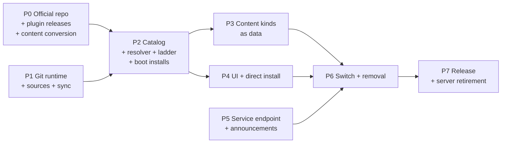

# Multi-source Git Marketplace — Blueprint

> Status: **Active plan, not started** (2026-09-23).
> Architecture: [../architecture/proposals/multi-source-git-marketplace.md](../architecture/proposals/multi-source-git-marketplace.md) ·
> Design specification: [../design/multi-source-git-marketplace.md](../design/multi-source-git-marketplace.md) ·
> Mockup: [../design/multi-source-git-marketplace.html](../design/multi-source-git-marketplace.html) ·
> Korean mirror: [../ko/blueprints/multi-source-git-marketplace.md](../ko/blueprints/multi-source-git-marketplace.md)

This plan delivers the architecture in eight phases. Each phase lists its
pull requests, what it must not break, and the evidence that closes it. The
new stack is built beside the current one and switched on in one change
(phase 6), so the app never runs two marketplace implementations at once and
no compatibility shim outlives the switch.

## 0. Inputs this plan depends on

| Input | Owner | Needed by |
|---|---|---|
| Location of the official marketplace repository (and optional mirrors) | Repository migration plan | Phase 1 constant `OFFICIAL_MARKETPLACE`, phase 0 |
| Working CI on the hosting account that builds plugin release assets | Repository migration plan | Phase 0 release pins |
| Service domain default (`https://former-site.invalid` unless changed) | Owner | Phase 5 |
| Organizations that rely on today's managed installs (the internal `orion` plugin) have an internal marketplace and a policy file with `requiredInstalls` ready | Each organization | Phase 7 step 1 |

## 1. Phases at a glance

P0, P1 and P5 can proceed in parallel. P6 is the only phase that changes what
users run.

## 2. Phase 0 — Official marketplace repository and plugin releases

**Goal:** a repository that already satisfies the new contracts, so the app
work in P1–P4 has real data to test against.

| PR | Content |
|---|---|
| 0.1 | Layout from design §3.1, `README` for package authors, `CODEOWNERS`, branch protection (required review, required checks, no force-push, no direct push) |
| 0.2 | Validation workflow: descriptor and index schemas (vendored from ave `schemas/marketplace/` with a drift test), content limits, naming, secret scan, `minAppVersion` present, plugin `authority` equal to the released `plugin.json`, version strictly increasing, `(kind,name,version)` → one commit, `latest` not yanked |
| 0.3 | Index generator + "committed index equals regenerated index" check |
| 0.4 | Release-pin workflow (design §6.3): download the asset, hash, unpack, compare `plugin.json` with the descriptor, open the pin PR |
| 0.5 | One release-workflow PR in **each official plugin repository**: on tag `vX.Y.Z` build `{name}-{X.Y.Z}.zip` and upload it as a release asset of that repository; `requires.minAppVersion` set in `plugin.json` |
| 0.6 | Content conversion scripts, run once: every agent, skill and MCP package in the current seed set; the non-default theme bundles to `theme.json`; the Korean catalog to a language package; provider presets; messaging connections |
| 0.7 | Plugin descriptors for every currently published plugin, pinned to the release assets from 0.5. For plugins in `HOST_SECRET_GRANTS` (today `meeting` and `local-indexer`), `versions[]` also lists every older version still installed in the field: the exact zip the current server serves for that version is uploaded unchanged as that version's release asset and pinned by its sha256, so migrated installs keep their grant (design §16.3) |
| 0.8 | `policy/revocations.json` carrying today's active revocations of official packages |

**Exit:** validation passes on `main`; branch protection verified through the
hosting API; every current catalog package appears in `marketplace.json` with
`minAppVersion`; every plugin resolves through the release rung in a dry run;
the field-version pins of 0.7 match the server's recorded artifact hashes.

## 3. Phase 1 — Git runtime, source registry, sync

New module root `src/marketplace/` (main process). Nothing is wired into the
UI or boot yet except a status probe.

| PR | Content | Tests |
|---|---|---|
| 1.1 | `git/detect.ts`, `git/run-git.ts` (design §9.1, §9.3): minimum 2.38.1, macOS Command Line Tools shim check, generated `GIT_CONFIG_GLOBAL`, askpass helper with single-use host-bound tickets, `http.followRedirects=false`, export by `rev-list --missing=print` + batch fetch + `git archive` | fake git binaries for version gates (2.38.0 refused, 2.38.1 accepted); the full env/flag contract asserted per call; only the allowed keys copied into the global config; askpass refuses a host the ticket does not name; protocol rejection |
| 1.2 | `git/managed-git.ts` + `managed-git-pins.ts` (design §9.2): PAC-aware download through the network gate, sha256, temp extract, rename, smoke test; `GIT_EXEC_PATH`, `GIT_TEMPLATE_DIR`, CA bundle from `corp-ca-extract.ts` (`schannel` on Windows); `ave:git:runtime:*` IPC | local fixture server; wrong hash; truncated download; interrupted extract keeps the prior copy |
| 1.3 | `schemas/marketplace/index.schema.json`, `package.schema.json` + hand-written fail-closed validators per kind (design §4, §5) | fixture matrix per kind: valid, each rule broken, unknown keys |
| 1.4 | `net/source-url.ts` (`normalizeSourceUrl`) and the shared network gate (design §7.1, §7.4), taking over the private-network guard from `cloud-marketplace-fetcher.ts`; `sources/registry.ts` (`sources.json`, `state.json`, reserved names, policy allow/block/http hosts, official constant, managed `additional` sources) | normalization equivalences; reserved names re-checked on load; block beats allow; private targets refused; redirect to a blocked host refused |
| 1.5 | `sources/sync.ts` (design §7.3): full-history partial fetch, history rule, snapshot write and pruning, atomic pin move, mirror fallback, offline serving, sync of hidden sources that still have installed packages | local bare repos: fast-forward with the pin far behind, rewrite (official and managed refuse, custom needs review), invalid index keeps pin, unreachable primary uses mirror |

**Exit:** targeted tests green; `bun run typecheck`, lint and the import-cycle
check green; a dev build syncs the P0 repository and a custom fixture
repository from a real host, **including once behind a TLS-inspecting proxy**
with the managed git copy on macOS and Windows.

## 4. Phase 2 — Aggregated catalog, install resolver, boot installs

| PR | Content | Tests |
|---|---|---|
| 2.1 | `catalog/aggregate.ts`: rows keyed `(source, kind, name)`, version choice (design §6.1) with `installation-id` rollout buckets, pre-release behind `canaryOptIn`, per-source revocations | table tests for `minAppVersion`, yank, platform, pre-release, rollout, revocation, `upgrade_required` minimum |
| 2.2 | Git-install manifest rules (design §5.3): `requires.minAppVersion` required and equal to the descriptor; every authority field equal to the descriptor. Paired SDK PR merged in the same window for the schema copy and its drift test | schema tests; plugin fixtures updated |
| 2.3 | `resolve/plugin-ladder.ts` (design §6.2) producing a staged artifact; plan bound to snapshot and version commits; tree digest (§6.4); dependency preflight on the descriptor authority | every rung used/skipped/failed; each authority-field mismatch stops the ladder; a sync between plan and execute does not change the result; rung outcomes in the plan and receipt |
| 2.4 | Install pipeline entry that takes a staged, already-verified artifact: reuses staging → receipt → registry → generation; `origin` on registry entries; no envelope verification on this path | existing pipeline suites unchanged and green; new origin assertions; recovery journals exercised |
| 2.5 | `resolve/mcp.ts`: descriptor or `server.json` → generation-scoped MCP descriptor → existing approval | npm/pypi/oci/remote mapping; relative `stdio` command containment |
| 2.6 | Identity rules: `PACKAGE_ID_CONFLICT` across kinds and sources, source switch transaction, update binding | cross-source same name; switch keeps plugin data directory |
| 2.7 | `boot-installs/` (design §10.2): `DEFAULT_INSTALLS`, policy `defaultInstalls` and `requiredInstalls`, `default-installs.json`; `secret-access/grants.ts` (`HOST_SECRET_GRANTS`) with the four grant conditions of design §10.3. Built and tested here, wired in phase 6 | installed once and never after uninstall; required: reinstall, update, uninstall and disable denied; lists limited to official/managed; grant refused for custom origin, tree rung, a different artifact hash and a swapped manifest; legacy receipt-hash path |

**Must not break:** every existing plugin lifecycle, recovery and generation
test. The pipeline change in 2.4 and the modules in 2.7 are additive until
phase 6 removes the old entry.

## 5. Phase 3 — Content kinds as data

| PR | Content | Tests |
|---|---|---|
| 3.1 | Content package store + `packages/ledger.json` (install, uninstall, origin) with the file rules of design §5.4, SVG excluded, assets served through a host scheme | limits, links, traversal, SVG rejected |
| 3.2 | Themes: load `theme.json` into the `ThemeBundle` shape; move the WCAG contrast computation that today lives only in `theme/bundles/__tests__/contrast.test.ts` into a runtime validator used by both that test and the installer, and reject failing themes at install; built-in `moonstone` and `gallery` stay compiled in; installed ids are validated strings, not additions to the `BundleId` union | contrast failure rejection; switching to and from an installed theme |
| 3.3 | Languages: open locale registry; install `messages.json` as a catalog layered over `en`; key-existence check against the `en` key set at install (unknown keys rejected, missing keys fall back to `en` and are listed in the package detail) | missing/unknown key handling; locale switch |
| 3.4 | Fonts (new kind): serve files through a host asset scheme, register `@font-face`, add installed families to the appearance font list; license file required | font load in renderer; uninstall while selected falls back to the default |
| 3.5 | Providers and messaging connections: move the current asset-package install code onto the ledger | parity with today's install/uninstall behavior |

**Exit:** every official content package from P0 installs, activates and
uninstalls in a dev build; the settings pickers list installed items.

## 6. Phase 4 — UI and direct install

| PR | Content |
|---|---|
| 4.1 | Marketplace browse: kind tabs, source filter, search, Add menu, cards with source badge and state chips including `Source removed` and `Required by your organization`, boot-install banner (design §15.1) |
| 4.2 | Package detail sheet with provenance (SHA tooltips), compatibility, permissions from the descriptor, delivery rungs, versions; install progress (§15.2–15.3) |
| 4.3 | Sources view (including `Syncing` and the overflow menu), Add marketplace dialog (preview → confirm), token entry, history-rewrite review (§15.4–15.6) |
| 4.4 | Git runtime card and the blocking step inside the Add dialog, including `Not found`, `too old`, `smoke-testing` and `failed` (§15.7) |
| 4.5 | Direct install: Git URL, MCP form (existing), `server.json` paste, client-config import (design §8) |
| 4.6 | Deep links `ave://install/<kind>/<name>@<source>`, `ave://uninstall/<kind>/<name>@<source>` and `ave://marketplace/add?url=…`, all opening the confirming UI, never acting directly |
| 4.7 | i18n for all new copy through the generator; key-existence gate |

**Exit:** CDP-driven checks on a packaged dev build for each screen state in
the mockup, including layout measurements at the narrow width tier.

## 7. Phase 5 — Service endpoint and announcements

| PR | Content |
|---|---|
| 5.1 | `web/public/.well-known/former-service.json` and `web/public/announcements/v1.json` (initially empty list) |
| 5.2 | `service/client.ts`: base resolution (policy → accepted move for this build constant → build constant), `movedTo` accepted only with a matching `movedFrom`, at most one move per build constant; announcement fetch and cache, `en` label fallback, dismissed ids unchanged |
| 5.3 | Telemetry reads its same-origin endpoint from the service document; inactive when absent; no marketplace API key |

**Exit:** the web deploy publishes both files through its manual production
gate; the app shows a test announcement from a staging base.

## 8. Phase 6 — Switch and removal

One PR series merged together, after P2–P5 are complete. The design's
disposition table (design §16.2) is the checklist; every row is closed in
this phase.

| PR | Content |
|---|---|
| 6.1 | Boot and IPC use the new stack; Settings → Marketplace renders the new UI; the settings migration removes `backend`, `cloudBaseUrl` and `cloudAllowPrivateNetwork`; the `marketplace.apiKey` secret and its IPC are deleted; the old IPC channels and the `ave://install`/`ave://uninstall` slug forms are replaced (design §16.2) |
| 6.2 | First-boot migration of existing installs (design §16.3): bind registry entries to `ave` as `legacy`; grant continuity by receipt hash; `installSource: "admin"` → `user` and recorded as applied default installs; unmatched entries unlocked with the boot notice; provider presets and theme/language activations to ledger entries |
| 6.3 | Remove privileged packages (design §10.1): `installPolicy` and `publisher` leave the manifest schema, `manifest-validation.ts`, renderer types and — in a paired SDK PR merged in the same window — the SDK schema; managed boot install, managed update kinds, actor escalation, delisted removal; the deployment guard's admin branch is replaced by the `requiredInstalls` check in uninstall and disable; the secret-gate admin bypass and its audit path are deleted and tier 3 reads `HOST_SECRET_GRANTS` |
| 6.4 | Delete the server stack per design §16.2: `cloud-marketplace-fetcher.ts`, the local/disabled fetchers, server download and `.sig` handling in `marketplace-installer.ts`, `envelope-verifier.ts`, `marketplace-keys.ts`, `publisher-keys.ts`, `signed-doc-fetcher.ts`, `signed-doc-cache.ts`, `admission/`, the `whitelist/` and `revocation/` transports and their boot steps, `mcp-marketplace-install.ts`, `offline-cache.ts`; move `canonical-json.ts` and `secret-gate.ts` to `src/plugins/secret-access/`; feed `revocationRegistry` from snapshots; public-key parameters removed from `plugin-artifact-store.ts` and `mcp-setup.ts`; the web-store button; rewrite the tests that asserted managed or signed behavior |
| 6.5 | Replace `.github/workflows/marketplace-e2e.yml` with an in-repo end-to-end test against a local git fixture (design §17), in the same series so CI never loses marketplace E2E coverage |
| 6.6 | Documentation: `docs/architecture/architecture.md` Plugin Runtime section, plugin development and publishing guides (EN and KO, including the `installPolicy: "admin"` examples), `docs/ko/references/plugin-tool-schema-design.md`, `resources/AGENTS.md`, and `web/app/docs/servers/marketplace/*` (server pages removed, a package-author page added); this plan's status updated |

**Exit:** full `test:vitest`, typecheck, lint, knip baseline, import cycles,
packaged-app smoke; no source file references `installPolicy`,
`installSource: "admin"` or the removed modules; an upgrade test from the
previous release with installed plugins (including a former admin install
and a granted plugin), a custom theme and the Korean language shows them
bound to `ave`, the granted plugin still reading its LLM key, and nothing
reinstalled.

## 9. Phase 7 — Release and retirement

Order matters because released apps only learn about the change through the
old server's announcement endpoint.

1. Tell organizations that use today's managed installs to publish their
   internal marketplace and a policy file with `requiredInstalls` before they
   deploy the new release; the old lock does not carry over.
2. Ship the app release containing phase 6.
3. Publish an announcement **on the old server** telling users of older
   builds to update, and keep the old server read-only until the release has
   been out for one release cycle.
4. Stop the old server, its web UI and its deployment; remove its secrets and
   runners.
5. Archive the `agent-marketplace` and `marketplace-whitelist` repositories.

**Exit:** no app code path or workflow references the old server; the old
repositories are archived.

## 10. Risks and their controls

| Risk | Control in this plan |
|---|---|
| A merge to the official repository ships code (no signatures) | P0 exit requires branch protection verified through the API; the history rule refuses rewritten official history; the official source has no install, lock or grant privilege of its own (D10), so a merge reaches only users who accept the update, machines whose policy requires the package, and the plugin names in the app's grant table; official revocations cover official packages |
| No cross-source kill switch (owner decision) | Per-install permission review and per-update capability diff; users remove packages and sources; organizations use `marketplaces.block` and device management |
| Organizations lose the uninstall lock on internal plugins at the switch | Input in §0, phase 7 step 1, and the boot notice naming each unlocked entry |
| Granted plugins lose LLM-key access after migration | P0.7 pins field versions; P6 exit proves continuity on an upgraded profile |
| Default-install and grant changes need an app release | Accepted; revocations remain the fast path for turning something off |
| Corporate networks: proxies and TLS inspection | git runs with the PAC-derived proxy; the managed copy uses a CA bundle built from the corporate roots the app already extracts (Windows `schannel`); P1 exit includes a run behind a TLS-inspecting proxy |
| Official repository growth from committed builds | Official plugins use the release rung; the tree rung is for small or custom plugins |
| Hosting outage of the official repository | Mirror URLs in `OFFICIAL_MARKETPLACE`; commit pins make mirrors interchangeable; cached snapshots keep browsing and installed packages working |
| Older app builds after the server stops | Phase 7 ordering: new release first, announcement on the old channel, then shutdown |
| Open theme/locale sets weaken type exhaustiveness | Built-in ids keep their unions; installed ids are validated strings handled by explicit branches |
| Custom sources shipping malicious code or probing internal services | Consent at add, permission review per install, capability diff per update, the shared network gate, managed policy allow/block lists |
