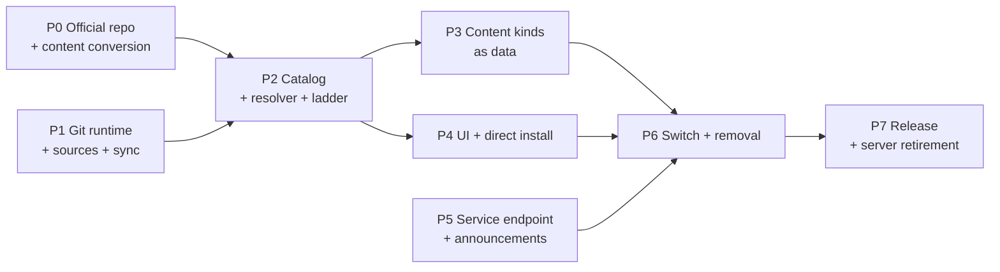

# Multi-source Git Marketplace — Blueprint

> Status: **Active plan, not started** (2026-09-23).
> Architecture: [../architecture/proposals/multi-source-git-marketplace.md](../architecture/proposals/multi-source-git-marketplace.md) ·
> Design specification: [../design/multi-source-git-marketplace.md](../design/multi-source-git-marketplace.md) ·
> Mockup: [../design/multi-source-git-marketplace.html](../design/multi-source-git-marketplace.html) ·
> Korean mirror: [../ko/blueprints/multi-source-git-marketplace.md](../ko/blueprints/multi-source-git-marketplace.md)

This plan delivers the architecture in eight phases. Each phase lists its
pull requests, what it must not break, and the evidence that closes it. The
new stack is built beside the current one and switched on in one change
(phase 6), so the app never runs two marketplace implementations at once and
no compatibility shim outlives the switch.

## 0. Inputs this plan depends on

| Input | Owner | Needed by |
|---|---|---|
| Location of the official marketplace repository (and optional mirrors) | Repository migration plan | Phase 1 constant `OFFICIAL_MARKETPLACE`, phase 0 |
| Working CI on the hosting account that builds plugin release assets | Repository migration plan | Phase 0 release pins |
| Service domain default (`https://former-site.invalid` unless changed) | Owner | Phase 5 |

## 1. Phases at a glance

P0, P1 and P5 can proceed in parallel. P6 is the only phase that changes what
users run.

## 2. Phase 0 — Official marketplace repository

**Goal:** a repository that already satisfies the new contracts, so the app
work in P1–P4 has real data to test against.

| PR | Content |
|---|---|
| 0.1 | Layout from design §3.1, `README` for package authors, `CODEOWNERS`, branch protection (required review, required checks, no force-push, no direct push) |
| 0.2 | Validation workflow: descriptor and index schemas (vendored from ave `schemas/marketplace/` with a drift test), content limits, naming, secret scan, `engines` present, version strictly increasing, `(kind,name,version)` → one commit |
| 0.3 | Index generator + "committed index equals regenerated index" check |
| 0.4 | Release-pin workflow (design §6.3): download the asset, hash, unpack, compare `plugin.json`, open the pin PR |
| 0.5 | Content conversion scripts, run once: 169 agents, 154 skills, 23 MCP packages from the current seed set; 14 non-default theme bundles to `theme.json`; the Korean catalog to a language package; provider presets; messaging connections |
| 0.6 | Plugin descriptors for every currently published plugin, pinned to release assets built by each plugin repository's own release workflow |
| 0.7 | `policy/revocations.json` carrying today's active revocations; `policy/grants.json` carrying today's whitelist grants |

**Exit:** validation passes on `main`; branch protection verified through the
hosting API; every current catalog package appears in `marketplace.json` with
`engines`; every plugin resolves through the release rung in a dry run.

## 3. Phase 1 — Git runtime, source registry, sync

New module root `src/marketplace/` (main process). Nothing is wired into the
UI or boot yet except a status probe.

| PR | Content | Tests |
|---|---|---|
| 1.1 | `git/detect.ts`, `git/run-git.ts` (design §9.1, §9.3), including the macOS Command Line Tools shim check | fake git binaries for version gates; the full env/flag contract asserted per call; protocol rejection |
| 1.2 | `git/managed-git.ts` + `managed-git-pins.ts` (design §9.2): PAC-aware download, sha256, temp extract, rename, smoke test; `ave:git:runtime:*` IPC | local fixture server; wrong hash; truncated download; interrupted extract keeps the prior copy |
| 1.3 | `schemas/marketplace/index.schema.json`, `package.schema.json` + hand-written fail-closed validators per kind (design §4, §5) | fixture matrix per kind: valid, each rule broken, unknown keys |
| 1.4 | `sources/registry.ts` (`sources.json`, reserved names, policy allow/block/http hosts, official constant) | reserved names re-checked on load; policy precedence |
| 1.5 | `sources/sync.ts` (design §7.2): partial fetch, history rule, snapshot write, atomic pin move, mirror fallback, offline serving | local bare repos: fast-forward, rewrite (official refuses, custom needs review), invalid index keeps pin, unreachable primary uses mirror |

**Exit:** targeted tests green; `bun run typecheck`, lint and the import-cycle
check green; a dev build syncs the P0 repository and a custom fixture
repository from a real host.

## 4. Phase 2 — Aggregated catalog and install resolver

| PR | Content | Tests |
|---|---|---|
| 2.1 | `catalog/aggregate.ts`: rows keyed `(source, kind, name)`, version choice (design §6.1) with `installation-id` rollout buckets | table tests for engines, yank, platform, rollout, revocation, `upgrade_required` minimum |
| 2.2 | Host plugin schema: `extensions["ai.agent-connector.ave"].engines` (design §5.3); SDK schema copy and its drift test updated in the SDK repository in the same window | schema tests; plugin fixtures updated |
| 2.3 | `resolve/plugin-ladder.ts` (design §6.2) producing a staged artifact; tree digest (§6.4) | every rung used/skipped/failed; mismatch stops the ladder; rung outcomes in the plan |
| 2.4 | Install pipeline entry that takes a staged, already-verified artifact: reuses staging → receipt → registry → generation; `origin` on registry entries; no envelope verification on this path | existing pipeline suites unchanged and green; new origin assertions; recovery journals exercised |
| 2.5 | `resolve/mcp.ts`: descriptor or `server.json` → generation-scoped MCP descriptor → existing approval | npm/pypi/oci/remote mapping; relative `stdio` command containment |
| 2.6 | Identity rules: `PLUGIN_ID_CONFLICT`, source switch transaction, update binding | cross-source same name; switch keeps plugin data directory |

**Must not break:** every existing plugin lifecycle, recovery and generation
test. The pipeline change in 2.4 is additive until phase 6 removes the old
entry.

## 5. Phase 3 — Content kinds as data

| PR | Content | Tests |
|---|---|---|
| 3.1 | Content package store + `packages/ledger.json` (install, uninstall, origin) with the file rules of design §5.4 | limits, links, traversal |
| 3.2 | Themes: load `theme.json` into the `ThemeBundle` shape; move the WCAG contrast computation that today lives only in `theme/bundles/__tests__/contrast.test.ts` into a runtime validator used by both that test and the installer, and reject failing themes at install; built-in `moonstone` and `gallery` stay compiled in; installed ids are validated strings, not additions to the `BundleId` union | contrast failure rejection; switching to and from an installed theme |
| 3.3 | Languages: open locale registry; install `messages.json` as a catalog layered over `en`; key-existence check against the `en` key set at install (unknown keys rejected, missing keys fall back to `en` and are listed in the package detail) | missing/unknown key handling; locale switch |
| 3.4 | Fonts (new kind): serve files through a host asset scheme, register `@font-face`, add installed families to the appearance font list; license file required | font load in renderer; uninstall while selected falls back to the default |
| 3.5 | Providers and messaging connections: move the current asset-package install code onto the ledger | parity with today's install/uninstall behavior |

**Exit:** every official content package from P0 installs, activates and
uninstalls in a dev build; the settings pickers list installed items.

## 6. Phase 4 — UI and direct install

| PR | Content |
|---|---|
| 4.1 | Marketplace browse: kind tabs, source filter, search, cards with source badge and state chip (design §15.1) |
| 4.2 | Package detail sheet with provenance, compatibility, permissions, delivery rungs, versions; install progress (§15.2–15.3) |
| 4.3 | Sources view, Add marketplace dialog (preview → confirm), token entry, history-rewrite review (§15.4–15.6) |
| 4.4 | Git runtime card and the blocking step inside the Add dialog (§15.7) |
| 4.5 | Direct install: Git URL, MCP form (existing), `server.json` paste, client-config import (design §8) |
| 4.6 | Deep links `ave://install/<kind>/<name>@<source>` and `ave://marketplace/add?url=…`, both opening the confirming UI, never installing directly |
| 4.7 | i18n for all new copy through the generator; key-existence gate |

**Exit:** CDP-driven checks on a packaged dev build for each screen state in
the mockup, including layout measurements at the narrow width tier.

## 7. Phase 5 — Service endpoint and announcements

| PR | Content |
|---|---|
| 5.1 | `web/public/.well-known/former-service.json` and `web/public/announcements/v1.json` (initially empty list) |
| 5.2 | `service/client.ts`: base resolution (policy → build constant), `movedTo` handling, announcement fetch and cache, dismissed ids unchanged |
| 5.3 | Telemetry reads its endpoint from the service document; inactive when absent |

**Exit:** the web deploy publishes both files through its manual production
gate; the app shows a test announcement from a staging base.

## 8. Phase 6 — Switch and removal

One PR series merged together, after P2–P5 are complete:

| PR | Content |
|---|---|
| 6.1 | Boot and IPC use the new stack; Settings → Marketplace renders the new UI; `marketplace.cloudBaseUrl`, `cloudAllowPrivateNetwork` and the API-key controls are removed with a settings migration that drops them |
| 6.2 | First-boot migration of existing installs (design §16): bind `user`/`admin` registry entries to `ave` by id; convert installed provider presets and theme/language activations to ledger entries |
| 6.3 | Delete `cloud-marketplace-fetcher.ts`, envelope verification in the install path, `marketplace-keys.ts`, `publisher-keys.ts`, `signed-doc-fetcher.ts`, `signed-doc-cache.ts`, the `admission/`, `whitelist/` and `revocation/` transports (revocation behavior moves to the official policy file), the web-store button, and their tests |
| 6.4 | `docs/architecture/architecture.md` Plugin Runtime section, plugin development guide and marketplace publishing guide rewritten for the new model; this plan's status updated |

**Exit:** full `test:vitest`, typecheck, lint, knip baseline, import cycles,
packaged-app smoke; an upgrade test from the previous release with installed
plugins, a custom theme and the Korean language shows them bound to `ave` and
working.

## 9. Phase 7 — Release and retirement

Order matters because released apps only learn about the change through the
old server's announcement endpoint.

1. Ship the app release containing phase 6.
2. Publish an announcement **on the old server** telling users of older
   builds to update, and keep the old server read-only until the release has
   been out for one release cycle.
3. Stop the old server, its web UI and its deployment; remove its secrets and
   runners.
4. Archive the `agent-marketplace` and `marketplace-whitelist` repositories.
5. Replace the cross-repository `marketplace-e2e` workflow with an in-repo
   end-to-end test against a local git fixture (design §17).

**Exit:** no app code path or workflow references the old server;
the old repositories are archived; the in-repo E2E test runs in CI.

## 10. Risks and their controls

| Risk | Control in this plan |
|---|---|
| A merge to the official repository ships code to every user (no signatures) | P0 exit requires branch protection verified through the API; the history rule refuses rewritten official history; `policy/revocations.json` is the kill switch |
| Corporate networks: proxies and TLS inspection | git runs with the PAC-derived proxy; the managed copy uses the OS certificate store (Windows `schannel`, macOS system trust); P1 exit includes a run behind a TLS-inspecting proxy |
| Official repository growth from committed builds | Official plugins use the release rung; the tree rung is for small or custom plugins |
| Hosting outage of the official repository | Mirror URLs in `OFFICIAL_MARKETPLACE`; commit pins make mirrors interchangeable; cached snapshots keep browsing and installed packages working |
| Older app builds after the server stops | Phase 7 ordering: new release first, announcement on the old channel, then shutdown |
| Open theme/locale sets weaken type exhaustiveness | Built-in ids keep their unions; installed ids are validated strings handled by explicit branches |
| Custom sources shipping malicious code | Consent at add, permission review per install, capability diff per update, managed policy allow/block lists |
