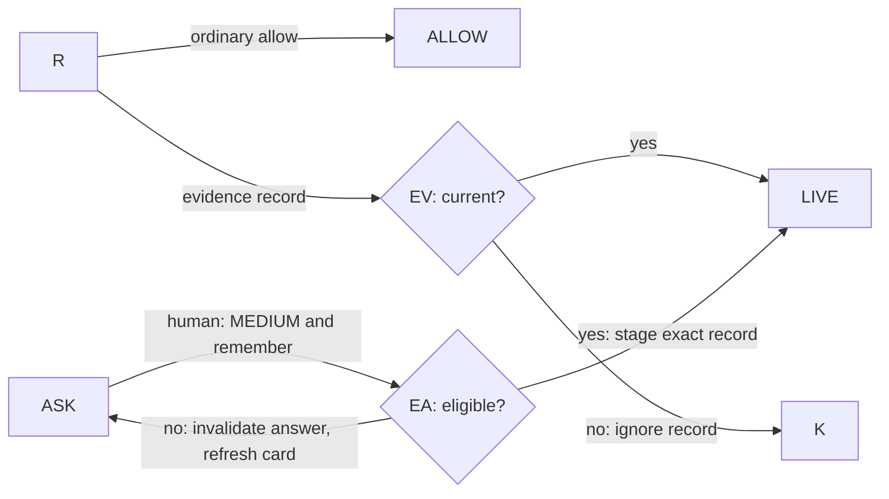

# Evidence-carrying re-adjudication

**Owner decision needed (2026-11-13).** Design only for [#333](https://github.com/ken-jo/ave/issues/333). The attached [permission decision tree](../architecture/permission-decision-tree.md) stays authoritative and unchanged. Decide the additions below before implementation.

## Decision-tree delta

At `4cd4afb63`, ordinary HIGH cards already support approval memory; the issue's blanket one-shot premise is stale ([gate](../../src/permissions/approval-gate.ts), [policy](../architecture/permission-policy-design.md#reviewer-failure)). Add an evidence-bound human disposition while preserving the classifier.

Preserve all branches and order, including `T → H → F → U → R → K → Q → RV` and `MC → RR → RV`. R checks rules/memory; K selects tool kind; ASK is the normal card; LIVE checks account/session/authority; 질문† is forced approval. New nodes: EV/EA. Only this delta applies:

`EV` runs **inside R's remembered-allow lookup**, after deny/ask rules. Evidence records never fall through to ordinary matching. `EA` revalidates eligibility/evidence after the human's ordinary-card response. Eligible: a plugin invocation whose sole HIGH reason is host-tagged `write path not declared`, with verified artifact identity and active filesystem/process confinement of its exact worker/child. Known outside-directory targets, untrusted network destinations, destructive/exfiltration findings, reviewer failures, other HIGH reasons and missing provenance are ineligible. Actual effects retain their gates.

Keep raw `max(rule, model)` HIGH. **MEDIUM enables only this exact remembered allow at R**; it never feeds RV or changes tool kind. No LOW. At `LIVE → ALLOW`, recheck authority/evidence/action, append required audit and atomically commit the staged record before handler entry. Failure denies without storing. Reuse retains LIVE/pre-effect guards. Model resubmission, parent authority, 질문†, headless and mode routes stay unchanged.

## Approval card

Use the existing host-owned card and verified local/owner-bound remote answer path. Show plugin/tool, exact input/project, HIGH reason, artifact/signer, containment dimensions and evidence status. Escape plugin text; no plugin-rendered controls.

| Element | 한국어 | English |
| --- | --- | --- |
| Heading | 근거 부족으로 HIGH로 분류된 요청 | Request rated HIGH because evidence is missing |
| Explanation | 호스트가 검증한 근거를 확인하세요. MEDIUM 재판정은 이 요청과 동일한 입력에만 적용되며, 실제 효과의 권한 검사는 계속됩니다. | Review host-verified evidence. A MEDIUM disposition applies only to this request and identical input; effect permissions still apply. |
| Default approval | HIGH 유지 · 이번만 허용 | Keep HIGH · Allow once |
| Explicit alternative | MEDIUM으로 재판정하고 동일 요청 기억 | Re-adjudicate as MEDIUM and remember this exact request |
| Denial | 거절 | Deny |

The alternative is unselected; disable it with a host reason when ineligible. It approves this invocation and remembers MEDIUM for identical input, without wildcard/session/global scope. Dismissal denies; existing owner-away waiting and ordinary approval choices remain. Evidence changes invalidate the answer; refresh without silently substituting Allow once. Manage/revoke in existing approval memory UI.

## Evidence and record verification

**Artifact identity, required:** current-generation `verifyPluginIntegrity` in [runtime](../../src/plugins/runtime/index.ts), backed by `verifyInstallReceipt`. Require marketplace origin and a host-trusted production signer; revalidate receipt/loaded artifact identity at consent/reuse. Historical `plugin_integrity_verified` rows, key names or first-party labels are insufficient. Reject absent/rejected/dev evidence. Provenance is not safety.

**Containment, required:** resolve the exact host-owned worker/child generation's live [sandbox capability](../../src/permissions/sandbox-capability.ts) and policy/root identity; require filesystem and process confinement. Shell settings, manifest claims and filesystem-only proof are insufficient. Network, secrets and nested effects retain their gates.

**Effect history, advisory:** [shadow logs](../../src/permissions/reviewer/risk-shadow-log.ts) are non-HMAC and cannot authorize or populate trusted history; initially show trusted history as unavailable. Future host-mediated observations must disclose coverage. `hostObservable:false`, empty history and past non-mutation never prove future read-only behavior.

Extend exact approval records with raw/effective verdict, human decision and host evidence digest/reference. Bind tool/source, canonical arguments, cwd and trust origin additionally to plugin/descriptor generation, artifact hash, trusted signer, static reason, confinement policy/root identity and permission-policy version. The host builds/compares these; the renderer submits only choice/request identity. Hashing plugin claims does not verify them.

Reload/restart, artifact/descriptor/policy change, signer revocation, integrity rejection, confinement loss or revocation invalidates the record and restores ordinary routing. Revalidate after waits/before effects. Never migrate existing approvals automatically. Use the protected approval store; audit raw HIGH, human MEDIUM, scope, digest and invalidation without secrets.

## Security and precedent

An attacker-controlled plugin can misdescribe calls, behave benignly during observation and cause repeated prompts. It cannot supply evidence, set MEDIUM, answer its card, widen this grant, inherit another principal's consent or authorize nested effects through this record. Admission, deny rules, forced floors, egress and secret leases remain enforced. Signed malicious code can still damage permitted resources after approval. Compromised hosts/renderers and sandbox escapes remain outside this guarantee.

**VS Code comparison (official docs checked 2026-11-13).** Per the owner's ambiguity rule, follow [tool approvals](https://code.visualstudio.com/docs/agents/run/approvals#tool-approval): inspect tool inputs, default to Allow Once, offer explicit broader scopes only where supported, honor manual-only policy, and let users manage/reset approvals. [Sandbox documentation](https://code.visualstudio.com/docs/agents/run/agent-sandboxing#understand-the-sandbox-boundary) separates approval from containment. Apply those properties here; evidence-bound risk re-adjudication is an Ave proposal, not a documented VS Code feature.

## Smallest implementation

1. Obtain the owner decision on EA/EV, MEDIUM-only scope and mandatory evidence; then update the canonical tree and owning policy together.
2. Add host evidence eligibility/identity and exact-record invalidation using existing runtime, capability and approval stores. Leave shadow-history promotion out.
3. Extend the shared pending-card/IPC schema, validators, preload, guarded handler, renderer and ko/en catalogs together. Preserve sender, live-authority and audit checks.
4. Test valid consent/reuse/revocation, every missing evidence input, tampering, reload/sandbox-loss races, explicit ask/deny/質問†/headless parity and nested-effect isolation; run the changed card's background E2E, relevant lock suites and typecheck. No product implementation in this PR.
