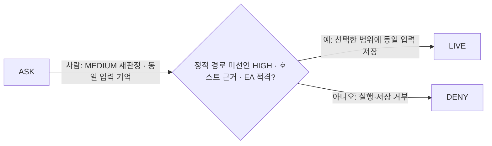

# Evidence-carrying re-adjudication

**Owner decision, 2026-11-13: “EA 만 채택”.** [#333](https://github.com/ken-jo/ave/issues/333) adopts human-only EA and rejects EV. The [permission decision tree](../architecture/permission-decision-tree.md) owns routing. Existing decisions and ordinary card choices stay unchanged unless the person explicitly selects EA.

## Exact tree delta

Add only these edges beside ASK's existing approval response; every existing node, edge and order remains unchanged:

EA validates the host-owned pending request and evidence when the person chooses re-adjudication. Only a plugin invocation whose sole HIGH reason is the host-proven static `write path not declared` is eligible. Missing evidence or provenance, known outside-directory targets, untrusted destinations, concrete destructive/exfiltration findings, other HIGH reasons, forced floors, one-shot requests, headless creation and reviewer failures are excluded. A displayed reason string or plugin claim cannot establish eligibility.

Raw `max(rule, model)` remains HIGH. The human's MEDIUM disposition authorizes this invocation and an exact-input remembered allow at the existing R stage; it never feeds RV, changes tool kind or grants nested effects. LOW is out of scope. Existing local/owner-bound remote consent, live account/session/authority, audit and execution checks remain. Failed EA denies execution and storage; it never silently becomes Allow once.

## Approval card

Use the existing host-owned normal card. Show tool/plugin, exact input and project, static HIGH reason, verified artifact identity and recorded signer metadata. Escape plugin text; plugin-rendered controls cannot grant consent.

| Element | 한국어 | English |
| --- | --- | --- |
| Unselected option | MEDIUM으로 재판정 | Re-adjudicate as MEDIUM |
| Explanation | 호스트가 검증한 근거는 이 입력에만 적용됩니다. 기억할 범위를 선택하세요. 실제 효과의 권한 검사는 계속됩니다. | Host-verified evidence supports this exact input. Choose how long to remember it; effect permissions still apply. |
| Ordinary default | 이번만 허용 | Allow once |
| Rejection | 거절 | Deny |

The option exists only when the host supplies eligible evidence. A person must select it explicitly; sentence suggestions, scope selection and model output never select it. It affects lasting allow only, using the existing session/project/global scope choices. Allow once and Deny keep their ordinary meaning. Reset the option when the request changes. Dismissal denies; owner-away waiting is unchanged. A save failure, including a refused home, leaves no remembered authority or successful ordinary response. Existing approval memory UI manages revocation.

## Host evidence and exact memory

**Static provenance:** retain the classifier's matched rule through host-private issued evidence. Display wording can replace the reason, so comparing renderer text is insufficient. The gate binds evidence to the pending tool, plugin, final input, trust origin and cwd; the renderer sends only its choice and request identity.

**Artifact identity:** use the load-time `verifyPluginIntegrity` result retained for the invocation's pinned runtime instance in [runtime](../../src/plugins/runtime/index.ts). Require signed-marketplace receipt provenance, artifact hash and nonblank signer metadata. `verifyInstallReceipt` checks covered payload against the host-trusted stored receipt; it does not reauthorize a signer against current keys or refresh signature verification. Historical audit rows, labels and plugin claims are insufficient; unsigned/dev/missing evidence is absent. An admitted pinned generation may finish after replacement under existing lifecycle/effect guards. Provenance does not prove safety.

**Sandboxing stays separate:** actual worker/child confinement is context, not EA eligibility. An absent sandbox does not disqualify EA; shell settings and manifest claims grant no containment. Sandbox, network, secret and nested-effect permissions remain independent execution boundaries.

**Effect history:** [shadow logs](../../src/permissions/reviewer/risk-shadow-log.ts) are non-HMAC and cannot authorize or populate trusted history. Empty history, `hostObservable:false` and past non-mutation never prove future behavior. No trusted-history promotion is needed.

Store EA records in a dedicated namespace with historical HIGH, effective MEDIUM and the host evidence reference. Match exact tool/plugin ID, canonical input and trust origin within the user's chosen session/project/global scope and applicable cwd identity. Tool-wide cache keys cannot broaden input coverage. Evidence records never fall through to ordinary allow matching; old approvals are not migrated.

**No EV:** reuse reads that dedicated exact record through R, without rechecking artifact/generation, evidence, confinement or rule risk. Scope expiry and explicit revocation end the grant. Evidence changes do not automatically revoke it. Existing admission, deny/ask rules, forced floors, live authority and effect checks still run; they are independent enforcement, not evidence revalidation.

## Security and comparison

An attacker-controlled plugin can misdescribe calls, behave benignly during observation and cause repeated prompts. Its wire/API claims cannot mint host evidence, select MEDIUM, answer a card, widen the exact record or inherit another principal's consent. EA changes no OS isolation: unconfined code retains its existing host access. Signed code can still damage permitted resources after approval. Remembered consent outlives its evidence; the user controls scope and revocation. Compromised hosts/renderers and sandbox escapes remain outside this guarantee.

The owner's reference is [VS Code tool approvals](https://code.visualstudio.com/docs/agents/run/approvals#tool-approval), checked 2026-11-13: inspect inputs, choose one-use or supported broader approval scopes, and manage/reset saved approvals. Approval and sandboxing are separate layers. The owner adopts that scope model here with no reuse evidence revalidation; EA risk re-adjudication is an Ave feature, not a claim that the reference implements it.

## Smallest implementation and validation

1. Preserve classifier results; retain host-only static provenance and pinned-generation receipt evidence for EA creation.
2. Add the card opt-in, shared payload, guarded save and dedicated exact-memory namespace. Reuse needs no evidence provider, new settings or EV stage.
3. Cover eligible creation and every exclusion, forged input, exact scope/revocation, save failures, unchanged ordinary choices and reuse after evidence changes. Freeze existing decision fixtures before implementation and require zero differences.
4. Run targeted permission/card tests, typecheck, unused-code/lint gates, packaging/script lock suites and the approval-card background E2E. No skips, retries, raised timeouts or default-value fallbacks.
