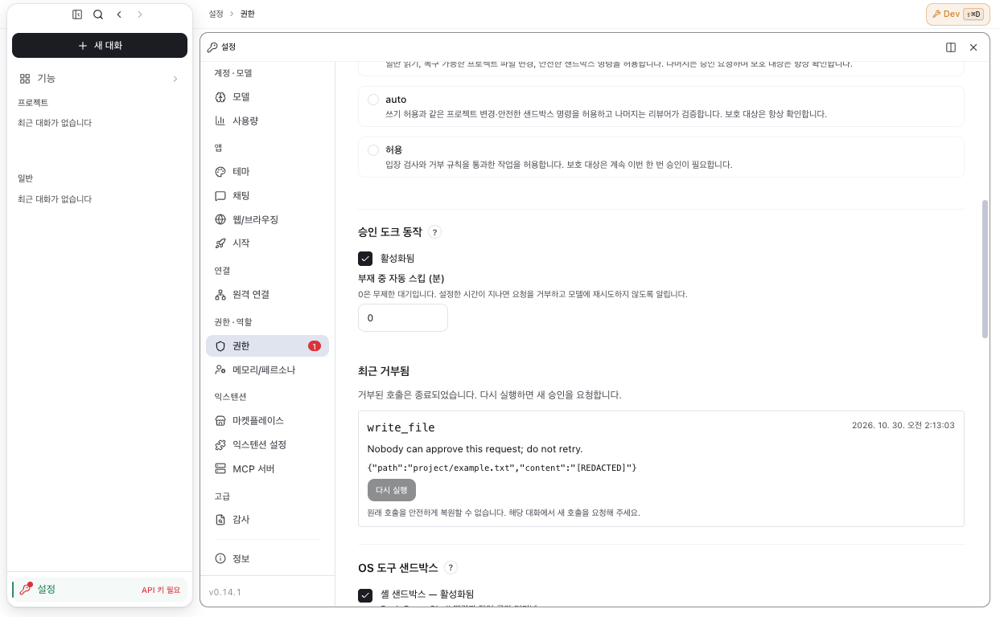

# Permission pipeline validation record

Snapshot: 2026-10-30, working tree on `feat/permission-pipeline-v4`. The [approved decision tree](../architecture/permission-decision-tree.md) defines behavior; the [97-site inventory](permission-decision-inventory.md#current-source-reconciliation) records current source ownership and retained boundaries. These results describe the inspected working tree before the final publish gates. They do not certify a release or future CI result.

## Targeted results

| Scope | Observed result | Evidence and limits |
| --- | --- | --- |
| Core decision matrix, native executor, authorization and escalation | 10,589 passed across 5 files | `core-final.log`: pure matrix and boundary cases plus actual executor/authorization paths. Escalation cases use controlled issued evidence; they do not establish native Linux denial attribution. |
| Replay reconstruction, root binding and manager | 52 passed across 4 files | `replay-manager-final.log`: saved invocation references, fresh permission entry, exact input/root identity and manager integration. Persisted references are not stored grants or executable-input copies. |
| Scoped rules and redirect boundaries | 75 passed | `redirect-final.log`: full scoped-rules suite after earlier redirect failures were fixed. A preceding single-case filtered run is not counted as another 75 passes. |
| IPC grants, effect ledger and terminal authorization | 16 passed across 3 files | `consumer-final.log`: egress-grant IPC, host-observed effect ledger and terminal authorization-required behavior. |
| Changed desktop flows | 6 unique cases passed | `ui-e2e.log` initially had 4 passes and 2 navigation-fixture failures. After fixture corrections, `ui-e2e-recheck.log` passed the 2 affected cases and repeated 1 already passing navigation case. The repeated case is counted once. |

These are separate targeted runs. Their totals are not a fresh whole-suite result, and overlapping cases are not additional unique coverage.

## Built-app and visible evidence

The isolated built app was exercised through the desktop test harness and CDP. The captured permissions view shows the owner-away value `0` with its unlimited-wait explanation, a DLP-redacted recent denial and the no-retry reason. The seeded entry has no safely resolvable original invocation, so its rerun control is disabled; this screenshot does not prove the valid persisted-reference rerun path. That path has separate reconstruction and executor tests above. The inspected capture contains no account email.

The screenshot and CDP assertions establish the displayed state in that isolated build. They do not establish production authentication, every native backend or a packaged installer result.

## Remaining gates and decisions

- Final integrated typecheck: passed (`typecheck-final.log`).
- Full app build, isolated built-app/CDP exercise and final main-process build: passed in the lead validation lane. The screenshot above records the inspected visible state.
- Pre-push gate: pending. No future CI or publish result is asserted.
- Native filesystem-denial attribution is supported by the macOS monitor. Installed Linux diagnostic-attempt records are deliberately rejected as escalation authority, so Linux retains the original failure. The owner decision remains pending: accept this limitation or require a trusted Linux supervisor before delivery. Controlled Linux executor cases prove orchestration only.
- Related terminal work [#308](https://github.com/ken-jo/ave/pull/308) remains open in this handoff; this record does not count it as landed verification.
- The external design source has three-way drift relative to the committed contract and implementation. Its proposed surface selectors remain pending owner confirmation; this record does not revise the immutable tree.
