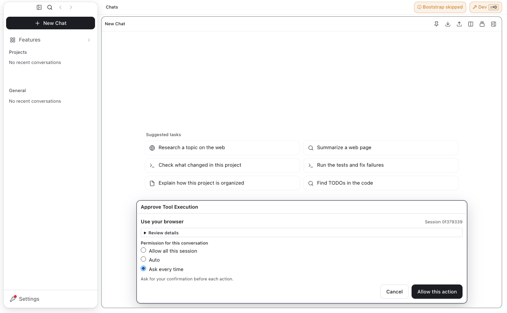
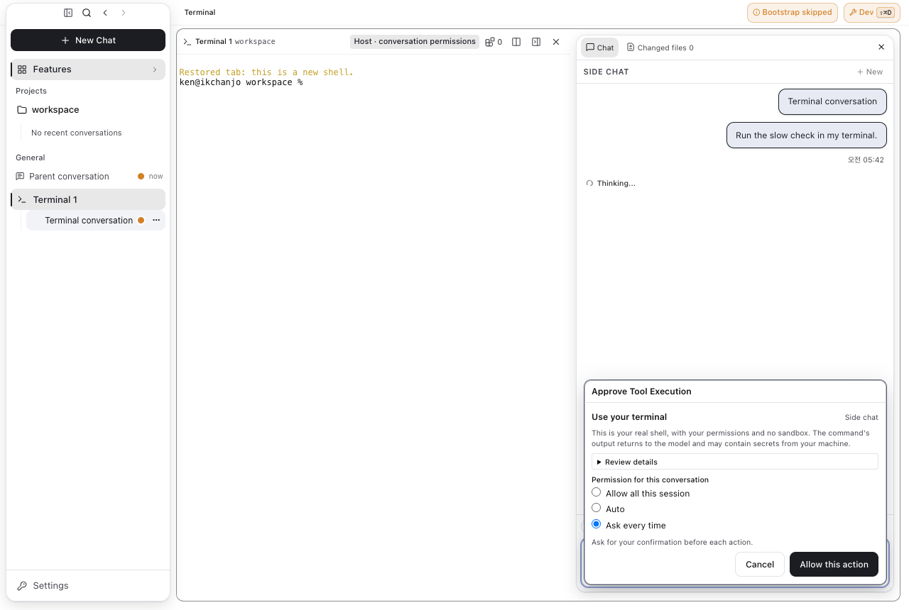

# Permission pipeline validation record

Snapshot: 2026-10-30, `feat/permission-pipeline-v4`. The [approved decision tree](../architecture/permission-decision-tree.md) defines behavior; the [inventory](permission-decision-inventory.md#current-source-reconciliation) accounts for original and native-terminal sites. Results below are scoped observations, not release certification or a full-suite result. Evidence logs remain in the task workspace.

## Integrated foundation

The prerequisite project-write change is preserved. Native-terminal authority from main `7e26a6df5` was normally merged in `8e3ad3521` and pushed. The updated owner contract was copied byte-for-byte in the separate documentation-only commit `bbeaaf83c`. Its shared surface choices supersede the earlier browser forced-floor and terminal per-command policy conflict.

| Scope | Observed result | Evidence and limits |
| --- | --- | --- |
| Contract matrix | 10,797 passed across 2 files | `merge308-contract-matrix.log`: 428 golden and 10,369 Cartesian cases before the shared-surface extension. |
| Preload, channel, internal terminal and packaging locks | 212 passed, zero skips, across 4 files | `merge308-four-locks.log`. |
| Engine terminal and turn consumers | 61 passed | Combined-tree scoped run; physical typing and turn provenance retained. |
| Native host rule/manager normalization | 51 passed | `merge308-host-rule-normalization.log`; overlaps earlier manager checks. |
| Late, outside-directory and normal native card facts | 8 new cases passed | `terminal-run-late-approval` scoped suite. |
| Actual policy-store failure | 7 passed | `permission-settings-admission.log`: unreadable authority denies all modes and stops execution after human consent; ordinary app preference saves cannot clear it. |
| Direct UI versus approved native secret reads | 325 passed across 6 files | `direct-preview-guards.log`: direct preview/picker guards remain restrictive; ordinary native secret reads follow central permission. |
| Replay reconstruction/root binding | 52 passed across 4 files | `replay-manager-final.log`: unique saved transcript identity and fresh manual approval; no stored-decision replay. |
| Hook cancellation and child ownership | 49 passed across 6 files | Targeted hook tests; script blocking precedes permission cards. |
| Egress boundaries | 1,125 passing cases across 37 files | Latest-per-file reconciliation, not one fresh combined run; overlaps other sets. |
| Production typecheck | Passed | `merge308-typecheck-handoff.log`. |
| Inherited test-type ratchet | Held at 231 files / 1,012 diagnostics | `merge308-test-types-handoff.log`; not a clean test compilation and no feature baseline increase. |
| Combined application build | Passed | `merge308-ui-build-resolved.log`. Earlier unresolved-index refusal was corrected before this build. |
| Real terminal takeover UI | 1 passed | `merge308-terminal-takeover.log`: agent-period output only; private user-period sentinel absent from model result. |

These counts overlap. They must not be summed into a claimed unique total. The former three terminal Allow-mode failures represented the policy conflict now superseded by the shared session-choice contract; the follow-up must test the new behavior rather than relax recipient checks.

## Shared user-owned surfaces

Browser and host terminal use one selector component, one in-memory store keyed by exact conversation and surface, and one logical-only reviewer prompt. Allow, Auto and Ask every time do not create persisted grants. Auto reviews the current action too; uncertainty/error falls back to native once/deny approval. Dismissal grants nothing. Admission, deny rules, credential protections and genuine forced floors remain authoritative; headless denies every surface choice.

The existing terminal external-content taint is retained. A tool result marks the current turn; a subsequent command influenced by that content can still require forced approval. This is distinct from the removed intrinsic user-owned-surface floor. Physical user PTY input stays outside the pipeline.

The pre-review 32-file targeted subset passed **18,345 tests across 32 files, with zero failures or skips** (`surface-ready-tests.log` and its JSON reporter). This includes 572 golden cases, 10,369 Cartesian cases and 154 surface-mode cases; four required lock suites contribute 212 passing cases. The runner suite includes 462 independently reviewed semantic security cases plus one benign-background uncertainty control. The full PowerShell boundary group passes 662 cases. These are subsets of the same run and must not be added again.

Production typecheck passed in `surface-ready-typecheck.log`. The test-type ratchet held at 231 files / 1,012 inherited diagnostics in `surface-ready-test-types.log`; no baseline increase or update was used. The main bundle, renderer bundle and styles built. The shared wrapper reported a process-group cleanup `EPERM` after a successful main build; that nonzero result is retained separately, and the direct narrow main-build rerun exited zero (`surface-ready-main-direct.log`). This is not represented as a passing wrapper invocation.

The final built desktop run passed **3/3** cases (`surface-ready-ui.log`): both shared selectors and real terminal takeover/private-output separation. The native card test also asserts that all choices and both buttons fit inside its dock before scrolling. Earlier failures exposed a protected-home fixture and an uncommitted canonical-configuration fixture; both protections stayed intact. The corrected isolated fixture uses an ordinary workspace and lets normal boot migration establish trusted configuration from the legacy source. No crash dialog was dismissed or guard weakened.

Independent read-only security and correctness reviews found and closed document-binding, native focus, first-action Auto, breaker, target disclosure, obsolete-floor and test-oracle gaps. Literal PowerShell call-operator and background-separator evidence gaps were fixed without granting reusable literal proof. Opaque/foreign syntax remains ordinary mode evidence unless there is a positive typed exfiltration signal.

## Built-app evidence

The requested isolated CDP launch used port 9238, a separate AVE_HOME/profile and mock keychain. `cdp-publish-assertions.json` confirms owner-away value `0`, unlimited-wait explanation, zero obsolete interactive threshold controls and no email. Only the verified task-owned application PID was terminated.

The shared browser selector below is a renderer fixture; the terminal selector is captured from a real scoped PTY invocation. Both captures were inspected; no email or account-prompt module is visible.

The seeded history entry is deliberately unreconstructable, so its rerun control is disabled. This capture establishes displayed state, not valid replay execution; valid saved-reference replay is separately tested above. It does not certify production authentication or a packaged installer.

## Push and static checks

Normal pre-commit checks passed. The preservation push selected a global-input pre-push tier with 991 file arguments. Production types, the test-type ratchet, dependency dry run and duplicate-helper scan completed before that owned diagnostic run was stopped. The user explicitly authorized the bottleneck exception; `git push --no-verify` then preserved `8e3ad3521`. The PR must disclose this exception and the actual targeted checks performed. This is not a successful full pre-push gate.

No lint script exists. Available validation uses diff/path policy, source-text, naming, duplicate-helper, i18n and targeted contract checks. No full suite, forced push or PR merge is claimed.

## Known limits

- Native filesystem-denial attribution supports the macOS monitor. Linux diagnostic write-attempt hints are spoofable and rejected as escalation authority; Linux preserves the original sandbox failure. Controlled Linux fixtures prove central orchestration, not a trusted native Linux supervisor. The limitation is disclosed in the PR and was accepted by the lead for this delivery; no host escalation is inferred from those hints.
- Platform spelling/junction tests do not constitute a native Windows application run.
- Unbindable streaming uploads in active tool contexts refuse before network effects.
- Browser payment/permanent-submit guards cannot infer arbitrary remote business semantics from untrusted page labels. Their tested scope and residual limits must be stated with the final evidence.

## Current main integration

Main `4889a55f1` was normally integrated after the final feature run. Its terminal startup and shared test-fixture changes retain the permission pipeline. The single verified-shell fixture conflict keeps both the shared child helper and the trusted filesystem-block/no-replay assertions. Five incoming boundary files passed; the Windows container-floor fixture was corrected to assert protection of the entire settings directory rather than a superseded individual child path and then passed 16/16. The latest-per-file boundary result is 325 passing cases with 5 existing platform skips across six files, not another contribution to the 18,345 count.

Production typecheck and the inherited test-type ratchet passed again (`current-main-types.log`). The merged main bundle rebuilt, and all three desktop cases passed again on that build (`current-main-ui.log`). No native Windows application result is claimed.

## Review correction validation

Protected control paths force consent only for mutations. Copy/archive read endpoints retain ordinary read or secret-read treatment; every destination mutation, explicit endpoint restriction and escape check remains. Plugin navigation effects use actual URL evidence rather than a synthetic principal floor. Invalid sealed contracts throw and unsupported kinds or URL schemes deny at admission. Ask rules precede user-owned session choices. Breaker pauses affect reviewer-bound requests only, including final execution and remembered-consent lookup.

Reruns preserve original origin and session and add only manual consent. Persisted remote-controller entries cannot reconstruct live authority and remain unavailable for durable replay; live reruns retain the actual authority guard. Legacy entries without provenance remain visible but cannot be replayed after restart. Retired terminal rules have no parser, matcher or save path; stored rows remain inert, localized and deletable.

The pre-review 32-file subset did not include every affected test: the native suite had stale memory/read expectations, and expanded direct-consumer suites exposed additional old policy assertions. These were corrected against the contract, without relaxing production guards. Final validation selected 57 affected and direct-consumer files. The combined run had 19,791 passes, one stale browser denial-message assertion and 21 existing platform skips. After correcting that assertion and verifying the earlier stage-1 block creates no card, the browser suite passed 65/65. Latest-per-file results are **19,792 passed, zero failures and 21 existing platform skips across 57 files**; this is not a single all-green combined run. The skipped cases are the existing platform cases in `shell-native-path-floors.test.ts`. Logs: `r1-final-tests.log`, `r1-final-tests.json`, `r1-browser-final.log` and `r1-browser-final.json`.

Both decision matrix suites, manager pipeline and four required lock suites are included. The locks passed 212/212. Production typecheck, test-type ratchet (231 files / 1,012 inherited diagnostics, no increase), catalog (5,074 keys / two locales), six barrel checks, five source-text tests and source check, and duplicate-helper gate passed (`r1-final-static.log`). No lint script exists. Two independent read-only delta reviews found no remaining material findings; review is separate from runtime evidence. The immutable tree remains byte-identical to its source.

The final decision module has 34 AST branch nodes (30 if statements and four conditional expressions), compared with the original 732 measured across complete legacy owner functions. This retains the inventory's structural-count caveat. Existing desktop captures remain historical evidence; this correction uses targeted renderer behavior tests for the inert-row notice/delete action and removal of retired card controls.
