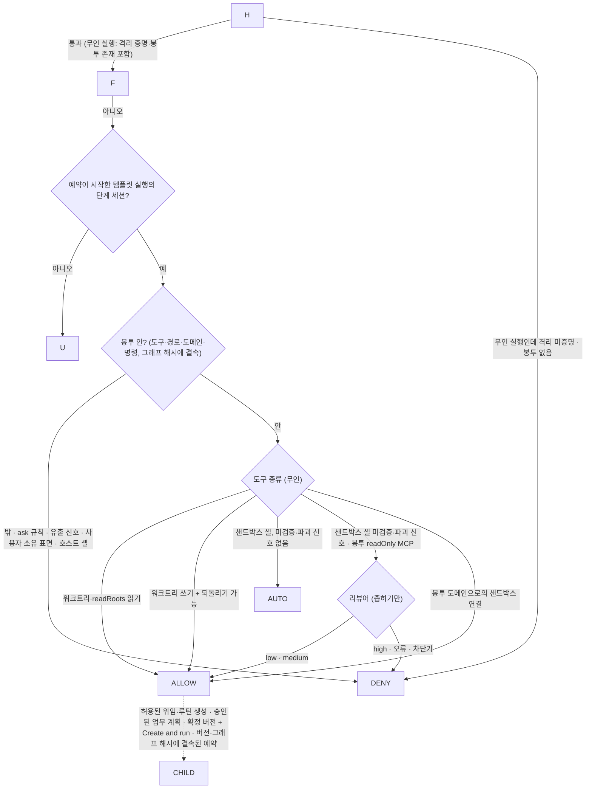

# Design review: running Ave work safely with no human approval

> Owner decision 2026-11-16: OD-1 A, OD-2 B (with the read-only interim limit for WT-8), OD-3 B, OD-4 A — see [decisions.md](decisions.md). Item numbers here follow decisions.md (the review itself is WT-14).

Date: 2026-11-16. Read-only review against Ave main `c2214d704`.
Permission tree (attach to every brief that follows from this review): `docs/architecture/permission-decision-tree.md` in a current `ken-jo/ave` clone.
D1–D9 and W1 are taken as decided. Nothing below reopens them.

## 1. Short answer

Do not relax the headless rule. Add a separate lane for one kind of session only: a stage child of a template run that a schedule started. In that lane no call ever asks. A call is allowed only when all three hold, and is otherwise denied with "do not retry":

1. it is inside a **capability envelope** the owner confirmed with the template version (part of the graph hash);
2. the effect runs inside a **proven OS sandbox and the stage worktree**, with no host shell, no secrets and deny-by-default egress;
3. it has **no outward-facing effect**. Results leave the run only as a host-made branch or diff and as requested outputs that wait at a human gate.

The envelope is a ceiling the owner declared. The sandbox is the boundary. The reviewer only narrows. Budgets stop a run that goes wrong. This is the same shape as the four reference hosts, which all make unattended runs safe by environment and by deferring writes, not by approving calls.

## 2. What happens today (baseline)

"Everything is denied" is not quite what the tree and code do. From `src/permissions/decision-pipeline.ts`, `src/engine/turn/tool-scope.ts` and the tree:

| Call in a session with no approver | Default (strict) | Allow writes | auto | Allow |
| --- | --- | --- | --- | --- |
| Ordinary read, readOnly MCP | allow | allow | allow | allow |
| In-project write with checkpoint | deny | **allow** | **allow** | allow |
| Sandboxed shell, no unproven or destructive signal | deny (read-only proven: allow) | **sandbox-auto** | **sandbox-auto** | sandbox-auto |
| Network, other MCP, outside-project write, host shell, escalation, secret read | deny | deny | **reviewer decides first**; low or medium allows | **allow** |
| 질문† floors, user-owned surface, agent browser, exfil signal | deny | deny | deny | deny |

Three findings follow.

- **F1. The ambient mode decides what an unattended run may do.** This follows the tree (`Q -->|허용 모드| ALLOW`): `applyMode` returns allow in the Allow mode without reaching the no-approver deny (only the exfil signal is checked first), and the mode matrix marks the headless cell for Allow "n/a". If a scheduled stage child runs under the owner's ambient mode, an owner who works in Allow mode gets host shells and network at night with nobody present. Whether the child takes the ambient mode was not verified. The lane in section 5 removes the question by not consulting the mode. This review does not propose changing Allow mode for other headless sessions such as `--exec`.
- **F2. In auto mode an LLM is the only check** on network, MCP and host-shell calls of an unattended run (resolved conflict 6). The reviewer reads content the run fetched. Claude Code's own action documents the same limit: "Auto mode is a review, not a boundary" [S6].
- **F3. Sandbox reads are broad.** `permission-policy-design.md` says "Reads remain broad. This policy adds no sandbox read denies" beyond the Ave home and the sensitive-path floor. Broad reads plus any allowed destination is an exfiltration path.

Existing pieces the design reuses: the headless tool scope already removes MCP and arbitrary-egress builtins (`includeMcp`, `includeEgress` are false when headless); the shell egress allow-list starts empty and goes through the local proxy; routine scope defaults to plugin deny-all; `withholdSessionAuthority` keeps a scheduled turn from inheriting the chat's grants; a Linux operator-container attestation exists for `--exec`.

Not verified: which mode and which approval-surface state a stage child of a routine-started run receives, because WT-3 and WT-8 are not built. The design below removes the dependency on both.

## 3. Reference hosts (primary sources, fetched 2026-11-16)

Every quote was matched against the fetched page text. Source keys are in section 9.

| Host | How an unattended run is made safe | Evidence |
| --- | --- | --- |
| Claude Code, `-p` | A call that needs approval is denied, not asked. Allow rules or `--allowedTools` pre-authorise. `dontAsk`: "anything that would prompt is denied", for "Locked-down CI and scripts". `bypassPermissions`: "Isolated containers and VMs only". | [S1] [S2] |
| Claude Code, auto mode | Classifier blocks by default "Sending sensitive data to external endpoints", "Force push" and more. Breaker "3 times in a row or 20 times total". Non-interactive: "has no prompt to fall back to". | [S1] |
| Claude Code, sandbox | "Claude Code approves a command automatically, with no prompt, when the command runs inside the sandbox." "allowed domains start empty". Limits it states: "This default still allows reading credential files"; the proxy "does not terminate or inspect TLS traffic", so domain fronting can pass; "Allowing broad domains such as `github.com` can create paths for data exfiltration." `allowUnsandboxedCommands: false` removes the unsandboxed retry. | [S3] |
| Claude Code, cloud and dev container | Cloud: "git credentials and signing keys stay outside the sandbox, and a proxy authenticates on the session's behalf with scoped credentials"; network "limited by default". Dev container: with skip-permissions it does "not prevent a malicious project from exfiltrating anything accessible inside the container". | [S4] [S5] |
| claude-code-action | "can only be triggered by users with write access to the repository". "Auto mode is a review, not a boundary". "Do not use a personal access token". | [S6] |
| Codex `exec` | "By default, `codex exec` runs in a read-only sandbox." `--full-auto` "is no longer supported"; use `--sandbox workspace-write`. `danger-full-access` "only in a controlled environment (for example, an isolated CI runner or container)". | [S7] |
| Codex sandbox and approvals | workspace-write "keeps network access turned off unless you enable it". "`<writable_root>/.git` is protected as read-only". `-a never` with a sandbox: "it never asks for approval". `approvals_reviewer = "auto_review"` "applies when approvals are interactive". | [S8] |
| Codex cloud | "Setup scripts still run with internet access"; "By default, Codex blocks internet access during the agent phase." "restrict network requests to `GET`, `HEAD`, and `OPTIONS`". Names the risk: "Prompt injection from untrusted web content", "Code or secret exfiltration". | [S9] |
| codex-action | `safety-strategy` values: "`drop-sudo` (default) — On Linux and macOS runners, the action revokes the default user's `sudo` access before invoking Codex", `unprivileged-user`, `read-only`, and "`unsafe` — No privilege reduction". An `allow-users` input exists for who may trigger. | [S10] |
| VS Code agents | "Commands that run inside the sandbox are approved automatically." "Terminal auto-approval is a best-effort convenience, not a security boundary." "Approving a request does not approve its response." Sandbox "is not a virtual machine or user-account boundary" and "does not replace the isolation provided by cloud sessions or Dev Containers". "Turning on sandboxing does not block outbound network access by default." Allow all and Autopilot "skip approval prompts, but an enabled sandbox still restricts terminal file system and network access"; the risk is stated as "Bypasses all user approvals". Scheduled unattended work is pointed at cloud automations: "Review cloud automation security and usage before enabling unattended work." | [S11] [S12] [S13] |
| Copilot cloud agent | "only has the ability to push to a single branch"; "a new copilot/ branch is created … the agent can only push to that branch". "Draft pull requests … must be reviewed and merged by a human." "workflows are not triggered until" the code is reviewed. The requester cannot approve the PR. Firewall: "applies to processes started by the agent through its Bash tool"; disabling it means "increasing risks of exfiltration". | [S14] [S15] |
| GitHub Agentic Workflows | "The agent job runs with minimal read-only permissions"; "write operations are deferred to separate jobs that execute only after the agent completes." "Safe outputs separate action requests from execution." Egress through a "configurable domain allowlist". Detection is "defense in depth, not proof". | [S16] [S17] |
| GitHub Actions | Default token "read access only for repository contents"; "Avoid using the `pull_request_target` workflow trigger if it's not necessary." | [S18] |

Common pattern: (a) nothing asks; a call is pre-authorised or denied; (b) the environment is the boundary, and the LLM reviewer is described as a review; (c) the network is off or allow-listed by default; (d) credentials stay outside the agent; (e) writes that leave the environment are produced by a separate, human-gated step.

### Where "when permissions are ambiguous, follow VS Code" applies

VS Code's hands-off local answer is a permission level, not a design for an absent owner: "Allow all and Autopilot skip approval prompts, but an enabled sandbox still restricts terminal file system and network access", with the caution that they "skip confirmation for potentially destructive actions, including file edits, terminal commands, and external tool calls" [S11]. For scheduled work with nobody present it points at cloud automations [S12]. Following VS Code literally would therefore be option O7 plus the sandbox: remove approvals and rely on the sandbox. The owner ruled out a relaxation, so the rule does not decide the core question. What it does confirm is that the sandbox, not the approval, is the part that still holds when approvals are gone. It also decides four ambiguous points, and the design follows it on each:

1. Sandboxed commands are approved automatically. This is Ave's existing `SB → AUTO` edge; keep it in the unattended lane.
2. A command allow-list is "not a security boundary". The envelope's command list is therefore a ceiling and a statement of intent. The sandbox stays the boundary.
3. "Approving a request does not approve its response." An envelope domain makes the connection allowed. The fetched content stays untrusted and carries taint into later stages (D7).
4. Grants are scoped to the session. The envelope is scoped to the run and never becomes a saved rule.

Where VS Code is looser than Ave (sandbox network open by default, Allow all and Autopilot with a warning, no envelope), Ave keeps its stricter default. This is a deliberate departure from the rule and is put to the owner as OD-2.

## 4. Options compared

Threat columns: INJ = prompt injection through fetched or repository content; REPO = a malicious repository (hooks, build scripts, git filters); EXF = exfiltration; DEST = destructive local effects. Cost is in work-plan items; WT-15 to WT-18 are new items proposed in section 6.

| Option | Tree nodes or edges changed | INJ | REPO | EXF | DEST | Build cost |
| --- | --- | --- | --- | --- | --- | --- |
| **O0. Status quo (D8 as written)** | None. | Open in auto mode (F2) and, if the child takes the ambient mode, in Allow mode (F1). | Sandboxed shell runs repo code; host shell possible in Allow mode. | Open in Allow mode; reviewer-only in auto. | Bounded to project writes with checkpoint; open in Allow mode. | 0. Unsafe in two modes, near-useless in Default. |
| **O1. Capability envelope only** | New nodes `UN`, `EV` after `F`; new edge `EV → DENY` for outside; `Q` is never reached; `R` allow rules and remembered grants not consulted in the lane. | Injected text can still use everything inside the envelope. | Open if the envelope lists a host command. | Open through any listed domain or MCP tool. | Bounded by listed paths. | WT-1, WT-2, WT-11 extended; WT-15 new. |
| **O2. Proven sandbox and worktree only** | `H`: admission refuses the run without sandbox proof. `SB → Q` for host shell becomes `→ DENY`. No envelope. | Injected text controls a confined process. | Contained to the worktree; host-side git operations stay exposed unless hardened. | Closed while egress is empty; reads still broad (F3). | Contained to the worktree. | WT-4, WT-8 extended; WT-16 new. Useful only for offline stages. |
| **O3. LLM reviewer as the gate** | `Q → RV` reused; `RV → ASK` becomes `→ DENY` (already so when headless). | The reviewer is the target. | Reviewer sees command text, not what a script does. | Probabilistic. | Probabilistic. | Small. Not a boundary on its own [S6]. |
| **O4. Deferred outward outputs** | `CHILD` edge and Work approvals note: outputs are work objects decided at a gate. No tool-call edge. | Injection can shape a result, but a person reads it before it leaves. | Same. | Closes the push, send and publish channels. | No effect. | WT-3, WT-4 extended; WT-17 new. |
| **O5. Budgets and breakers** | None in the tree (scheduler predicates; D6 untouched). | Limits how long an injected run continues. | Same. | Limits volume, not the first leak. | Limits repetition. | WT-18 new. |
| **O6. Disposable container or VM** | `H`: run admitted only with an attested disposable environment. | Contained to a throwaway copy. | Best containment. | Still needs the egress allow-list. | Best: nothing local to destroy. | Large. Linux attestation exists; macOS and Windows need a VM runtime. |
| **O7. Relax: Allow mode or reviewer-approved asks unattended** | `Q -->|사람 없음| DENY` weakened. | Open. | Open. | Open. | Open. | Small. Rejected: it is the relaxation the owner ruled out. |
| **Recommended: O1 + O2 + O4 + O5, with O3 narrowing only** | Section 5. | Injected text can act only inside the envelope, inside the sandbox, and cannot send anything out; residual below. | Contained to the worktree; host git hardened. | Residual: a listed domain is a channel; reads are narrowed to reduce what it can carry. | Contained to the worktree and undoable. | WT-1, 2, 3, 4, 8, 11, 12, 13 extended; WT-15, 15, 16, 17 new. |

## 5. Recommended design: the unattended run lane

### 5.1 Q1 — what authorises the stage children

The authority is a new, fourth source on the `CHILD` edge: a **schedule attachment**, which is a work approval.

- The existing "allowed routine creation" source is not enough. The `routine_schedule` tool's approval is an ordinary write card whose remembered key covers only the action, the chat connection and the plugin scope (`routineScheduleApprovalCacheKey`), and it can be remembered for the session. It binds to no template, version or hash, and a model can call it. That tool must not be able to attach a schedule to a template.
- Attaching a schedule to a template is an owner decision on a host work object, of the same class as a plan approval: a keyboard gesture in the desktop window, or a Tailnet decision under D3. It binds to `(templateId, version, graphHash)`. The graph hash covers the envelope (5.2), so it also binds the envelope. It is audited with its origin.
- A scheduled fire may create only the stage children of that pinned version. If the stored version's hash differs, the run refuses to start (the existing pinning rule).
- A scheduled fire is not a `Create and run` gesture and does not borrow D1 B. D1 B stays the source for attended starts.
- Confirming v2 does not move a schedule. The schedule keeps running v1 until the owner re-attaches it. This closes the path where a new version (possibly drafted from injected text and confirmed in a hurry) silently changes what runs at night. The editor shows "2 schedules still use v1".
- For scheduled runs `beginRun` reads the pin from the schedule, not the template's current version. This is the one place this design differs from notes-r6 (a), which pins "the version current at that moment"; that rule stays for attended runs.

### 5.2 The capability envelope

Per stage, stored in `TemplateStage` and inside `graphHash`:

```ts
interface StageEnvelope {
  tools: string[];                 // exact builtin tool names; never broader than toolScope
  writePaths: string[];            // globs relative to the stage worktree; default ["**"]
  readRoots: string[];             // extra read-only roots outside the worktree (toolchains, caches); default []
  network: { host: string; port?: number }[];   // egress allow-list for this stage's sandboxed shell; default []
  commands: string[];              // command prefixes the stage is expected to run; a ceiling, not a boundary
  mcpReadOnlyTools: string[];      // "server.tool" names that declare readOnlyHint; default []
  outputs: OutputKind[];           // what the stage may request for the human gate (5.4); default ["branch"]
  budget: { rounds: number; minutes: number; costUsd: number };
}
```

Rules:

- Inside the envelope a call continues down the lane. Outside it the call is denied with `outside-envelope` and "do not retry". It is never asked and never queued. D8's sentence "tool asks with nobody present are still denied" stays true, because nothing in this lane becomes an ask.
- The envelope only narrows. It cannot list a host shell, a 질문† target, a secret file, a user-owned surface, an MCP tool without `readOnlyHint`, or an outward action. The editor refuses these at confirmation, and the evaluator refuses them again at run time.
- The envelope replaces ambient authority. The owner's mode, saved allow rules, remembered grants, the run-scoped grant (D5) and persistent egress grants are not consulted. Deny rules and ask rules still apply; an ask rule that matches means deny. This makes F1 irrelevant to the lane.
- A stage with no envelope cannot run unattended. The run parks in Needs review with that reason.
- The lane is keyed on how the run started, not on whether someone happens to be reachable. A scheduled run stays in the lane for its whole life, even when the desktop window is open or a Tailnet phone is paired. An outside-envelope call is denied, never turned into a card that waits. Otherwise the same template would behave differently depending on who was at the desk, and a card could sit open all night. A person who wants to widen a run stops it and starts it attended (`Create and run`, D1 B), where the ordinary tree, cards and D5 grants apply. Human gates are different: they park and can be decided at any time (D8).
- Sub-agents (D2) inherit the stage's envelope and budget and cannot widen them.
- The confirm screen shows the envelope as the "what this version may do with nobody present" table. The line "confirming grants no permission" in the round-6 mockup must change for templates that carry an envelope.

### 5.3 Isolation the lane requires

Checked at admission (`H`) for every call. A missing precondition parks the run; it never degrades to a host route.

- **Shell**: only the confined route (`HostShellExecutionPlan.sandboxed === true`). `executionMode: "host"`, escalation after a sandbox denial and the unsandboxed retry are denied. Same intent as Claude Code's `allowUnsandboxedCommands: false` [S3].
- **Platforms**: macOS Seatbelt and Linux bubblewrap qualify when the boot probe passed. Windows qualifies only with MXC shells active; the srt-win-only plan has no process confinement and does not qualify. Open conflict: MXC shells today require `features.windowsShellLocalNetworkAccess`, which defaults to off and opens local-network ingress, while this lane refuses local and private destinations. Until an MXC route exists that needs no local-network access, a Windows host with the flag off cannot run all-tools stages unattended, and a host with it on runs them with a weaker network boundary than macOS and Linux. The confirm screen must say which. This is a limit of the design, not a solved point. The `sandbox-unavailable` and unverifiable-boundary states do not qualify.
- **Filesystem**: writes only to the stage worktree (W1) and its temp directory, with the existing mandatory write denies. Reads narrowed to the worktree, the toolchain roots and `readRoots`; the rest of the home directory is read-denied. This is new (F3) and needs a per-platform check: Seatbelt is path-based; Linux can mask and bind as it does for the Ave home; Windows deny stamps on a home-wide tree hit the ACL propagation cost recorded on 2026-11-10 and need their own design.
- **Builtin file tools** run in the host, not the sandbox. In the lane they get the same path policy: read inside the worktree and `readRoots`, write inside `writePaths`, secret files denied both ways.
- **Secrets**: scrubbed environment, no keychain, no secret lease, no git credential helper, no SSH agent socket, no Unix sockets.
- **Network**: the egress proxy allow-list for the stage is exactly `envelope.network`, held for the run only. Empty by default. Local and private-network destinations are refused. The arbitrary-egress builtins (`web_fetch` class) stay removed, as the headless tool scope does today. The proxy does not inspect TLS, so it cannot limit HTTP methods as Codex cloud does [S9]; say this in the confirm screen next to each domain.
- **Git**: `.git` is a 질문† floor and a mandatory write deny, and a linked worktree's metadata is in the main repository's common directory. A confined stage therefore cannot commit. The host makes the commit after the stage ends. Host-side git on a possibly hostile repository (worktree add, add, commit, the W1 merge) must run with hooks off, no clean/smudge or textconv filters, no fsmonitor and no credential prompt. Not verified in code: WT-4 is not built.
- **Repository hooks and loaders**: project hook commands, skills and MCP servers found in the repository do not load in the lane. A hook that would ask is already denied headless.
- **MCP and plugins**: these processes are not inside the shell sandbox and hold their own credentials. Only tools named in `mcpReadOnlyTools` that declare `readOnlyHint` are visible. Their results are external content and carry taint. This changes the headless tool scope from "no MCP" to "declared read-only MCP only".

### 5.4 Outputs instead of outward effects

- The only things a stage produces are: its final message, a host-made commit on a run branch such as `ave/run-<runId>/<stageId>`, and **requested outputs** from `envelope.outputs` (for example push this branch, open a pull request, post this text).
- A requested output is data on the stage run. It is covered by `outputHash`. It executes only after the human gate that D8 already parks in Needs review is approved, locally or over the Tailnet (D3), and it is executed by the host with the approver present, through the ordinary tree.
- This is not the deferred approval queue the tree forbids. No tool call is parked and nothing is replayed. The person decides a work object bound to a hash, as with a plan approval. The reference is GitHub Agentic Workflows' safe outputs [S16] [S17] and the Copilot agent's draft pull request [S14].
- A template whose last stage has an automatic gate ends unattended with a branch and a report. Nothing leaves the machine.

### 5.5 Reviewer, narrowing only

Inside the envelope, two kinds of call still go to the reviewer before they run: a sandboxed shell with an unproven or destructive signal, and an envelope MCP read. Low or medium continues. A call with an exfil signal never reaches the reviewer; it is denied at `EV`. High, error or an open breaker denies. There is no model choice, no resubmission with a user quote (no user turn exists) and no card. The reviewer can never allow something outside the envelope. D6 is unchanged.

### 5.6 Budgets and breakers

Scheduler predicates, not tree nodes:

- Per stage: rounds, wall-clock minutes, cost. Exceeding one ends the stage `failed`.
- Per run: total cost and minutes; three `outside-envelope` or `no-approver` denials in one stage end that stage and park the run with the denied calls listed (redacted like Recently denied).
- Per schedule: one run at a time; a fire is skipped while an earlier run is parked; after two consecutive failed or parked runs the schedule pauses until the owner looks.
- Retry stays manual (notes-r6 (c) 5).

### 5.7 Forbidden unattended, whatever the envelope says

질문† floors (protected paths, critical delete, project escape, other-principal turn, sandbox-unavailable); host shell, escalation and the unsandboxed retry; user-owned browser tabs and the host terminal; a new origin in the agent browser; secret-file reads, keychain and host credential stores; any call with an exfil signal; push, publish, send, merge, purchase, deploy; MCP tools without `readOnlyHint`; changes to settings, rules, permissions, plugins, MCP servers, templates, schedules or routines; device or OAuth sign-in; spawning beyond D2 depth 1.

### 5.8 Tree changes in mermaid terms

Order is kept. New nodes sit after `F`, so admission, deny rules, hooks and every 질문† floor still come first.



Edits to the existing text:

- Edge `F -->|아니오| U` becomes `F -->|아니오| UN` and `UN -->|아니오| U`.
- `CHILD` edge label gains the fourth source, the schedule attachment (the third is D1 B). The existing "루틴 생성" source keeps its meaning and does not cover template runs.
- `Q -->|"사람 없음: 모델에 알림"| DENY` is unchanged and still covers every other headless session.
- Note "Headless means deny": add "A stage session of a schedule-started template run does not reach `Q`; it uses the unattended lane, where a call is allowed inside its confirmed envelope and proven isolation and is otherwise denied. Nothing asks."
- Note "Delegated work": add that the lane consults no mode, allow rule, remembered grant, run-scoped grant or persistent egress grant.
- Note "Work approvals": add the schedule attachment (bound to template id, version and graph hash) and requested outputs (bound to `outputHash`) as work objects.
- Exfil note: in the lane an exfil signal denies before the envelope. This differs from `R`, where an allow rule precedes the guardrail.
- Mode matrix: add a row "unattended template stage" with the same value in every mode column. The existing headless row is not edited.

### 5.9 Threats left open by the recommended design

| Threat | What remains |
| --- | --- |
| Prompt injection | Injected text can still steer the stage within the worktree and the envelope: wrong code on the run branch, a misleading report, a crafted output request. The human gate is the control, so the gate must show the diff and each requested output, not only the stage's summary. A model-judged pass condition (D9) is not a control against injection. |
| Malicious repository | Repository code runs in the sandbox with the stage's reads and envelope domains. Sandbox escape is the residual; Seatbelt, bubblewrap and MXC are not VM boundaries (VS Code says the same of its sandbox [S13]). The option that closes this is O6. |
| Exfiltration | Each envelope domain is a channel for whatever the stage can read: the worktree and `readRoots`. Domain fronting and DNS are residuals the Claude Code sandbox documents for the same proxy design [S3]. Package registries accept uploads. With an empty `network` this channel is closed. |
| Destructive local effects | Limited to the worktree, which the host can discard. Residuals: disk filling, CPU use until the budget fires, and a harmful change that a person later approves at the gate. |

## 6. Build cost

| Item | Change |
| --- | --- |
| WT-1 (tree) | Add section 5.8. Owner decision needed first. |
| WT-2 (store) | `StageEnvelope` in `TemplateStage`, inside `graphHash`; schedule record pinned to `(templateId, version, graphHash)`. |
| WT-3 (scheduler) | Lane flag on stage children, host-minted; requested outputs on `WorkItemStageRun`. |
| WT-4 (worktrees) | Host-made commit and run branch; hardened host git; worktree as the only write root. |
| WT-8 (routine start) | Schedule attachment as a work approval (not the `routine_schedule` tool); fire reads the schedule pin; parks with a reason when a precondition fails. |
| **WT-15 new** — envelope evaluator | `UN`, `EV`, `KU`, `RVU` in `decision-pipeline.ts`; ambient mode, rules and grants not consulted. Medium. Fable, security review by a different model. |
| **WT-16 new** — unattended isolation profile | Sandbox-proof precondition per OS, read narrowing, secret and socket scrub, run-held egress list, no escalation, MCP read-only scope. Large; the Windows read narrowing is the hard part. |
| **WT-17 new** — requested outputs | Output kinds, hash binding, host execution after the gate. Medium. |
| **WT-18 new** — budgets and schedule breakers | Small to medium. |
| WT-11, WT-12 (UI) | Envelope editor, the confirm table, "schedules still on v1", parked-run reasons, the output list at the gate, on desktop and phone. |
| WT-13 (verification) | Hostile fixtures: a repository with hooks, filters and a postinstall script that reads the home directory and posts to a listed and an unlisted host; injected text in fetched content; Allow-mode host. Each must show a working control. |

Order: WT-15 and WT-16 land before a schedule can run all-tools stages. See the note under OD-2 for what D8 ships before that.

## 7. Owner decisions

**OD-1. What authorises the stage children of a scheduled run (Q1)?**
- A. A new work approval, the schedule attachment, bound to the exact version and graph hash and decided by the owner locally or over the Tailnet. The `routine_schedule` tool cannot make it. A new version does not move the schedule. **Recommended.**
- B. The schedule follows the template's current version; confirming v2 is the authority.
- C. Every scheduled run parks at a start gate until a person approves.
- Why A: B lets one confirmation change every unattended run at once, and C removes what D8 was for.

**OD-2. How are tool calls decided inside an unattended run?**
- A. Keep today's rule (asks are denied) and only stop the ambient mode from applying to scheduled stage children.
- B. The unattended lane: envelope, proven sandbox and worktree; inside is allowed, outside is denied, nothing asks; ambient mode, rules and grants are ignored. **Recommended.**
- C. B, but only inside a disposable container or VM (O6).
- Why B: A leaves all-tools stages useless at night. C is the strongest boundary and can be added later as a stricter isolation value without changing the tree again.
- Consequence to decide with it: if WT-8 merges before WT-15 and WT-16, a schedule should be able to start only templates whose stages are all `toolScope: "read"`. This narrows what D8 ships in the meantime. The alternative is to hold WT-8 until both land. Recommended: hold nothing, ship WT-8 with the read-only limit, and lift it in the PR that lands WT-16.
- It also departs from "follow VS Code": VS Code's hands-off level removes approvals and keeps the sandbox, with no envelope (section 3).

**OD-3. What is the reviewer's role in the lane?**
- A. None. Envelope and sandbox decide alone.
- B. Narrowing only: it checks the two call kinds in 5.5 and can only deny. **Recommended.**
- C. It may allow calls outside the envelope.
- Why B: it costs little and catches some injected actions inside the envelope. C makes an LLM the boundary, which every reference host declines to do.

**OD-4. May anything leave the machine while nobody is present?**
- A. No. Results are a host-made branch and requested outputs that execute after a human gate. `network` and `mcpReadOnlyTools` are empty unless the owner fills them at confirmation. **Recommended.**
- B. A, plus an unattended push of the run branch to a declared remote.
- C. Envelope-declared outward actions run unattended.
- Why A: Copilot's agent pushes to one branch from an ephemeral machine with a scoped token [S14]. On the owner's machine the push credential is the owner's own, so B needs a scoped-credential proxy first (as in Claude Code cloud [S4]). That is a separate piece of work.

## 8. Limits of this review

- Read-only. Nothing was run. F1 comes from reading `applyMode` and `decidePermission`, not from a test.
- The stage scheduler, worktrees and routine start are not built, so their interaction with the lane is designed, not observed.
- Read narrowing on Windows was not costed against the MXC and ACL-stamp mechanisms.
- Not fetched: the Codex auto-review lifecycle page, the Claude Code cloud-environments access-level page, the Copilot agent's token scope and secret set.

## 9. Sources

Fetched 2026-11-16. Vendor documentation or the vendor's own repository only.

- [S1] Claude Code, permission modes — https://code.claude.com/docs/en/permission-modes
- [S2] Claude Code, run programmatically (headless) — https://code.claude.com/docs/en/headless
- [S3] Claude Code, sandboxing — https://code.claude.com/docs/en/sandboxing
- [S4] Claude Code on the web — https://code.claude.com/docs/en/claude-code-on-the-web
- [S5] Claude Code, development containers — https://code.claude.com/docs/en/devcontainer
- [S6] claude-code-action, security — https://github.com/anthropics/claude-code-action/blob/main/docs/security.md
- [S7] Codex, non-interactive mode — https://learn.chatgpt.com/docs/non-interactive-mode (redirect target of developers.openai.com/codex)
- [S8] Codex, agent approvals and security — https://learn.chatgpt.com/docs/agent-approvals-security
- [S9] Codex cloud, internet access — https://learn.chatgpt.com/docs/cloud/internet-access
- [S10] openai/codex-action README — https://github.com/openai/codex-action
- [S11] VS Code, agent approvals — https://code.visualstudio.com/docs/agents/run/approvals
- [S12] VS Code, agent security — https://code.visualstudio.com/docs/agents/run/security
- [S13] VS Code, agent sandboxing — https://code.visualstudio.com/docs/agents/run/agent-sandboxing
- [S14] GitHub Copilot cloud agent, risks and mitigations — https://docs.github.com/en/copilot/concepts/security-governance-and-network-settings/risks-and-mitigations
- [S15] GitHub Copilot, customize the firewall — https://docs.github.com/en/copilot/how-tos/copilot-on-github/customize-copilot/customize-the-firewall
- [S16] GitHub Agentic Workflows, architecture — https://github.github.com/gh-aw/introduction/architecture/
- [S17] GitHub Agentic Workflows, safe outputs — https://github.github.com/gh-aw/reference/safe-outputs/
- [S18] GitHub Actions, secure use reference — https://docs.github.com/en/actions/reference/security/secure-use

Ave sources read: `docs/architecture/permission-decision-tree.md`, `docs/architecture/permission-policy-design.md` (OS shell sandbox policy; Reads, network and status; Foreground And Headless Behavior), `docs/architecture/architecture.md` (OS Execution Sandbox And Plugin Workers), `docs/architecture/session-model-v2.md` (Routine Sessions), `src/permissions/decision-pipeline.ts`, `src/engine/turn/tool-scope.ts`, `src/routines/routine-engine.ts`, `src/boot/steps/routines-wiring.ts`, `src/core/work-board-engine.ts`, `src/permissions/approval-gate.ts`, `src/permissions/ave-home-read-boundary.ts`; and `decisions.md` and `notes-r6.md` in this folder.
