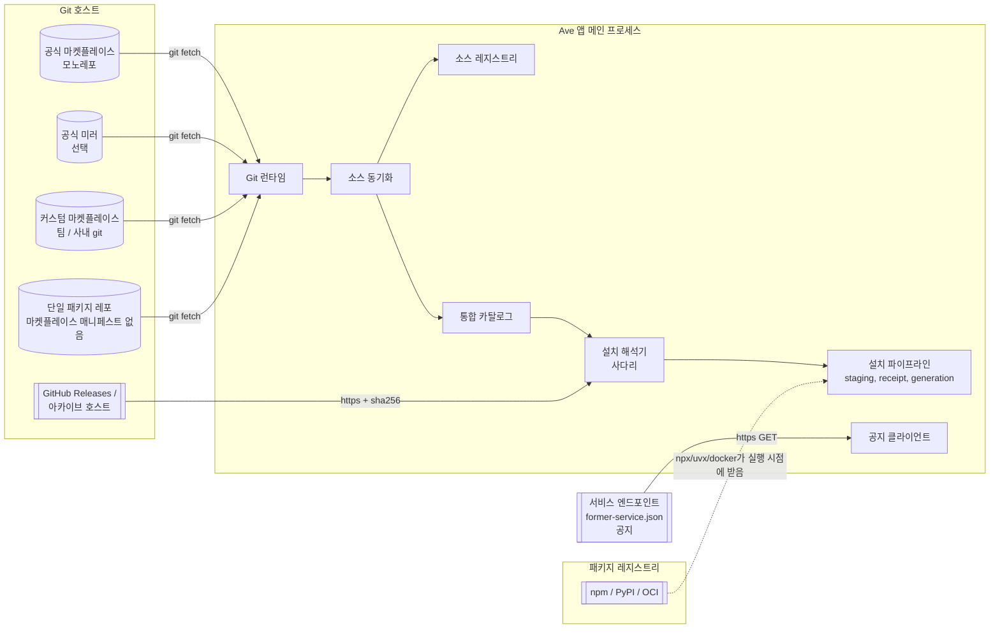

# 멀티 소스 Git 마켓플레이스 — 아키텍처

> 상태: **제안 — 방향 확정, 미구현** (오너 결정 2026-09-23). 영어 원문
> [../../../architecture/proposals/multi-source-git-marketplace.md](../../../architecture/proposals/multi-source-git-marketplace.md)이
> 기준이고, 이 문서는 그 한국어 미러입니다. 내용이 다르면 영어 원문을 따릅니다.
>
> 관련 문서:
> - 청사진(단계별 실행 계획): [../../blueprints/multi-source-git-marketplace.md](../../blueprints/multi-source-git-marketplace.md)
> - 설계서(계약, 스키마, UI 상태): [../../design/multi-source-git-marketplace.md](../../design/multi-source-git-marketplace.md)
> - 목업: [../../../design/multi-source-git-marketplace.html](../../../design/multi-source-git-marketplace.html)

## 1. 바꾸는 이유

지금 앱의 마켓플레이스는 하나뿐입니다. `MarketplaceSettings.cloudBaseUrl`은
카탈로그 서버(`agent-marketplace/server`)를 가리킵니다. 이 서버가 카탈로그를
관리하고, artifact zip을 저장하고, `prod-v1` Ed25519 키로 서명하고, 공지를
내보내고, 텔레메트리를 받고, 게시 승인과 yank, canary 롤아웃, 사내망 공개
범위를 처리합니다. 옆에는 React 웹 스토어가 있습니다. *설정 → 마켓플레이스 →
고급*에서 URL을 바꾸면 그 서버 하나가 **교체**될 뿐이고, 두 번째 서버가
추가되지는 않습니다.

오너가 없애려는 문제는 세 가지입니다.

1. **운영 주체도 하나, 장애 영역도 하나입니다.** 서버와 웹 UI, 호스팅
   배포, `marketplace-whitelist` 레포에서 내보내는 서명 피드를 모두 우리가
   운영합니다. 게다가 피드들이 한 호스팅 계정을 함께 씁니다. 그 계정에 장애가
   나면 whitelist, admission, revocation 피드와 앱 릴리스 피드가 한꺼번에
   멈춥니다.
2. **두 번째 출처가 없습니다.** 팀이 공식 카탈로그 옆에 사내 카탈로그를 둘
   방법이 없습니다. "사내 전용"을 처리하는 수단은 서버가 비밀로 보관해야 하는
   CIDR 목록 하나뿐입니다.
3. **매니페스트에 묶여 있습니다.** 마켓플레이스 행으로 등록되지 않은 것은
   (`server.json`으로 기술된 MCP 서버, 매니페스트 없는 스킬 폴더 등) 임시
   경로로만 추가할 수 있습니다. MCP 탭의 입력 양식과 데스크톱 설정 가져오기가
   그런 경로입니다.

## 2. 이 아키텍처가 반영한 오너 결정

| # | 결정 | 이 문서에 미치는 영향 |
|---|---|---|
| D1 | 공식 마켓플레이스는 **git 모노레포**입니다. 루트에 테마, 폰트, 언어, 플러그인, MCP 서버와 그 밖의 공식 패키지 종류를 둡니다. 웹 스토어와 카탈로그 서버는 두지 않습니다. | 카탈로그는 git 안의 데이터입니다. 카탈로그 서버와 웹 UI, 호스팅 배포는 종료합니다. |
| D2 | 사용자는 URL로 **git 마켓플레이스를 추가 등록**합니다. 등록한 마켓플레이스는 모두 **함께** 나열됩니다. 여러 패키지 인덱스가 하나의 카탈로그로 모이는 구조입니다. | N개 항목을 가진 소스 레지스트리와 통합 카탈로그를 둡니다. |
| D3 | Ave 마켓플레이스 매니페스트가 **없어도** 패키지를 설치할 수 있습니다(MCP 서버, 스킬 폴더, 단일 패키지 레포). | 패키지 descriptor를 합성하는 직접 설치 어댑터를 둡니다. |
| D4 | 신뢰는 **git 고정만** 씁니다. **서명은 없습니다.** 공식 소스와 사용자 소스 모두 같습니다. | `prod-v1` 봉투 검증과 서명된 admission/whitelist/revocation 피드, 그 키들을 제거합니다. 무결성은 커밋 SHA와, 고정된 git 내용 안에 적힌 sha256 값에서 나옵니다. |
| D5 | 생태계가 쓰는 배포 형식 가운데 **MCPB 번들만 빼고** 모두 지원합니다. 레포 디렉터리, git 소스(`github`, `url`, `git-subdir`), 아카이브(`url`+`sha256`), MCP 실행 명세(`npx`/`uvx`/`docker`/원격)와 MCP Registry `server.json`이 대상입니다. | 6절 |
| D6 | 플러그인 설치는 **사다리**를 따라 해석합니다. GitHub Release 에셋이 게시되어 있으면 그것을 받고, 없으면 다음 대상으로 한 단계씩 내려가 설치할 수 있는 artifact를 찾습니다. | 7절 |
| D7 | git 전송에는 **git CLI**를 씁니다. git이 없으면 설치 시퀀스에서 git을 준비합니다. | 8절 |
| D8 | 게시 승인은 **기본 브랜치 머지**로 대신합니다. 버전 호환 범위는 **각 패키지의 매니페스트에 선언**합니다. | 승인 대기열이 없어지고 `engines.ave`가 필수가 됩니다. |
| D9 | 공지는 우리 도메인의 **정적 서비스 엔드포인트**로 옮깁니다(B안). 도메인은 바꿀 수 있게 둡니다. 사내 전용 콘텐츠는 사용자가 등록하는 **사내 커스텀 마켓플레이스**로 옮깁니다. | 10절 |

## 3. 시스템 구성



앱 바깥에 있는 것은 모두 다른 곳의 정적 저장소입니다. 앱은 패키지를 나열하고
해석하고 설치할 때 Ave가 운영하는 API를 호출하지 않습니다.

## 4. 구성 요소

| 구성 요소 | 책임 | 대체하거나 재사용하는 것 |
|---|---|---|
| **Git 런타임** (`src/marketplace/git/`) | 쓸 수 있는 `git`을 찾습니다(시스템 2.27 이상, 또는 앱 관리형 사본). 관리형 사본은 고정된 sha256으로 검증해 설치합니다. git은 강화된 환경(프로토콜 허용 목록, 프롬프트 없음, PAC 프록시)에서 실행합니다. | `PythonRuntimeBootstrapper`(`src/main/python-runtime.ts`) 패턴 |
| **소스 레지스트리** | 등록한 소스를 `~/.ave/marketplaces/sources.json`에 보관합니다(id, URL, ref, 고정 커밋, 활성 여부, 인증 방식, origin: official / custom / direct). 예약 이름과 관리 정책을 적용합니다. | `MarketplaceSettings.cloudBaseUrl` 대체 |
| **소스 동기화** | 소스마다 fetch하고 후보 커밋을 고르고 히스토리 규칙(§9.2)을 적용합니다. 그 커밋의 인덱스를 파싱·검증한 뒤 고정 커밋을 원자적으로 옮기고, 불변 카탈로그 스냅숏을 게시합니다. | HTTP 카탈로그 조회와 `offline-cache.ts`의 역할 대체 |
| **통합 카탈로그** | 활성 소스 스냅숏의 합집합입니다. 행의 키는 `(source, kind, name)`이고 소스 사이에서는 아무것도 병합하지 않습니다. 호환성(`engines.ave`), yank, 롤아웃 대상 여부, 설치/업데이트 상태를 계산합니다. | `MarketplaceFetcher.listPlugins/getPluginDetail` 대체 |
| **설치 해석기** | `(source, kind, name, version)` 하나에 대해 **설치 계획**을 만듭니다. 플러그인은 artifact 사다리, MCP는 실행 명세, 콘텐츠 종류는 파일 목록을 계획에 담고, 사용자가 해야 할 동의도 함께 담습니다. | 신규. 기존 파이프라인에 넘깁니다. |
| **설치 파이프라인** | staging, receipt, 레지스트리 커밋, generation 게시, 복구 저널 | `marketplace.ts` / `plugin-artifact-store.ts` / `plugin-generation-coordinator.ts`를 **그대로 재사용**하고 봉투 검증만 뺍니다. |
| **콘텐츠 패키지 저장소** | 테마, 폰트, 언어, 스킬, 에이전트, 프로바이더, 메시징 연결을 `~/.ave/packages/<kind>/<name>/<version>/`에 데이터로 설치하고 담당 하위 시스템에 등록합니다. | "숨겨 둔 내장 항목을 활성화하는" 에셋 모델 대체 |
| **직접 설치 어댑터** | git URL, 붙여 넣은 `server.json`, MCP 설정을 검사해 패키지 descriptor를 합성합니다. | MCP 탭 입력 양식과 `claude-desktop-import.ts` 확장 |
| **정책 파일** | **공식** 레포 안의 `policy/revocations.json`과 `policy/grants.json`이 서명된 revocation, whitelist 피드를 대체합니다. | `src/plugins/revocation/`, `src/plugins/whitelist/`, `src/plugins/admission/`의 전송 계층 대체 |
| **서비스 클라이언트** | 설정된 서비스 기준 주소에서 `/.well-known/former-service.json`을 읽고, 그 문서가 가리키는 공지 문서를 읽습니다. | 마켓플레이스 서버의 `listAnnouncements()` 대체 |

## 5. 식별 모델

- **소스 id**: `^[a-z0-9][a-z0-9-]{1,62}$`. 공식 소스의 id는 `ave`입니다.
  `ave`, `official`, `ave-official`과 `ave-`로 시작하는 이름은 예약되어
  사용자 소스가 쓸 수 없습니다. 이 검사는 소스를 추가할 때뿐 아니라 불러올
  때마다 다시 실행합니다.
- **패키지 키**: `(source, kind, name)`이고 `kind:name@source`로 씁니다
  (`plugin:meeting@ave`, `theme:nord@ave`, `mcp:tracker@team-tools`).
- **런타임 식별자**는 지금과 같습니다. 플러그인의 런타임 id는 `plugin.json`의
  `name`이고, 도구 이름과 이벤트 이름은 각자의 네임스페이스를 유지합니다.
  런타임 id는 전역이므로 **id마다 설치된 플러그인은 최대 하나**입니다.
  `plugin:meeting@ave`가 설치된 상태에서 `plugin:meeting@team-tools`를
  설치하는 것은 *소스 전환*입니다. 사용자가 명시적으로 확인해야 하고, 자동으로
  일어나지 않습니다.
- **바인딩**: 설치한 패키지는 자신을 설치한 소스를 기억합니다. 업데이트는 그
  소스에서만 찾습니다. 다른 소스에 같은 이름의 더 높은 버전이 있으면 보여
  주기만 하고 조용히 설치하지 않습니다. 이 규칙이 없으면 어떤 소스든 같은
  이름에 더 높은 버전을 올려 다른 소스의 패키지를 바꿔치기할 수 있습니다
  (dependency confusion).

## 6. 패키지 종류와 배포 형식

| 종류 | 배포 형식 | 코드를 실행하는가 |
|---|---|---|
| `plugin` | 플러그인 artifact(`plugin.json` + 빌드된 `dist/`). 사다리(§7)로 해석합니다. | 예(플러그인 워커) |
| `mcp` | 실행 명세: `stdio`(`npx`, `uvx`, `docker`, 또는 패키지 디렉터리 기준 상대 경로 명령) 또는 원격 `http`. MCP Registry `server.json`으로 선언할 수도 있습니다. | 예(MCP 서버 프로세스) 또는 원격 |
| `skill` | `SKILL.md`와 리소스 | 아니요(지시문) |
| `agent` | `AGENTS.md` 프로필 | 아니요(지시문) |
| `theme` | `theme.json`(`ThemeBundle` 형태의 데이터) | 아니요 |
| `font` | `font.json`과 `woff2`/`woff`/`ttf`/`otf` 파일 | 아니요 |
| `language` | `language.json`과 메시지 카탈로그 JSON | 아니요 |
| `provider` | 프로바이더 프리셋(현재의 `MarketplaceProviderPackageAsset`) | 아니요(네트워크 설정) |
| `messaging-connection` | 연결 선언(현재의 에셋 형태) | 아니요(자격 증명 스키마) |

MCPB(`.mcpb`) 번들은 결정 D5에 따라 범위에서 뺍니다.

마켓플레이스의 모든 패키지에는 `kind`, `name`, `version`, `engines.ave`를
담은 **패키지 descriptor**(`ave-package.json`)가 있습니다. 플러그인 종류는
호스트가 소유한 `plugin.json`을 런타임 매니페스트로 계속 씁니다. descriptor와
`plugin.json`의 id와 버전은 같아야 하고, CI와 설치 시점에 한 번씩 확인합니다.

## 7. 설치 해석

### 7.1 콘텐츠 종류

해석기는 고정된 커밋의 패키지 디렉터리를 sparse checkout으로 가져옵니다.
종류별 파일 규칙(허용 확장자, 크기, 링크 금지)으로 검증한 뒤 콘텐츠 패키지
저장소에 넘깁니다.

### 7.2 MCP

실행 명세를 generation 범위의 MCP descriptor로 옮기고, 기존 MCP 승인 절차
(정적 정책 지문, owner/version 정확 바인딩)로 승인합니다. `npx`/`uvx`/`docker`는
실행 시점에 각자의 레지스트리에서 서버 코드를 받고, 실행 명세가 패키지
버전을 고정합니다.

### 7.3 플러그인 — artifact 사다리 (D6)

```mermaid
flowchart TD
  S([plugin@version 계획]) --> R1{Release 에셋이<br/>선언되었거나 관례 경로에 있고,<br/>sha256이 git에 고정되었는가?}
  R1 -- 예 --> D1[https로 다운로드] --> V1{sha256 일치?}
  V1 -- 예 --> OK
  V1 -- 아니요 --> F1[기록: digest 불일치] --> R2
  R1 -- 아니요 --> N1[기록: 건너뜀, 사유] --> R2
  R2{아카이브<br/>url + sha256 선언?} -- 예 --> D2[다운로드] --> V2{sha256 일치?}
  V2 -- 예 --> OK
  V2 -- 아니요 --> F2[기록] --> R3
  R2 -- 아니요 --> N2[기록] --> R3
  R3{고정 커밋의 git에<br/>빌드된 트리가 있는가?} -- 예 --> D3[sparse checkout] --> OK
  R3 -- 아니요 --> FAIL([NO_INSTALLABLE_ARTIFACT<br/>단계별 사유 포함])
  OK[[staged artifact]] --> M{plugin.json의 id, version,<br/>engines, capabilities가<br/>descriptor와 일치?}
  M -- 예 --> P([기존 설치 파이프라인])
  M -- 아니요 --> X([MANIFEST_MISMATCH])
```

규칙:

- 사다리 순서는 **release → archive → git tree**로 고정합니다. 선언되지 않았거나,
  고정되지 않았거나, 실패한 단계는 기록하고 다음 단계로 넘어갑니다.
- 다운로드하는 단계는 고정된 커밋의 git 안(패키지 descriptor나 인덱스)에 적힌
  `sha256`으로만 신뢰합니다. 그런 고정값이 없는 release 에셋은
  `ARTIFACT_NOT_PINNED`로 건너뛰며, release 호스트가 주는 정보만 믿고 받아들이지
  않습니다. 이렇게 해야 D4가 유지됩니다. 신뢰의 근거는 언제나 커밋입니다.
- 어떤 단계도 사용자 컴퓨터에서 코드를 빌드하지 않습니다.
- 계획과 단계별 결과를 사용자에게 보여 주고 설치 receipt에 기록합니다. 설치가
  실패하면 무엇 때문인지 스스로 설명할 수 있어야 합니다.

## 8. Git 런타임 (D7)

- **모드** `auto`(기본): 시스템 `git`이 2.27 이상이면 그것을 쓰고, 아니면 관리형
  사본 설치를 제안합니다. `system`과 `managed`는 한쪽을 강제합니다.
- **관리형 사본**: macOS와 Linux는 `dugite-native`, Windows는 `MinGit`을 각
  upstream GitHub 릴리스에서 `~/.ave/runtime/git/<version>/`으로 받습니다. 앱
  소스에 고정한 sha256으로 검증하고 `git --version`으로 동작을 확인합니다.
  인스톨러에 번들하지 않고 런타임에 받으므로 GPLv2 재배포 의무가 Ave
  인스톨러에 생기지 않습니다.
- **강화된 실행 환경**(모든 호출): `GIT_TERMINAL_PROMPT=0`, 해당 호스트용으로
  저장한 토큰만 내주는 askpass 헬퍼, `GIT_ALLOW_PROTOCOL=https:ssh`(`file`,
  `ext`, `git` 금지. 평문 `http`는 관리 정책이 지정한 사내 호스트에만 허용),
  `-c protocol.file.allow=never`, `-c submodule.recurse=false`,
  `-c core.fsmonitor=false`, `-c core.hooksPath=<빈 디렉터리>`, PAC 해석기에서
  얻은 프록시. 관리형 사본은 `GIT_CONFIG_NOSYSTEM=1`도 설정합니다.
- **가져오는 방식**: bare partial clone(`--filter=blob:none`)을 만든 뒤, 계획에
  필요한 경로만 sparse checkout합니다. submodule과 LFS는 쓰지 않습니다.

## 9. 신뢰 모델 (D4)

### 9.1 사용자를 보호하는 수단

| 위협 | 통제 |
|---|---|
| 전송 중 바이트 변조 | git 호스트와 release 호스트까지의 TLS, 그리고 다운로드하는 모든 artifact에 대해 git에 적어 둔 sha256 고정값 |
| 소스가 버전의 의미를 몰래 바꾸는 경우 | 버전은 커밋으로 해석됩니다. 버전과 커밋의 대응은 설치 시점과 인덱스에 기록됩니다. 같은 버전을 다른 커밋으로 다시 게시하면 CI가 거부하고 클라이언트가 경고합니다. |
| 소스 히스토리 재작성, 롤백 | §9.2 |
| 사용자 소스가 공식 소스를 사칭하는 경우 | 예약 이름. 공식 소스의 정체성은 앱에 내장된 URL 목록에 묶이고, 불러올 때마다 다시 확인합니다. |
| 사용자 소스가 배너를 띄우는 경우 | 공지는 서비스 엔드포인트만 내보냅니다. 소스는 공지를 낼 수 없습니다. |
| 소스 사이의 dependency confusion | 설치한 패키지는 자신의 소스에 묶입니다(§5). |
| 사용자 소스의 악성 코드 | 소스를 추가할 때 명시적 동의, 설치할 때마다 권한 검토(기존 capability, 네트워크, plugin-access 검토), 업데이트할 때 capability 차이 검토, 관리 정책(§9.3) |
| 공식 레포 탈취 | 공식 레포의 branch protection(필수 리뷰)과 CODEOWNERS, 단조 히스토리 규칙, 킬 스위치 역할을 하는 `policy/revocations.json` |

의도적으로 **없앤 것**: artifact 서명, `prod-v1` 신뢰 앵커, 서명된
whitelist/admission/revocation 문서와 그 키. D4에 따라 공식 기본 브랜치에
머지할 수 있는 사람은 모든 사용자에게 코드를 배포할 수 있습니다. 그래서 공식
레포의 보호 설정이 보안 경계의 일부가 되며, 청사진의 완료 조건에 들어
있습니다.

### 9.2 히스토리 규칙

소스의 ref가 움직이면, 후보 커밋은 고정된 커밋의 후손이어야 합니다
(`git merge-base --is-ancestor`).

- 공식 소스: 후손이 아닌 후보는 거부합니다(`SOURCE_HISTORY_REWRITTEN`). 이전
  고정 커밋을 유지합니다.
- 사용자 소스와 직접 설치 소스: 사용자에게 경고를 보여 주고, 사용자가 명시적으로
  새 히스토리를 받아들일 수 있습니다.

고정값이 커밋 SHA이므로 공식 **미러**는 기본 주소와 서로 바꿔 쓸 수 있습니다.
미러가 준 커밋도 같은 규칙을 만족하면 받아들입니다. 미러는 신뢰를 늘리지 않고
가용성만 늘립니다.

### 9.3 관리 정책

기존 시스템 정책 파일(`/Library/Application Support/Ave/policy.json`,
`%ProgramData%\Ave\policy.json`)에 `marketplaces` 블록을 추가합니다. 소스
URL과 호스트 패턴의 허용·차단 목록, 평문 `http`를 허용할 사내 호스트, 미리
등록할 소스, 직접 설치 허용 여부, 공식 소스를 끌 수 있는지 여부를 담습니다.
사용자 설정은 이 정책을 덮어쓸 수 없습니다.

## 10. 서비스 엔드포인트 (D9)

앱은 작은 정적 문서 하나를 읽습니다.

```
GET {serviceBase}/.well-known/former-service.json
```

이 문서는 공지 문서 경로와, 필요하면 다른 정적 리소스를 가리킵니다.
`serviceBase`의 기본값은 빌드 시점의 `https://former-site.invalid`입니다. 관리 정책이
덮어쓸 수 있고, 도메인을 바꿀 때는 문서에 새 주소(`movedTo`)를 적을 수
있습니다. 공지는 지금의 계약(`MarketplaceAnnouncement`: 등급, 표시 기간,
이동 전용 action)을 유지합니다. 텔레메트리는 마켓플레이스 URL에서 분리되고,
서비스 문서가 수집 엔드포인트를 알려 줄 때만 동작합니다.

## 11. 호스트에서 유지하는 것, 바꾸는 것, 없애는 것

| 유지 | 변경 | 제거 |
|---|---|---|
| 설치 파이프라인: staging, receipt, generation, 복구 저널, 번들 수명 주기 | `MarketplaceFetcher`는 소스 스냅숏 위의 카탈로그 뷰가 됩니다 | `cloud-marketplace-fetcher.ts`, `/api/v1/*` 클라이언트 |
| 권한, capability, 네트워크, plugin-access 검토 | 레지스트리 항목에 `origin`(소스, 커밋, 단계, digest)이 추가됩니다 | 설치 경로의 `envelope-verifier.ts`, `marketplace-keys.ts`, `publisher-keys.ts` |
| MCP 승인과 거버넌스 | 테마와 로케일 집합이 데이터 기반의 열린 집합이 되고, 내장 기본값은 유지합니다 | `signed-doc-fetcher.ts`, `signed-doc-cache.ts`, `admission/`, `whitelist/`, `revocation/`의 전송 계층 |
| `ave://` 딥 링크 | `ave://install/<kind>/<name>@<source>`, `ave://marketplace/add?url=` | "웹 마켓플레이스 열기" 버튼 |
| 업데이트 확인 토글 | 업데이트 확인은 소스 스냅숏을 읽습니다 | 텔레메트리와 `marketplace.cloudBaseUrl`의 결합 |

agent-marketplace 서버 레포와 marketplace-whitelist 레포는 청사진의 이전 절차를
마친 뒤 archive합니다.

## 12. 검토한 대안

- **서버를 하나 유지하고 git을 두 번째 백엔드로 추가하는 방식.** D1/D9에 따라
  기각합니다. 이 변경이 없애려는 운영 부담이 그대로 남습니다.
- **사용자 소스에 서명(TOFU 키)을 쓰는 방식.** D4에 따라 기각합니다.
- **순수 JS git 구현.** D7에 따라 기각합니다. 사내 git 호스트에는 SSH와 OS
  자격 증명 헬퍼가 필요합니다.
- **사용자 컴퓨터에서 플러그인을 빌드하는 방식.** 기각합니다. 설치 중에 임의의
  수명 주기 스크립트가 실행되고 툴체인이 필요합니다. 조사한 어느 생태계도 이렇게
  하지 않습니다.
- **MCPB 번들.** D5에 따라 제외합니다.
