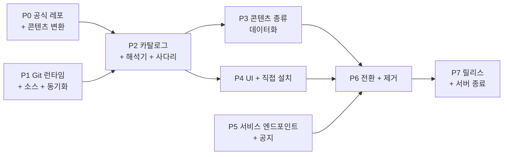

# 멀티 소스 Git 마켓플레이스 — 청사진

> 상태: **실행 계획, 미착수** (2026-09-23). 영어 원문
> [../../blueprints/multi-source-git-marketplace.md](../../blueprints/multi-source-git-marketplace.md)이
> 기준이고, 이 문서는 그 한국어 미러입니다. 내용이 다르면 영어 원문을 따릅니다.
>
> 아키텍처: [../architecture/proposals/multi-source-git-marketplace.md](../architecture/proposals/multi-source-git-marketplace.md) ·
> 설계서: [../design/multi-source-git-marketplace.md](../design/multi-source-git-marketplace.md) ·
> 목업: [../../design/multi-source-git-marketplace.html](../../design/multi-source-git-marketplace.html)

이 계획은 아키텍처를 여덟 단계로 나눠 구현합니다. 단계마다 PR 목록, 깨뜨리면
안 되는 것, 단계를 닫는 증거를 적습니다. 새 스택은 현재 스택 옆에 만들고 한
번의 변경(6단계)으로 켭니다. 그래서 앱이 마켓플레이스 구현 두 개를 동시에 돌리는
일이 없고, 호환 shim이 전환 이후까지 남지 않습니다.

## 0. 이 계획이 기다리는 입력

| 입력 | 담당 | 필요한 시점 |
|---|---|---|
| 공식 마켓플레이스 저장소 위치(선택적 미러 포함) | 저장소 이전 계획 | 1단계 상수 `OFFICIAL_MARKETPLACE`, 0단계 |
| 플러그인 release 에셋을 빌드할 호스팅 계정의 정상 CI | 저장소 이전 계획 | 0단계 release 고정값 |
| 서비스 도메인 기본값(바꾸지 않으면 `https://former-site.invalid`) | 오너 | 5단계 |

## 1. 단계 한눈에 보기

P0, P1, P5는 병렬로 진행할 수 있습니다. 사용자가 실행하는 코드를 바꾸는 단계는
P6 하나뿐입니다.

## 2. 0단계 — 공식 마켓플레이스 저장소

**목표:** 새 계약을 이미 만족하는 저장소를 만들어, P1–P4의 앱 작업이 실제
데이터로 테스트할 수 있게 합니다.

| PR | 내용 |
|---|---|
| 0.1 | 설계서 §3.1의 레이아웃, 패키지 작성자용 `README`, `CODEOWNERS`, branch protection(필수 리뷰, 필수 체크, force-push 금지, 직접 push 금지) |
| 0.2 | 검증 워크플로: descriptor와 인덱스 스키마(ave `schemas/marketplace/`에서 가져오고 drift 테스트로 확인), 콘텐츠 한도, 이름 규칙, 비밀 값 스캔, `engines` 존재, 버전 엄격 증가, `(kind,name,version)` → 커밋 하나 |
| 0.3 | 인덱스 생성기 + "커밋된 인덱스가 다시 생성한 인덱스와 같다" 검사 |
| 0.4 | release-pin 워크플로(설계서 §6.3): 에셋 다운로드, 해시 계산, 압축 해제, `plugin.json` 비교, 고정값 PR 생성 |
| 0.5 | 한 번 실행하는 콘텐츠 변환 스크립트: 현재 시드 세트의 에이전트 169개, 스킬 154개, MCP 패키지 23개. 기본이 아닌 테마 번들 14개를 `theme.json`으로. 한국어 카탈로그를 언어 패키지로. 프로바이더 프리셋. 메시징 연결 |
| 0.6 | 현재 게시된 모든 플러그인의 descriptor. 각 플러그인 저장소의 release 워크플로가 빌드한 에셋에 고정 |
| 0.7 | 현재 유효한 revocation을 담은 `policy/revocations.json`, 현재 whitelist grant를 담은 `policy/grants.json` |

**완료 조건:** `main`에서 검증 통과. 호스팅 API로 branch protection 확인. 현재
카탈로그의 모든 패키지가 `engines`와 함께 `marketplace.json`에 있음. 모든
플러그인이 시험 실행에서 release 단계로 해석됨.

## 3. 1단계 — Git 런타임, 소스 레지스트리, 동기화

새 모듈 루트 `src/marketplace/`(메인 프로세스). 상태 확인용 probe 외에는 아직
UI나 부팅에 연결하지 않습니다.

| PR | 내용 | 테스트 |
|---|---|---|
| 1.1 | `git/detect.ts`, `git/run-git.ts`(설계서 §9.1, §9.3). macOS Command Line Tools shim 검사 포함 | 버전 게이트용 가짜 git 바이너리, 호출마다 환경변수/플래그 계약 전체 확인, 프로토콜 거부 |
| 1.2 | `git/managed-git.ts` + `managed-git-pins.ts`(설계서 §9.2): PAC 반영 다운로드, sha256, 임시 경로 압축 해제, 이름 변경, 동작 확인. `ave:git:runtime:*` IPC | 로컬 fixture 서버, 잘못된 해시, 잘린 다운로드, 압축 해제 중단 시 기존 사본 유지 |
| 1.3 | `schemas/marketplace/index.schema.json`, `package.schema.json`과 종류별 수작성 fail-closed 검증기(설계서 §4, §5) | 종류별 fixture 행렬: 정상, 규칙별 위반, 알 수 없는 키 |
| 1.4 | `sources/registry.ts`(`sources.json`, 예약 이름, 정책 허용/차단/http 호스트, 공식 상수) | 불러올 때마다 예약 이름 재검사, 정책 우선순위 |
| 1.5 | `sources/sync.ts`(설계서 §7.2): partial fetch, 히스토리 규칙, 스냅숏 기록, 고정 커밋 원자적 이동, 미러 대체, 오프라인 제공 | 로컬 bare 저장소: fast-forward, 재작성(공식 거부, 커스텀 검토 필요), 잘못된 인덱스는 고정 커밋 유지, 기본 주소 불가 시 미러 사용 |

**완료 조건:** 대상 테스트 통과. `bun run typecheck`, lint, import-cycle 검사
통과. 개발 빌드가 실제 호스트에서 P0 저장소와 커스텀 fixture 저장소를 동기화.

## 4. 2단계 — 통합 카탈로그와 설치 해석기

| PR | 내용 | 테스트 |
|---|---|---|
| 2.1 | `catalog/aggregate.ts`: `(source, kind, name)` 키 행, `installation-id` 롤아웃 버킷을 쓰는 버전 선택(설계서 §6.1) | engines, yank, 플랫폼, 롤아웃, revocation, `upgrade_required` 최소 버전 표 테스트 |
| 2.2 | 호스트 플러그인 스키마: `extensions["ai.agent-connector.ave"].engines`(설계서 §5.3). SDK 저장소의 스키마 사본과 drift 테스트를 같은 기간에 갱신 | 스키마 테스트, 플러그인 fixture 갱신 |
| 2.3 | `resolve/plugin-ladder.ts`(설계서 §6.2)가 staged artifact를 만듦. 트리 digest(§6.4) | 단계별 사용/건너뜀/실패, 불일치 시 사다리 중단, 계획에 단계 결과 포함 |
| 2.4 | 이미 검증된 staged artifact를 받는 설치 파이프라인 진입점: staging → receipt → 레지스트리 → generation 재사용. 레지스트리 항목에 `origin`. 이 경로에는 봉투 검증 없음 | 기존 파이프라인 스위트 변경 없이 통과, 새 origin 검증, 복구 저널 확인 |
| 2.5 | `resolve/mcp.ts`: descriptor 또는 `server.json` → generation 범위 MCP descriptor → 기존 승인 | npm/pypi/oci/remote 대응, 상대 경로 `stdio` 명령 격리 |
| 2.6 | 식별 규칙: `PLUGIN_ID_CONFLICT`, 소스 전환 트랜잭션, 업데이트 바인딩 | 소스 간 같은 이름, 전환 시 플러그인 데이터 디렉터리 유지 |

**깨뜨리면 안 되는 것:** 기존 플러그인 수명 주기, 복구, generation 테스트 전부.
2.4의 파이프라인 변경은 6단계에서 옛 진입점을 제거하기 전까지 추가만 합니다.

## 5. 3단계 — 콘텐츠 종류의 데이터화

| PR | 내용 | 테스트 |
|---|---|---|
| 3.1 | 콘텐츠 패키지 저장소 + `packages/ledger.json`(설치, 제거, origin). 설계서 §5.4의 파일 규칙 적용 | 한도, 링크, 경로 이탈 |
| 3.2 | 테마: `theme.json`을 `ThemeBundle` 형태로 읽음. 지금은 `theme/bundles/__tests__/contrast.test.ts` 안에만 있는 WCAG 대비 계산을 런타임 검증기로 옮겨 그 테스트와 설치기가 함께 쓰게 하고, 기준에 못 미치는 테마는 설치 시 거부. 내장 `moonstone`, `gallery`는 계속 컴파일에 포함. 설치된 id는 `BundleId` 유니온에 추가하지 않고 검증된 문자열로 다룸 | 대비 미달 거부, 설치된 테마로 전환하고 되돌아오기 |
| 3.3 | 언어: 열린 로케일 레지스트리. `messages.json`을 `en` 위에 겹치는 카탈로그로 설치. 설치 시 `en` 키 집합 기준 키 존재 검사(모르는 키는 거부, 빠진 키는 `en`으로 대체하고 패키지 상세에 목록 표시) | 빠진 키/모르는 키 처리, 로케일 전환 |
| 3.4 | 폰트(새 종류): 호스트 에셋 스킴으로 파일 제공, `@font-face` 등록, 설치된 글꼴을 모양 설정의 글꼴 목록에 추가. 라이선스 파일 필수 | 렌더러의 글꼴 로드, 선택 중인 글꼴 제거 시 기본값으로 대체 |
| 3.5 | 프로바이더와 메시징 연결: 현재 에셋 패키지 설치 코드를 ledger로 옮김 | 현재 설치/제거 동작과 동등성 |

**완료 조건:** P0의 공식 콘텐츠 패키지가 모두 개발 빌드에서 설치, 활성화, 제거됨.
설정의 선택 목록에 설치된 항목이 나옴.

## 6. 4단계 — UI와 직접 설치

| PR | 내용 |
|---|---|
| 4.1 | 마켓플레이스 둘러보기: 종류 탭, 소스 필터, 검색, 소스 배지와 상태 칩이 있는 카드(설계서 §15.1) |
| 4.2 | 출처, 호환성, 권한, 배포 단계, 버전을 담은 패키지 상세 시트와 설치 진행(§15.2–15.3) |
| 4.3 | 소스 보기, 마켓플레이스 추가 대화 상자(미리보기 → 확인), 토큰 입력, 히스토리 재작성 검토(§15.4–15.6) |
| 4.4 | Git 런타임 카드와 추가 대화 상자 안의 차단 단계(§15.7) |
| 4.5 | 직접 설치: Git URL, MCP 입력 양식(기존), `server.json` 붙여 넣기, 클라이언트 설정 가져오기(설계서 §8) |
| 4.6 | 딥 링크 `ave://install/<kind>/<name>@<source>`와 `ave://marketplace/add?url=…`. 둘 다 확인 UI를 열 뿐 바로 설치하지 않음 |
| 4.7 | 새 문구 전부를 생성기로 i18n 처리, 키 존재 게이트 |

**완료 조건:** 패키징된 개발 빌드에서 목업의 화면 상태마다 CDP 검사. 좁은 폭
단계의 레이아웃 측정 포함.

## 7. 5단계 — 서비스 엔드포인트와 공지

| PR | 내용 |
|---|---|
| 5.1 | `web/public/.well-known/former-service.json`과 `web/public/announcements/v1.json`(처음에는 빈 목록) |
| 5.2 | `service/client.ts`: 기준 주소 결정(정책 → 빌드 상수), `movedTo` 처리, 공지 조회와 캐시. 닫은 공지 id 동작은 그대로 |
| 5.3 | 텔레메트리가 서비스 문서에서 엔드포인트를 읽음. 없으면 비활성 |

**완료 조건:** 웹 배포가 수동 프로덕션 게이트를 거쳐 두 파일을 게시. 앱이 스테이징
기준 주소의 시험 공지를 표시.

## 8. 6단계 — 전환과 제거

P2–P5를 마친 뒤 함께 머지하는 PR 묶음입니다.

| PR | 내용 |
|---|---|
| 6.1 | 부팅과 IPC가 새 스택을 사용. 설정 → 마켓플레이스가 새 UI를 렌더링. `marketplace.cloudBaseUrl`, `cloudAllowPrivateNetwork`, API 키 컨트롤을 제거하고, 이 값들을 지우는 설정 마이그레이션 추가 |
| 6.2 | 기존 설치의 첫 부팅 마이그레이션(설계서 §16): `user`/`admin` 레지스트리 항목을 id 기준으로 `ave`에 연결. 설치된 프로바이더 프리셋과 테마·언어 활성화를 ledger 항목으로 변환 |
| 6.3 | `cloud-marketplace-fetcher.ts`, 설치 경로의 봉투 검증, `marketplace-keys.ts`, `publisher-keys.ts`, `signed-doc-fetcher.ts`, `signed-doc-cache.ts`, `admission/`·`whitelist/`·`revocation/` 전송 계층(revocation 동작은 공식 정책 파일로 이동), 웹 스토어 버튼과 관련 테스트 삭제 |
| 6.4 | `docs/architecture/architecture.md`의 Plugin Runtime 절, 플러그인 개발 가이드, 마켓플레이스 게시 가이드를 새 모델로 다시 작성. 이 계획의 상태 갱신 |

**완료 조건:** 전체 `test:vitest`, typecheck, lint, knip 기준선, import cycle,
패키징 앱 스모크 통과. 플러그인, 커스텀 테마, 한국어가 설치된 이전 릴리스에서
업그레이드했을 때 모두 `ave`에 연결되어 동작.

## 9. 7단계 — 릴리스와 종료

이미 배포된 앱은 옛 서버의 공지 엔드포인트로만 변경 소식을 알 수 있으므로 순서가
중요합니다.

1. 6단계가 들어간 앱 릴리스를 배포합니다.
2. **옛 서버에** 공지를 올려 이전 빌드 사용자에게 업데이트를 안내하고, 그 릴리스가
   한 릴리스 주기 동안 나가 있을 때까지 옛 서버를 읽기 전용으로 유지합니다.
3. 옛 서버와 웹 UI, 배포를 멈추고 비밀 값과 러너를 제거합니다.
4. `agent-marketplace`와 `marketplace-whitelist` 저장소를 archive합니다.
5. 저장소를 넘나드는 `marketplace-e2e` 워크플로를, 로컬 git fixture를 쓰는 저장소
   내부 E2E 테스트로 바꿉니다(설계서 §17).

**완료 조건:** 옛 서버를 참조하는 앱 코드 경로와 워크플로가 없음. 옛 저장소
archive 완료. 저장소 내부 E2E 테스트가 CI에서 실행됨.

## 10. 위험과 통제

| 위험 | 이 계획의 통제 |
|---|---|
| 공식 저장소에 머지하면 모든 사용자에게 코드가 배포됨(서명 없음) | P0 완료 조건에 API로 확인한 branch protection 포함. 재작성된 공식 히스토리는 히스토리 규칙이 거부. `policy/revocations.json`이 킬 스위치 |
| 사내망: 프록시와 TLS 검사 | git은 PAC에서 얻은 프록시로 실행. 관리형 사본은 OS 인증서 저장소 사용(Windows `schannel`, macOS 시스템 신뢰 저장소). P1 완료 조건에 TLS 검사 프록시 뒤 실행 포함 |
| 커밋된 빌드로 공식 저장소가 커짐 | 공식 플러그인은 release 단계를 사용. tree 단계는 작거나 커스텀인 플러그인용 |
| 공식 저장소 호스팅 장애 | `OFFICIAL_MARKETPLACE`의 미러 URL. 커밋 고정 덕분에 미러를 서로 바꿔 쓸 수 있음. 캐시된 스냅숏으로 둘러보기와 설치된 패키지는 계속 동작 |
| 서버 종료 후 이전 앱 빌드 | 7단계 순서: 새 릴리스 먼저, 옛 채널에 공지, 그다음 종료 |
| 열린 테마/로케일 집합으로 타입 완전성이 약해짐 | 내장 id는 유니온을 유지. 설치된 id는 명시적 분기로 다루는 검증된 문자열 |
| 커스텀 소스가 악성 코드를 배포 | 추가 시 동의, 설치마다 권한 검토, 업데이트마다 capability 차이 검토, 관리 정책의 허용/차단 목록 |
