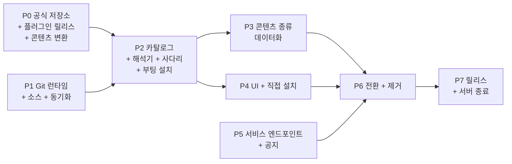

# 멀티 소스 Git 마켓플레이스 — 청사진

> 상태: **0~6단계 완료, 7단계 남음** (2026-09-25). 0단계는
> `ken-jo/agent-marketplace`에 머지됐고, 1~6단계는 ave PR #2551(P1),
> #2552(P2), #2554(P3), #2556(P4), #2553(P5)과 6단계 전환 PR입니다. 코드가
> 설계와 다른 곳은 설계서 §13.1과 §16.4에 적었습니다. 영어 원문
> [../../blueprints/multi-source-git-marketplace.md](../../blueprints/multi-source-git-marketplace.md)이
> 기준이고, 이 문서는 그 한국어 미러입니다. 내용이 다르면 영어 원문을 따릅니다.
>
> 아키텍처: [../architecture/proposals/multi-source-git-marketplace.md](../architecture/proposals/multi-source-git-marketplace.md) ·
> 설계서: [../design/multi-source-git-marketplace.md](../design/multi-source-git-marketplace.md) ·
> 목업: [../../design/multi-source-git-marketplace.html](../../design/multi-source-git-marketplace.html)

이 계획은 아키텍처를 여덟 단계로 나눠 구현합니다. 단계마다 PR 목록, 깨뜨리면
안 되는 것, 단계를 닫는 증거를 적습니다. 새 스택은 현재 스택 옆에 만들고 한
번의 변경(6단계)으로 켭니다. 그래서 앱이 마켓플레이스 구현 두 개를 동시에 돌리는
일이 없고, 호환 shim이 전환 이후까지 남지 않습니다.

## 0. 이 계획이 기대는 입력

| 입력 | 담당 | 필요한 단계 |
|---|---|---|
| 공식 마켓플레이스 저장소 위치(와 선택적 미러) | 2026-09-23 결정: `ken-jo/agent-marketplace`(2026-09-24 `ave-marketplace-index`에서 이름 변경). 공식 플러그인 소스도 담는 모노레포. 공개로 읽을 수 있어야 하며 상수는 `auth: { kind: "none" }`(설계서 §2.1, §3.1) | 1단계 상수 `OFFICIAL_MARKETPLACE`, 0단계 |
| 플러그인 릴리스 자산을 빌드하는, 호스팅 계정의 동작하는 CI | 저장소 이전 계획 | 0단계 릴리스 핀 |
| 서비스 도메인 기본값(바꾸지 않으면 `https://former-site.invalid`) | 오너 | 5단계 |
| 지금의 관리 설치에 기대는 조직이 자체 마켓플레이스와 `requiredInstalls`가 담긴 정책 파일을 준비 | 각 조직 | 7단계 1번 |

## 1. 단계 한눈에 보기

P0, P1, P5는 병렬로 진행할 수 있습니다. 사용자가 실행하는 것을 바꾸는 단계는
P6뿐입니다.

## 2. 0단계 — 공식 마켓플레이스 저장소와 플러그인 릴리스

**목표:** 새 계약을 이미 만족하는 저장소를 만들어, P1–P4의 앱 작업이 실제
데이터로 테스트할 수 있게 합니다.

| PR | 내용 |
|---|---|
| 0.1 | 설계서 §3.1의 레이아웃, 패키지 작성자용 `README`, `CODEOWNERS`, 브랜치 보호(필수 리뷰, 필수 체크, force-push 금지, 직접 push 금지, merge commit 전용). 관리자가 한 명인 동안 필수 승인 수는 0입니다. 작성자는 자기 PR을 승인할 수 없고 보호는 우회하지 않기 때문입니다. 두 번째 관리자가 생기면 1로 올립니다 |
| 0.2 | 검증 워크플로: descriptor·인덱스 스키마(ave `schemas/marketplace/`에서 가져오고 drift 테스트), 플러그인 계약(설계서 §5.6: ave 태그 시점으로 복사, 오프라인 해시 검사와 네트워크 태그 검사), 콘텐츠 한도, 이름 규칙, 시크릿 스캔, `minAppVersion` 존재, 플러그인 `authority`가 릴리스된 `plugin.json`과 같음, 버전 엄격 증가, `(kind,name,version)` → 커밋 하나, `latest`는 회수되지 않은 버전 |
| 0.3 | 인덱스 생성기 + "커밋된 인덱스 = 다시 만든 인덱스" 검사 |
| 0.4 | 릴리스 워크플로(설계서 §6.3): `main`에서, 소스 버전의 `<name>-v<X.Y.Z>` 태그가 없는 플러그인을 빌드하고 태그를 달아 `{name}-{X.Y.Z}.zip`을 이 저장소의 릴리스 자산으로 올린 뒤 핀 PR을 엶. 핀 PR의 CI는 자산을 내려받아 해시하고 풀어서 `plugin.json`을 descriptor와 대조 |
| 0.5 | 각 공식 플러그인의 소스를 히스토리와 함께 `plugins/<name>/source/`로 가져옴(각 공식 플러그인. 레포가 없는 `hello-world`는 현재 서버가 합성하는 패키지로 다시 만듦), `ave-plugin-template`은 `templates/plugin/`으로. 각 플러그인은 자기 lockfile을 두고 자기 디렉터리에서 빌드. 각 플러그인을 `@ave/plugin-sdk` git 의존에서 복사해 둔 계약과 `tools/`의 공용 빌드 헬퍼로 전환(설계서 §5.6). `plugin.json`에 `requires.minAppVersion` 설정, `installPolicy` 제거(설계서 §5.3). `ave-plugin-repo`은 공식 플러그인이 아니고 `portal`는 소유자의 git으로 옮기므로 둘 다 가져오지 않음 |
| 0.6 | 한 번만 실행하는 콘텐츠 변환 스크립트: 현재 시드 세트의 모든 에이전트, 스킬(Agent Skills 레이아웃, 설계서 §5.2), MCP 패키지, 기본이 아닌 테마 번들을 번들 id 그대로 `theme.json`으로, 한국어 카탈로그를 `korean` 언어 패키지로, 공급자 시드(모두 내장 벤더)를 벤더 패키지로, 메시징 연결(서버에 없음) |
| 0.7 | 현재 게시된 모든 플러그인의 descriptor를, 0.5에서 가져온 소스로 0.4가 빌드한 릴리스 자산에 핀. `HOST_SECRET_GRANTS`에 있는 플러그인(지금은 `meeting`, `local-indexer`)은 `versions[]`에 현장에 아직 설치된 이전 버전 중 앱이 불러올 수 있는 것(Agent Plugins 매니페스트 라인, `minAppVersion` 0.7.0, 설계서 §16.3)도 모두 나열: 각 버전마다 현재 서버가 제공하는 zip을 그대로 그 버전의 릴리스 자산으로 올리고 그 sha256으로 핀해서, 이관된 설치본이 grant를 유지하게 함(설계서 §16.3) |
| 0.8 | 현재 유효한 공식 패키지 폐기를 담은 `policy/revocations.json` |

**종료 조건:** `main`에서 검증 통과, 호스팅 API로 브랜치 보호 확인, 현재 카탈로그의
모든 패키지가 `minAppVersion`과 함께 `marketplace.json`에 있음, 모든 플러그인이
드라이런에서 release 단계로 해석됨, 0.7의 현장 버전 핀이 서버에 기록된 아티팩트
해시와 일치.

## 3. 1단계 — Git 런타임, 소스 레지스트리, 동기화

새 모듈 루트 `src/marketplace/`(메인 프로세스). 상태 확인을 빼면 아직 UI나
부팅에 연결하지 않습니다.

| PR | 내용 | 테스트 |
|---|---|---|
| 1.1 | `git/detect.ts`, `git/run-git.ts`(설계서 §9.1, §9.3): 최소 2.45.1, macOS Command Line Tools shim 검사, 생성한 `GIT_CONFIG_GLOBAL`, 호스트에 묶인 1회용 티켓을 쓰는 askpass 헬퍼, `http.followRedirects=false`, `rev-list --missing=print` + 일괄 fetch + `git archive`로 내보내기 | 버전 게이트용 가짜 git 바이너리(2.45.0 거부, 2.45.1 허용), 호출마다 환경/플래그 계약 전체 확인, 허용된 키만 전역 설정에 복사, 티켓이 가리키지 않는 호스트에 askpass 거부, 프로토콜 거부 |
| 1.2 | `git/managed-git.ts` + `managed-git-pins.ts`(설계서 §9.2): 네트워크 게이트를 거친 PAC 인식 다운로드, sha256, 임시 압축 해제, 이름 바꾸기, 스모크 테스트, `GIT_EXEC_PATH`, `GIT_TEMPLATE_DIR`, `corp-ca-extract.ts`에서 만든 CA 번들(Windows는 `schannel`), `ave:git:runtime:*` IPC | 로컬 픽스처 서버, 잘못된 해시, 잘린 다운로드, 중단된 압축 해제는 이전 사본 유지 |
| 1.3 | `schemas/marketplace/index.schema.json`, `package.schema.json` + 종류별로 손으로 쓴 fail-closed 검증기(설계서 §4, §5) | 종류별 픽스처 행렬: 정상, 규칙별 위반, 알 수 없는 키 |
| 1.4 | `net/source-url.ts`(`normalizeSourceUrl`)와 공용 네트워크 게이트(설계서 §7.1, §7.4), `cloud-marketplace-fetcher.ts`의 사설망 가드를 넘겨받음. `sources/registry.ts`(`sources.json`, `state.json`, 예약 이름, 정책 allow/block/http 호스트, 공식 상수, 관리 `additional` 소스) | 정규화 동치, 로드할 때마다 예약 이름 재검사, block이 allow보다 우선, 사설 대상 거부, 차단된 호스트로의 리다이렉트 거부 |
| 1.5 | `sources/sync.ts`(설계서 §7.3): 전체 이력 부분 fetch, 이력 규칙, 스냅숏 쓰기와 정리, 원자적 핀 이동, 미러 대체, 오프라인 제공, 설치 패키지가 남은 숨긴 소스의 동기화 | 로컬 bare 저장소: 핀이 한참 뒤인 fast-forward, 재작성(공식·관리는 거부, 커스텀은 검토), 잘못된 인덱스는 핀 유지, 기본 주소에 닿지 않으면 미러 사용 |

**종료 조건:** 대상 테스트 통과, `bun run typecheck`, lint, import-cycle 검사
통과, 개발 빌드가 실제 호스트의 P0 저장소와 커스텀 픽스처 저장소를 동기화하며,
**macOS와 Windows에서 관리형 git 사본으로 TLS 검사 프록시 뒤에서도 한 번 이상**
성공.

## 4. 2단계 — 통합 카탈로그, 설치 해석기, 부팅 설치

| PR | 내용 | 테스트 |
|---|---|---|
| 2.1 | `catalog/aggregate.ts`: `(source, kind, name)` 키의 행, `installation-id` 롤아웃 버킷을 쓰는 버전 선택(설계서 §6.1), `canaryOptIn` 뒤의 프리릴리스, 소스별 폐기 | `minAppVersion`, 회수, 플랫폼, 프리릴리스, 롤아웃, 폐기, `upgrade_required` 최소 버전 표 테스트 |
| 2.2 | git 설치 매니페스트 규칙(설계서 §5.3): `requires.minAppVersion` 필수이고 descriptor와 같음, authority 필드 전부 descriptor와 같음. 이 규칙은 스키마가 아니라 설치 계획의 것이므로(설계서 §5.3은 로컬 개발용으로 `requires.minAppVersion`을 선택으로 둠) 스키마 사본이나 SDK PR은 바뀌지 않음 | 규칙 테스트: 필드별, 존재 여부, `installPolicy` 이름 지정 거부 |
| 2.3 | 스테이징된 아티팩트를 만드는 `resolve/plugin-ladder.ts`(설계서 §6.2), 스냅숏·버전 커밋에 묶인 계획, 트리 다이제스트(§6.4), descriptor authority로 의존성 사전 점검 | 단계별 사용/건너뜀/실패, authority 필드 하나라도 불일치하면 사다리 중단, 계획과 실행 사이 동기화가 결과를 바꾸지 않음, 계획과 영수증에 단계 결과 |
| 2.4 | 이미 검증된 스테이징 아티팩트를 받는 설치 파이프라인 진입점: 스테이징 → 영수증 → 레지스트리 → generation 재사용, 레지스트리 항목의 `origin`, 이 경로에는 봉투 검증 없음 | 기존 파이프라인 스위트 변경 없이 통과, 새 origin 단언, 복구 저널 실행 |
| 2.5 | `resolve/mcp.ts`: descriptor나 `server.json` → generation 범위 MCP descriptor → 기존 승인 | npm/pypi/oci/remote 대응, 상대 `stdio` 명령 격리 |
| 2.6 | 식별 규칙: 종류·소스를 가로지르는 `PACKAGE_ID_CONFLICT`, 소스 전환 트랜잭션, 업데이트 바인딩 | 소스 간 같은 이름, 전환 시 플러그인 데이터 디렉터리 유지 |
| 2.7 | `boot-installs/`(설계서 §10.2): `DEFAULT_INSTALLS`, 정책 `defaultInstalls`와 `requiredInstalls`, `default-installs.json`. `secret-access/grants.ts`(`HOST_SECRET_GRANTS`)와 설계서 §10.3의 네 가지 grant 조건. 여기서 만들고 테스트하며 6단계에서 연결 | 한 번 설치하고 제거 후 다시 설치하지 않음, 필수: 재설치·업데이트·제거와 비활성화 거부, 목록은 공식·관리 소스로 제한, 커스텀 출처·tree 단계·다른 아티팩트 해시·바뀐 매니페스트면 grant 거부, legacy 영수증 해시 경로 |

**깨뜨리면 안 되는 것:** 기존 플러그인 수명주기, 복구, generation 테스트 전부.
2.4의 파이프라인 변경과 2.7의 모듈은 6단계에서 옛 진입점을 없애기 전까지 추가만
합니다.

## 5. 3단계 — 콘텐츠 종류 데이터화

| PR | 내용 | 테스트 |
|---|---|---|
| 3.1 | 콘텐츠 패키지 저장소 + `packages/ledger.json`(설치, 제거, 출처)과 설계서 §5.4의 파일 규칙, SVG 제외, 호스트 스킴으로 자산 제공 | 한도, 링크, 경로 탈출, SVG 거부 |
| 3.2 | 테마: `theme.json`을 `ThemeBundle` 형태로 로드. 지금 `theme/bundles/__tests__/contrast.test.ts`에만 있는 WCAG 대비 계산을 그 테스트와 설치기가 함께 쓰는 런타임 검증기로 옮기고, 실패하는 테마는 설치 때 거부. 내장 `moonstone`과 `gallery`는 컴파일된 채 유지. 설치된 id는 `BundleId` 유니언에 추가하지 않고 검증된 문자열로 | 대비 실패 거부, 설치 테마로 전환하고 되돌리기 |
| 3.3 | 언어: 열린 로케일 레지스트리. `messages.json`을 `en` 위에 겹치는 카탈로그로 설치. 설치 때 `en` 키 집합과 대조(모르는 키는 거부, 빠진 키는 `en`으로 대체하고 패키지 상세에 표시) | 빠진 키/모르는 키 처리, 로케일 전환 |
| 3.4 | 폰트(새 종류): 호스트 자산 스킴으로 파일 제공, `@font-face` 등록, 설치된 글꼴을 외관 글꼴 목록에 추가, 라이선스 파일 필수 | 렌더러에서 글꼴 로드, 선택된 상태에서 제거하면 기본값으로 |
| 3.5 | 공급자와 메시징 연결: 현재 자산 패키지 설치 코드를 원장으로 옮김 | 지금의 설치/제거 동작과 동등 |

**종료 조건:** P0의 모든 공식 콘텐츠 패키지가 개발 빌드에서 설치·활성화·제거되고,
설정의 선택기에 설치 항목이 나열됨.

구현된 P3(설계 §5.5): 공식 인덱스에는 아직 콘텐츠 패키지가 없으므로, 로컬 git
픽스처가 제공하는 테마·언어·폰트를 실제 sync → aggregate → plan → stage →
store 경로로 격리된 `AVE_HOME`에 설치해 종료 조건을 확인했습니다. 셋 다 콜드
부팅 뒤 적용되었고(설치된 폰트는 `ave-content:`로 로드), 선택기에 나열되었으며,
제거한 뒤에는 테마·언어·폰트가 기본값으로 돌아갔습니다. P3는 설치된 콘텐츠를
읽기 전용 채널 두 개로 보여 주고, 설치·제거 IPC는 P3가 준비한 활성화를 실행하는
6.1과 함께 들어옵니다.

P3 보안·정확성 리뷰에서 설계 §5.5의 규칙이 더해졌습니다.
- 언어 패키지는 인터페이스만 번역하고(`be_*` 키 불가) 영어의 자리표시자를
  지키며, 컴파일된 로캘은 정확한 태그로 공식·관리 소스에서만 대체할 수 있습니다.
- 설치된 폰트는 패키지 별칭으로 선언합니다.
- `ave-content:`는 앱 자신의 불투명 origin만 허용합니다.
- 로캘·폰트 패밀리당 패키지는 하나입니다.
- 활성화는 설정 쓰기가 끝난 뒤에는 던지지 않습니다.
- 벤더 프로바이더 패키지는 내장 벤더를 잠금 해제합니다.

다시 돌린 종료 확인에서는 콜드 부팅 뒤 Harbor 테마, 프랑스어, 별칭으로 선언한
Harbor Serif 페이스가 적용되었습니다.

## 6. 4단계 — UI와 직접 설치

| PR | 내용 |
|---|---|
| 4.1 | 마켓플레이스 둘러보기: 종류 탭, 소스 필터, 검색, Add 메뉴, `Source removed`와 `Required by your organization`을 포함한 상태 칩과 소스 배지가 달린 카드, 부팅 설치 배너(설계서 §15.1) |
| 4.2 | 출처(SHA 툴팁), 호환성, descriptor 기반 권한, 전달 단계, 버전이 있는 패키지 상세 시트와 설치 진행(§15.2–15.3) |
| 4.3 | 소스 화면(`Syncing`과 더보기 메뉴 포함), 마켓플레이스 추가 대화상자(미리보기 → 확정), 토큰 입력, 이력 재작성 검토(§15.4–15.6) |
| 4.4 | Git 런타임 카드와 추가 대화상자 안의 차단 단계, `Not found`, `too old`, `smoke-testing`, `failed` 포함(§15.7) |
| 4.5 | 직접 설치: Git URL, MCP 폼(기존), `server.json` 붙여넣기, 클라이언트 설정 가져오기(설계서 §8) |
| 4.6 | 딥링크 `ave://install/<kind>/<name>@<source>`, `ave://uninstall/<kind>/<name>@<source>`, `ave://marketplace/add?url=…` — 모두 확인 UI를 열고 바로 실행하지 않음 |
| 4.7 | 새 문구 전부 생성기를 통한 i18n, 키 존재 게이트 |

**종료 조건:** 패키징된 개발 빌드에서 목업의 화면 상태마다 CDP로 확인, 좁은 폭
구간의 레이아웃 측정 포함.

## 7. 5단계 — 서비스 엔드포인트와 공지

| PR | 내용 |
|---|---|
| 5.1 | `web/public/.well-known/ave-service.json`과 `web/public/announcements/v1.json`(처음엔 빈 목록) |
| 5.2 | `service/client.ts`: base 결정(정책 → 이 빌드 상수에 대해 받아들인 이전 → 빌드 상수), `movedFrom`이 맞을 때만 `movedTo` 수락, 빌드 상수당 최대 한 번. 공지 가져오기와 캐시, `en` 라벨 대체, 닫은 id는 그대로 |
| 5.3 | 텔레메트리는 서비스 문서에서 같은 오리진 엔드포인트를 읽고, 없으면 비활성. 마켓플레이스 API 키 없음 |

**종료 조건:** 웹 배포가 서비스 문서와 공지 파일을 게시하고, 앱이 스테이징 base에서 테스트 공지를
보여 줌.

구현된 P5(설계 §11): `AVE_SERVICE_BASE_URL`을 로컬 스테이징 base로 지정한 개발
빌드가 그 서비스 문서를 읽고 테스트 공지 배너를 보여 주었습니다. `en` 라벨
대체는 P3의 열린 로캘 레지스트리와 함께 들어갑니다. 사이트는 `web/**`가 머지될
때마다 배포되므로 서비스 문서와 공지 파일은 PR이 머지될 때 게시됩니다.

## 8. 6단계 — 전환과 제거

P2–P5가 끝난 뒤 함께 머지하는 PR 묶음입니다. 설계서의 처분 표(설계서 §16.2)가
체크리스트이고, 모든 행을 이 단계에서 닫습니다.

| PR | 내용 |
|---|---|
| 6.1 | 부팅과 IPC가 새 스택을 사용, 설정 → 마켓플레이스가 새 UI를 렌더링, 설정 이관으로 `backend`, `cloudBaseUrl`, `cloudAllowPrivateNetwork` 제거, `marketplace.apiKey` 시크릿과 그 IPC 삭제, 옛 IPC 채널과 `ave://install`/`ave://uninstall`의 slug 형식 교체(설계서 §16.2). MCP 설치는 `$DATA_DIR`를 만들고, 제거할 때 지울지 묻습니다(설계서 §5.2) |
| 6.2 | 기존 설치본의 첫 부팅 이관(설계서 §16.3): 레지스트리 항목을 `legacy`로 `ave`에 묶음, 영수증 해시로 grant 연속성, `installSource: "admin"` → `user`로 바꾸고 적용된 기본 설치로 기록, 맞지 않는 항목은 잠금 해제하고 부팅 알림, 공급자 프리셋과 테마·언어 활성화를 원장 항목으로, `moonstone`·`gallery` 밖의 컴파일된 테마 번들 14개 제거(패키지가 같은 id를 가짐, 설계서 §5.5) |
| 6.3 | 특권 패키지 제거(설계서 §10.1): `installPolicy`와 `publisher`를 매니페스트 스키마, `manifest-validation.ts`, 렌더러 타입에서 제거(SDK 사본은 없음, 설계서 §5.6). 스킬 패키지 스키마는 `schemas/sdk/`에서 호스트 소유 `schemas/skill-package.schema.json`으로 옮기고 `check:sdk-schemas` 게이트와 `sdk-schema-drift.yml`을 제거. 런타임 로더는 설치된 legacy 매니페스트의 이 필드를 경고 한 번과 함께 무시(설계서 §5.3). 관리 부팅 설치, 관리 업데이트 종류, 액터 승격, 목록 제외 시 제거 삭제. deployment guard의 admin 분기는 제거·비활성화의 `requiredInstalls` 검사로 대체. secret-gate admin 우회와 그 감사 경로 삭제, tier 3은 `HOST_SECRET_GRANTS`를 읽음 |
| 6.4 | 설계서 §16.2에 따라 서버 스택 삭제: `cloud-marketplace-fetcher.ts`, local/disabled fetcher, `marketplace-installer.ts`의 서버 다운로드와 `.sig` 처리, `envelope-verifier.ts`, `marketplace-keys.ts`, `publisher-keys.ts`, `signed-doc-fetcher.ts`, `signed-doc-cache.ts`, `admission/`, `whitelist/`와 `revocation/` 전송과 그 부팅 단계, `mcp-marketplace-install.ts`, `offline-cache.ts`. `canonical-json.ts`와 `secret-gate.ts`는 `src/plugins/secret-access/`로 이동, `revocationRegistry`는 스냅숏에서 공급, `plugin-artifact-store.ts`와 `mcp-setup.ts`에서 공개 키 매개변수 제거, 웹 스토어 버튼, 관리·서명 동작을 검증하던 테스트 재작성 |
| 6.5 | `.github/workflows/marketplace-e2e.yml`을 로컬 git 픽스처를 쓰는 저장소 내 E2E(설계서 §17)로 교체. CI가 마켓플레이스 E2E 커버리지를 잃지 않도록 같은 묶음에서 |
| 6.6 | 문서: `docs/architecture/architecture.md`의 Plugin Runtime 절, 플러그인 개발·게시 가이드(영문과 한국어, `installPolicy: "admin"` 예시 포함), `docs/ko/references/plugin-tool-schema-design.md`, `resources/AGENTS.md`, `web/app/docs/servers/marketplace/*`(서버 페이지 제거, 패키지 작성자 페이지 추가). 이 계획의 상태 갱신 |

**종료 조건:** 전체 `test:vitest`, typecheck, lint, knip 기준선, import cycle,
패키징 앱 스모크, 설치 시 거부와 로더의 legacy 경고 외에는 어떤 소스 파일도
`installPolicy`를 참조하지 않고, `installSource: "admin"`이나 제거한 모듈도
참조하지 않음. 이전 릴리스에서 올린 프로필(설치된 플러그인 — 이전
admin 설치와 grant 대상 플러그인 포함 —, 커스텀 테마, 한국어)이 `ave`에 묶이고,
grant 대상 플러그인이 여전히 LLM 키를 읽고, 아무것도 다시 설치되지 않음을 업그레이드
테스트로 확인.

## 9. 7단계 — 릴리스와 종료

릴리스된 앱은 옛 서버의 공지 엔드포인트로만 이 변화를 알게 되므로 순서가
중요합니다.

1. 지금의 관리 설치를 쓰는 조직에, 새 릴리스를 배포하기 전에 조직 마켓플레이스와
   `requiredInstalls`가 담긴 정책 파일을 게시하라고 알립니다. 옛 잠금은 이어지지
   않습니다.
2. 6단계를 담은 앱 릴리스를 배포합니다.
3. **옛 서버에** 이전 빌드 사용자에게 업데이트를 안내하는 공지를 올리고, 릴리스가
   한 릴리스 주기 동안 나가 있을 때까지 옛 서버를 읽기 전용으로 유지합니다.
4. 옛 서버, 그 웹 UI와 배포를 멈추고 시크릿과 러너를 제거합니다.
5. 다음 저장소를 보관(archive)합니다.
   - `agent-marketplace`와 `marketplace-whitelist`
   - `ave-plugin-sdk`
   - 0.5에서 공식 저장소로 소스를 옮긴 플러그인 저장소: `ave-plugin-meeting`,
     `ave-plugin-local-indexer`, `ave-plugin-mail`,
     `ave-plugin-assistant`, `ave-plugin-template`

**종료 조건:** 어떤 앱 코드 경로나 워크플로도 옛 서버를 참조하지 않고, 옛 저장소가
보관됨.

## 10. 위험과 통제

| 위험 | 이 계획의 통제 |
|---|---|
| 공식 저장소 머지가 코드를 배포함(서명 없음) | P0 종료 조건에 API로 확인한 브랜치 보호, 이력 규칙이 재작성된 공식 이력을 거부, 공식 소스에는 자체 설치·잠금·grant 특권이 없으므로(D10) 머지가 닿는 곳은 업데이트를 받아들인 사용자, 정책이 그 패키지를 필수로 둔 기기, 앱 grant 표의 플러그인 이름뿐, 공식 폐기는 공식 패키지에 적용 |
| 소스를 가로지르는 긴급 차단 없음(오너 결정) | 설치마다 권한 검토와 업데이트마다 capability 차이 검토, 사용자가 패키지와 소스를 제거, 조직은 `marketplaces.block`과 기기 관리 사용 |
| 전환 시 조직이 사내 플러그인의 제거 잠금을 잃음 | §0의 입력, 7단계 1번, 잠금이 풀린 항목을 알리는 부팅 알림 |
| 이관 후 grant 대상 플러그인이 LLM 키 접근을 잃음 | P0.7이 현장 버전을 핀, P6 종료 조건이 업그레이드 프로필에서 연속성을 증명 |
| 기본 설치와 grant 변경에 앱 릴리스가 필요 | 수용. 무언가를 끄는 빠른 경로는 폐기 |
| 사내 네트워크: 프록시와 TLS 검사 | git은 PAC에서 얻은 프록시로 실행, 관리형 사본은 앱이 이미 추출하는 사내 루트로 만든 CA 번들 사용(Windows는 `schannel`), P1 종료 조건에 TLS 검사 프록시 뒤 실행 포함 |
| 빌드 산출물 커밋으로 인한 공식 저장소 비대화 | 공식 플러그인은 release 단계, tree 단계는 작거나 커스텀 플러그인용 |
| 공식 저장소 호스팅 장애 | `OFFICIAL_MARKETPLACE`의 미러 URL, 커밋 핀이 미러를 서로 바꿔 쓸 수 있게 함, 캐시된 스냅숏으로 둘러보기와 설치된 패키지는 계속 동작 |
| 서버가 멈춘 뒤의 이전 앱 빌드 | 7단계 순서: 새 릴리스 먼저, 옛 채널로 공지, 그다음 종료 |
| 열린 테마·로케일 집합이 타입 완전성을 약화 | 내장 id는 유니언 유지, 설치된 id는 명시적 분기가 처리하는 검증된 문자열 |
| 커스텀 소스가 악성 코드를 싣거나 사내 서비스를 탐색 | 추가 시 동의, 설치마다 권한 검토, 업데이트마다 capability 차이, 공용 네트워크 게이트, 관리 정책 allow/block 목록 |
